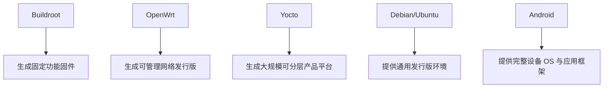

# Buildroot与OpenWrt区别

## 简介

本文从定位、优缺点、典型应用三个维度，对比 Buildroot、OpenWrt、Yocto、Debian、Ubuntu、Android。

## 背景

很多网络设备最终都运行 Linux，但“运行 Linux”不代表采用同一种系统形态。Buildroot 与 OpenWrt 经常被一起讨论，但它们解决的问题并不完全相同。

## 原理

可以把这几类系统粗略看成三组：

- 构建系统：Buildroot、Yocto
- 嵌入式发行版：OpenWrt
- 通用发行版或通用设备 OS：Debian、Ubuntu、Android

其中 Buildroot 更偏“把系统做出来”，而 OpenWrt 更偏“做一套可运行、可升级、可管理的软件发行版”。

## 组成

### 对比表

| 系统 | 定位 | 优点 | 缺点 | 典型应用 |
| --- | --- | --- | --- | --- |
| Buildroot | 嵌入式 Linux 构建系统 | 简单直接、可裁剪、镜像体积可控、适合固定功能设备 | 目标机不强调包管理，复杂产品线复用能力弱于 Yocto | 路由器、光猫、AP、IoT 网关、工业盒子 |
| OpenWrt | 网络设备发行版与开发框架 | 网络功能成熟、包管理友好、社区资源丰富 | 作为厂商深度定制基座时不一定最轻 | 家用路由器、软路由、开发板网络系统 |
| Yocto | 大型嵌入式发行版构建框架 | 元数据分层强、适合大规模产品线 | 学习和维护成本高，构建复杂 | 汽车、工业、企业级嵌入式平台 |
| Debian | 通用 GNU/Linux 发行版 | 包丰富、生态成熟、维护便利 | 对小型 Flash 设备过重，产品固件裁剪成本高 | 服务器、PC、部分大资源 ARM 设备 |
| Ubuntu / Ubuntu Core | 通用发行版与设备 OS | 生态成熟，Ubuntu Core 面向 IoT 设备、安全和 OTA 能力较强 | 对运营商网络设备的极致裁剪和 BSP 适配并非主场 | 云边设备、IoT、网关、企业设备 |
| Android | 设备 OS 与应用框架 | 完整应用框架、图形与生态成熟 | 复杂度高、系统栈重，不适合多数 ONT | 手机、平板、TV、车机 |

## 工作流程

## 实际应用

### 为什么很多运营商设备更偏向 Buildroot

- 功能固定，不需要设备上自由安装包
- 目标是小镜像、快启动、低资源占用
- 方便和 SoC 厂商 BSP、私有驱动、私有守护进程集成
- 更容易做工厂镜像与升级镜像的二次封装

### 为什么不是 Debian / Ubuntu

- 它们面向通用发行版场景
- 包多、依赖重、系统抽象层厚
- 对极小 Flash 设备不经济
- 产品固件通常不希望用户态像 PC 一样自由演化

### 为什么不是 Android

- Android 更像设备 OS + 应用框架
- 图形、Framework、HAL、SELinux、升级体系都更重
- 对典型 ONT 的需求明显过度

### 为什么不是 Yocto

- Yocto 很强，但也更复杂
- 对很多单平台或中小规模网络设备项目，Buildroot 的工程性价比更高

## 光猫中的体现

从 ONT 场景看，Buildroot 的优势特别明显：

- 非常适合固定功能设备
- 容易控制镜像大小
- 容易配合只读根文件系统
- 容易进行厂商二次开发
- 与 BusyBox、私有守护进程和板级 BSP 的耦合成本低

## 注意事项

- OpenWrt 和 Buildroot 不是简单的“谁更先进”，而是侧重点不同。
- 对大型平台化团队，Yocto 可能是更强但更重的选择。
- Ubuntu Core 在 IoT 安全和 OTA 方面有价值，但它的产品定位与典型 ONT 固件不完全一致。

## 参考资料

- 官方链接：Buildroot `https://buildroot.org/manual.html`、OpenWrt `https://openwrt.org/`、Yocto `https://docs.yoctoproject.org/`、Debian `https://www.debian.org/intro/about`、Ubuntu Core `https://ubuntu.com/core/features`、Android `https://source.android.com/docs/core/architecture`
- 官方源码：Buildroot `https://gitlab.com/buildroot.org/buildroot`、Yocto `https://git.yoctoproject.org/`、Android Code Search `https://cs.android.com/`
- 论坛：恩山无线论坛 `https://www.right.com.cn/forum/`、ChinaDSL `https://www.chinadsl.net/`、吾爱破解 `https://www.52pojie.cn/`
- GPL源码：后续结合厂商 GPL Release 中实际采用的构建系统验证
- 博客：Bootlin `https://bootlin.com`

## 最后验证时间

更新时间：2026-07-12

适用版本：通用构建系统与通用设备 OS 对比

验证环境：Buildroot、Yocto、Debian、Ubuntu Core、Android 官方资料整理

作者：Codex
