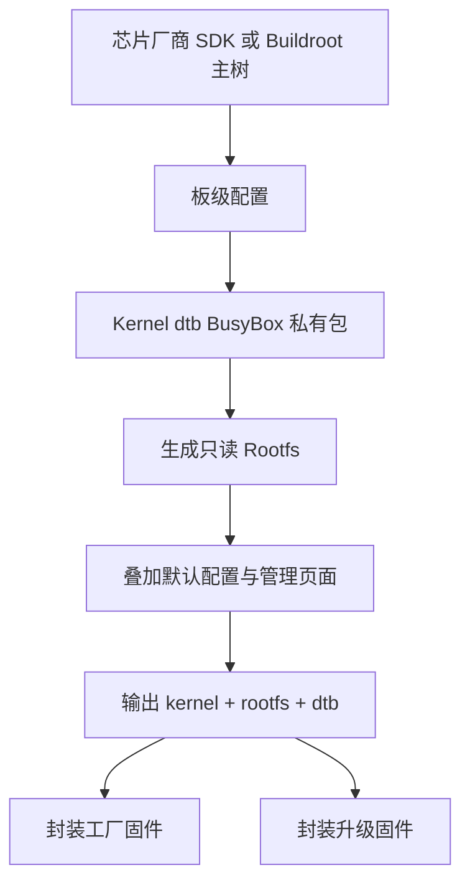

# Buildroot在光猫中的应用

## 简介

本文说明 Buildroot 为什么在光猫、家庭网关、ONU、ONT 等运营商设备中被大量采用，以及它在这些设备中的典型落地方式。

## 背景

光猫不是桌面电脑，也不是纯开发板。它往往同时承担：

- 光接入
- 家庭网关
- 局域网交换与 Wi-Fi
- 远程运维与运维协议
- Web 管理
- 大规模量产与运营商交付

这种设备形态天然偏向“固定功能、强约束、强定制”的系统，而不是通用发行版。

## 原理

Buildroot 适合光猫的原因主要有六类：

1. 易裁剪
2. 易控制体积
3. 易对接 Flash 与分区布局
4. 易与厂商 BSP 集成
5. 易生成固定镜像
6. 易做二次开发

## 组成

在 ONT 中，Buildroot 常与以下组件一起出现：

- 芯片厂商 BSP
- 定制 Linux kernel
- 定制设备树
- BusyBox
- 私有管理守护进程
- Web 管理页面
- TR-069、OMCI 或其他管理组件
- 厂商固件封装脚本

## 工作流程

## 实际应用

### 为什么运营商设备大量采用 Buildroot

- 系统功能相对固定，适合整体镜像式交付
- 目标设备资源有限，需要强裁剪
- 需要和芯片厂商 BSP 深度绑定
- 需要量产时保证固件一致性
- 需要方便做运营商定制和版本分支

### 为什么不用 Debian / Ubuntu

- 太偏向通用发行版
- 包依赖和体积对小设备不友好
- 不利于把系统收缩成精简固件
- 与厂商私有 BSP 的集成成本通常更高

### 为什么 Buildroot 更适合 Flash

- 不强调目标机包管理
- 只放运行期必要文件
- 容易生成只读压缩 rootfs
- 便于分离只读系统区和可写配置区

### 为什么容易升级

- 输出是固定镜像
- 便于厂商增加签名、校验、头部和版本信息
- 便于构建工厂镜像与在线升级包两种产物

### 为什么很多厂商都会二次开发

- Buildroot 主树易理解
- 板级与包体系可以直接扩展
- `board/`、`package/`、`configs/`、`br2-external` 结构天然适合产品分化

## 光猫中的体现

从 ONT 角度看，Buildroot 最大的现实价值不是“时髦”，而是“合适”：

- 足够小
- 足够直接
- 足够可控
- 足够容易与 BSP 和私有应用拼装

这也是为什么很多运营商设备虽然 UI、协议、数据库都很私有，但底层构建系统仍然能看到 Buildroot 的影子。

## 注意事项

- “很多光猫使用 Buildroot”是高概率现象，不代表所有 ONT 都使用 Buildroot。
- 某些厂商会在 Buildroot 外层再包一层 SDK 脚本，表面上不一定直接暴露 Buildroot。
- 判断一个设备是否基于 Buildroot，应结合目录、包结构、配置文件和 GPL 发布内容交叉验证。

## 参考资料

- 官方链接：Buildroot Manual `https://buildroot.org/manual.html`
- 官方源码：Buildroot `https://gitlab.com/buildroot.org/buildroot`
- 论坛：恩山无线论坛 `https://www.right.com.cn/forum/`、ChinaDSL `https://www.chinadsl.net/`、吾爱破解 `https://www.52pojie.cn/`
- GPL源码：后续结合具体厂商 GPL Release 进行交叉验证
- 博客：Bootlin `https://bootlin.com`

## 最后验证时间

更新时间：2026-07-12

适用版本：Buildroot 在 ONT 通用应用分析

验证环境：官方文档与嵌入式网络设备工程实践总结

作者：Codex
