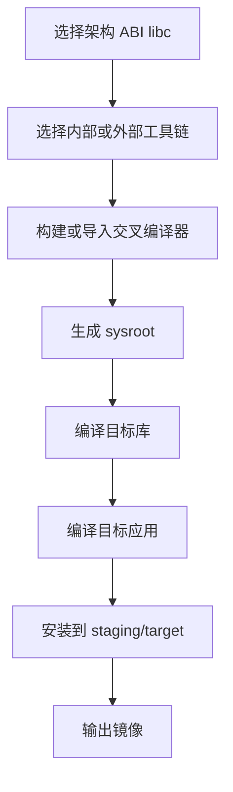

# Buildroot工具链

## 简介

本文说明 Buildroot 中工具链的角色，以及内部工具链、外部工具链、sysroot、SDK 与目标系统之间的关系。

## 背景

嵌入式系统几乎总是交叉编译。开发机常见是 x86_64 Linux，而目标机可能是 ARM、MIPS、AArch64、RISC-V。没有稳定工具链，就没有可复现固件。

## 原理

Buildroot 可以：

- 自己构建内部工具链
- 导入外部预构建工具链

官方手册明确支持几种外部工具链模式：

- 使用预定义外部工具链配置
- 使用已经安装在本机的外部工具链
- 使用完全自定义的外部工具链

工具链不仅是编译器本身，还包括：

- `binutils`
- `gcc`
- C 库
- 头文件
- sysroot

## 组成

Buildroot 工具链相关概念：

- Internal toolchain：由 Buildroot 直接构建
- External toolchain：来自外部 SDK 或预构建包
- Sysroot：目标头文件和库的集合
- `output/host/`：包含 host 工具和目标工具链 sysroot
- SDK：可从 Buildroot 导出，供外部应用开发使用

## 工作流程

Buildroot 还支持 `make sdk` 导出 SDK，本质上是把 `output/host/` 的工具链与开发文件打包供外部复用。

## 实际应用

内部工具链适合：

- 希望一切由 Buildroot 统一控制
- 追求复现性
- 想减少对外部 SDK 的依赖

外部工具链适合：

- 芯片厂商已提供经过验证的 SDK
- 需要对接私有 BSP
- 团队已在其他构建系统中固定使用某套工具链

## 光猫中的体现

在光猫项目里，外部工具链非常常见，原因包括：

- SoC 厂商常直接提供 SDK 与交叉工具链
- 厂商私有库可能只在特定 libc / gcc 版本下验证通过
- 某些 Wi-Fi、PON、交换芯片驱动依赖固定 ABI

但从长期维护看，内部工具链更利于理解全链路依赖。很多厂家会在“官方 SDK 阶段”使用外部工具链，在“重构或清理阶段”再考虑切换。

## 注意事项

- 目标 libc 选择会影响可用包、ABI 兼容性和体积。
- 工具链版本变化常常触发大面积重编译或兼容性问题。
- ONT 项目中，私有闭源库往往是工具链升级的最大阻力。

## 参考资料

- 官方链接：Buildroot Manual `https://buildroot.org/manual.html`
- 官方源码：Buildroot `https://gitlab.com/buildroot.org/buildroot`
- 论坛：恩山无线论坛 `https://www.right.com.cn/forum/`、ChinaDSL `https://www.chinadsl.net/`、吾爱破解 `https://www.52pojie.cn/`
- GPL源码：后续结合厂商 GPL SDK 中的交叉工具链说明验证
- 博客：Bootlin Buildroot Slides `https://bootlin.com/doc/training/buildroot/buildroot-slides.pdf`

## 最后验证时间

更新时间：2026-07-12

适用版本：Buildroot 2026.05 工具链机制

验证环境：Buildroot 官方手册第 6、8 章

作者：Codex
