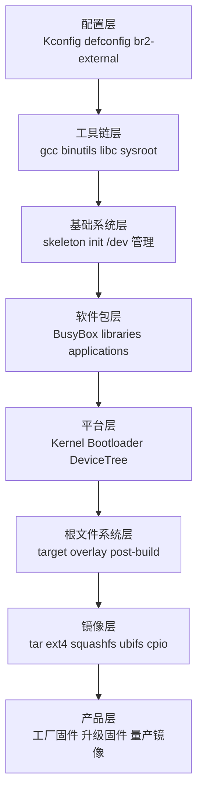

# Buildroot整体架构

## 简介

本文说明 Buildroot 的整体架构，以及它如何把工具链、Bootloader、Kernel、BusyBox、用户态库、应用程序和 Rootfs 组织成一套可交付固件。

## 背景

在嵌入式设备里，开发者通常面对的是“一整套系统”而不是单独程序。系统是否能量产，取决于几个关键问题：

- 工具链是否稳定
- 依赖是否可复现
- Kernel 与用户态是否匹配
- Rootfs 是否可控
- 镜像是否可封装进设备升级链路

Buildroot 把这些问题集中到一个统一构建入口里处理。

## 原理

从架构上看，Buildroot 不等于单一程序，而是“配置系统 + 包描述 + 构建基础设施 + 镜像生成逻辑”的组合。

它的核心边界如下：

- Buildroot 决定“构建什么”和“如何组装”
- 各包自己的构建系统负责“具体如何编译”
- Linux kernel 负责内核态
- BusyBox 与其他应用负责用户态
- 镜像打包步骤负责把系统落成适合设备刷写的产物

## 组成

Buildroot 整体可以拆成以下层次：

## 工作流程

Buildroot 的主流程可概括为：

1. 读取 `.config` 或 `defconfig`
2. 确定目标架构、工具链、包集合、内核与镜像格式
3. 下载源码
4. 构建 host 工具与交叉工具链
5. 构建目标包并安装到 `target/` 或 `staging/`
6. 生成 Kernel、设备树和 Bootloader 镜像
7. 拼装根文件系统并输出到 `output/images/`
8. 根据产品要求再封装成量产或升级格式

## 实际应用

这套架构的优势在于：

- 单一入口，便于自动化
- 适合 CI 与离线构建
- 目标系统不需要复杂包管理器
- 便于控制镜像大小
- 便于长期维护产品分支

## 光猫中的体现

ONT 设备的软件栈通常不是一个“自由生长”的 Linux 发行版，而是高度定制的产品系统。Buildroot 整体架构与这种产品模式非常契合：

- 平台层可以绑定 SoC 厂商 BSP
- 软件包层可以混合开源组件与私有守护进程
- 根文件系统层可以附加工厂默认配置
- 镜像层可以适配运营商升级链路

## 注意事项

- Buildroot 不是 BSP 的替代品，很多芯片支持仍需来自厂商内核、Bootloader 和补丁。
- Buildroot 也不是完整的产品升级框架，很多厂家会在输出镜像之外再加签名、分区头、校验头。
- 文档中的整体架构是通用模式，不代表所有厂商目录布局完全一致。

## 参考资料

- 官方链接：Buildroot Manual `https://buildroot.org/manual.html`
- 官方源码：Buildroot `https://gitlab.com/buildroot.org/buildroot`
- 论坛：恩山无线论坛 `https://www.right.com.cn/forum/`、ChinaDSL `https://www.chinadsl.net/`、吾爱破解 `https://www.52pojie.cn/`
- GPL源码：后续结合厂商 GPL Release 中的 `buildroot/`、`board/`、`configs/` 目录验证
- 博客：Bootlin Buildroot Slides `https://bootlin.com/doc/training/buildroot/buildroot-slides.pdf`

## 最后验证时间

更新时间：2026-07-12

适用版本：Buildroot 2026.05 通用架构

验证环境：Buildroot 官方手册第 1、8、9、18 章

作者：Codex
