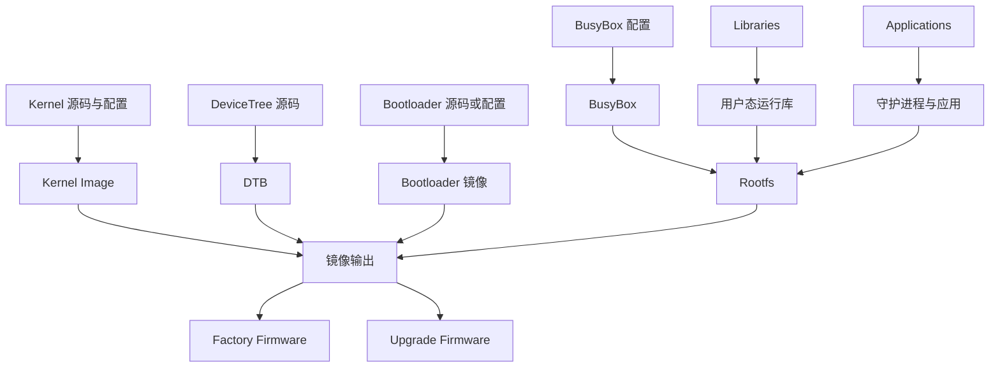
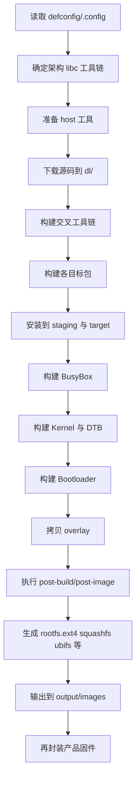

# Buildroot构建流程

## 简介

本文说明 Buildroot 如何从源码走到最终固件，重点覆盖 Bootloader、Kernel、DeviceTree、BusyBox、Libraries、Applications、Rootfs、Image、Factory Firmware、Upgrade Firmware 之间的关系。

## 背景

嵌入式开发的关键并不是“把一个程序编出来”，而是“把一套能启动、能联网、能升级、能量产的系统做出来”。Buildroot 的价值恰恰在于把这条链路串起来。

## 原理

Buildroot 在整体层面做三件事：

1. 根据配置确定目标系统的构成
2. 驱动所有组件按依赖顺序构建
3. 把构建结果组装为根文件系统和镜像

官方手册给出的主步骤包括：

- 下载源码
- 构建或导入交叉工具链
- 构建目标包
- 构建内核与 Bootloader
- 生成根文件系统镜像

## 组成

一条典型的构建链路如下：

## 工作流程

更细一点的 Buildroot 通用流程可以写成：

## 实际应用

在实际项目中，Buildroot 负责的是“通用构建和第一层组装”，而产品团队常常还会追加：

- 签名
- 厂商头部
- 运营商镜像格式
- 分区布局适配
- 双镜像或 A/B 升级策略

所以 `output/images/` 常常不是最终对外发布固件，而是中间产物。

## 光猫中的体现

在 ONT 中，构建流程通常还要满足以下要求：

- 对 NOR/NAND/EMMC 分区布局友好
- 能区分工厂固件与在线升级包
- 能注入默认配置与校准数据以外的系统文件
- 能方便厂商在不同运营商需求之间切换

Buildroot 适合做这条链路前半段，而后半段的签名、封包、升级控制则由厂商脚本接管。

## 注意事项

- `output/images/` 中的镜像是否能直接刷机，要看产品封装要求。
- Factory Firmware 与 Upgrade Firmware 往往不是同一个格式。
- 设备树、内核命令行、分区布局、init 系统之间常常互相影响，不能孤立理解。

## 参考资料

- 官方链接：Buildroot Manual `https://buildroot.org/manual.html`
- 官方源码：Buildroot `https://gitlab.com/buildroot.org/buildroot`
- 论坛：恩山无线论坛 `https://www.right.com.cn/forum/`、ChinaDSL `https://www.chinadsl.net/`、吾爱破解 `https://www.52pojie.cn/`
- GPL源码：后续结合厂商 GPL Release 中的镜像封装脚本核对
- 博客：Bootlin Buildroot Slides `https://bootlin.com/doc/training/buildroot/buildroot-slides.pdf`

## 最后验证时间

更新时间：2026-07-12

适用版本：Buildroot 2026.05 通用构建流程

验证环境：Buildroot 官方手册第 4、8、9 章

作者：Codex
