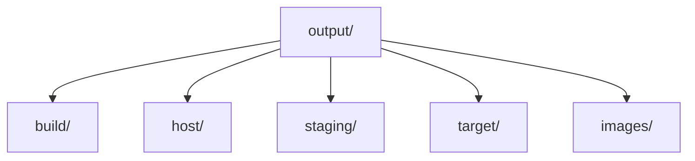

# Buildroot目录结构

## 简介

本文说明 Buildroot 源码树与 `output/` 目录的结构，以及哪些目录属于“源码输入”，哪些目录属于“构建产物”。

## 背景

很多人第一次接触 Buildroot 时，会把 `output/target/` 当成最终根文件系统，或者把板级配置直接散落到源码树中。理解目录结构，是正确维护 Buildroot 工程的基础。

## 原理

Buildroot 目录可以分成两大类：

- 构建系统自身的源码目录
- 一次构建生成的产物目录

官方手册明确说明，构建结果集中存放在 `output/` 下，而其中 `images/`、`build/`、`host/`、`target/` 各自承担不同职责。

## 组成

### 源码树常见目录

- `package/`：包描述、`Config.in`、`.mk`、补丁、哈希
- `system/`：默认 skeleton、系统通用配置
- `board/`：板级定制文件推荐存放位置
- `configs/`：`defconfig` 推荐存放位置
- `toolchain/`：工具链相关描述
- `linux/`、`boot/`：Kernel 与 Bootloader 相关基础设施
- `support/`：辅助脚本和工具

### 构建输出目录

- `build/`：每个组件的构建目录
- `host/`：宿主机工具和目标工具链 sysroot
- `staging/`：兼容性符号链接，指向工具链 sysroot
- `target/`：接近完整的目标根文件系统，但不应直接拿去刷机
- `images/`：最终镜像输出目录

## 工作流程

Buildroot 官方手册指出：

- `images/` 存放需要放到目标设备上的镜像文件
- `host/` 同时包含宿主机构建工具与目标工具链 sysroot
- `target/` 虽然接近根文件系统，但缺少设备节点且权限不完整，因此不应直接作为最终系统

这意味着日常工作中应遵循：

1. 改配置看源码树
2. 看编译细节进 `output/build/`
3. 看 sysroot 进 `output/host/`
4. 看最终镜像进 `output/images/`

## 实际应用

工程维护中最常见的误区有两个：

- 直接手改 `output/target/`，结果 `make clean` 后全部丢失
- 把板级文件散落在多个目录，后续无法复现

更稳妥的方式是把长期有效的内容固化到：

- `configs/<board>_defconfig`
- `board/<company>/<boardname>/`
- `br2-external`

## 光猫中的体现

在光猫项目里，构建树通常会再叠加 BSP、私有包和产品脚本，但核心关系仍然不变：

- 芯片/板级配置落在 `board/`
- BusyBox、Kernel、U-Boot 配置独立存放
- 工厂文件放入 overlay
- 最终可交付固件从 `output/images/` 再次封装

## 注意事项

- `output/target/` 不是“最终可刷写 rootfs”。
- `output/host/` 不是目标机根文件系统。
- `staging/` 在新工程里主要是兼容入口，理解上应以 `host/` 下的 sysroot 为主。

## 参考资料

- 官方链接：Buildroot Manual `https://buildroot.org/manual.html`
- 官方源码：Buildroot `https://gitlab.com/buildroot.org/buildroot`
- 论坛：恩山无线论坛 `https://www.right.com.cn/forum/`、ChinaDSL `https://www.chinadsl.net/`、吾爱破解 `https://www.52pojie.cn/`
- GPL源码：后续结合厂商 GPL Release 中的 Buildroot 树目录核对
- 博客：Bootlin Buildroot Slides `https://bootlin.com/doc/training/buildroot/buildroot-slides.pdf`

## 最后验证时间

更新时间：2026-07-12

适用版本：Buildroot 2026.05 输出目录机制

验证环境：Buildroot 官方手册第 4、8、9 章

作者：Codex
