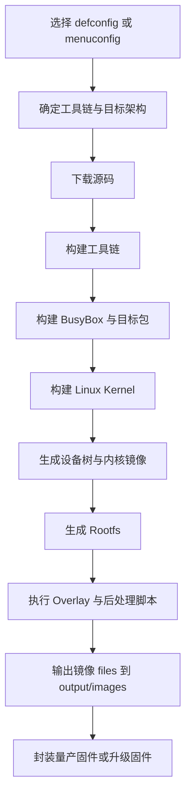

# Buildroot简介

## 简介

Buildroot 是一个面向嵌入式 Linux 的构建系统，用来在宿主机上从源码生成完整目标系统，包括交叉工具链、用户态包、Linux 内核、Bootloader、根文件系统和最终镜像。

## 背景

很多人第一次接触 Linux 时，习惯把系统理解成“安装一个发行版”。但在光猫、路由器、AP、随身 WiFi、IoT 网关、工业控制盒子等场景里，设备需求与通用 PC 完全不同：

- 存储空间小，常见为 NOR/NAND/eMMC 的固定分区
- 功能固定，不需要在设备上自由安装大量软件
- 启动链路和升级链路必须可控
- 大量设备需要量产、一致、可复现
- 厂商往往需要长期维护自有分支

因此，厂商更需要“构建系统”，而不是“桌面发行版”。

## 原理

Buildroot 的核心原则是“在构建阶段完成系统集成”。开发者选择：

- 架构与 ABI
- 工具链
- C 库
- Kernel 与 Bootloader
- BusyBox 与其他包
- 文件系统格式
- 目标机初始化方式

Buildroot 再根据这些配置把一个完整系统拼装出来。

## 组成

一个典型 Buildroot 工程通常包含：

- Buildroot 主源码树
- `.config` 或 `defconfig`
- `board/<company>/<boardname>/` 板级定制目录
- BusyBox、Kernel、Bootloader 配置文件
- `rootfs-overlay/`
- `post_build.sh` / `post_image.sh`
- 可能存在的 `br2-external` 外部扩展树

## 工作流程

## 实际应用

Buildroot 常被用于：

- 家用路由器与 AP
- 运营商光猫、家庭网关、FTTR 节点
- 4G/5G CPE 与随身 WiFi
- IoT 网关与工业边缘设备
- 单用途 NAS 或监控盒子

这些设备的共同点是：系统职责明确、资源有限、系统更新由厂商控制。

## 光猫中的体现

光猫通常同时承担接入、转发、管理、远程运维和家庭网关能力，因此需要：

- 可裁剪的系统组件
- 可定制的启动流程
- 可控的文件系统体积
- 容易与厂商私有守护进程集成
- 便于生成工厂镜像和升级镜像

Buildroot 正好符合这些要求，所以它在 ONT 领域出现频率非常高。

## 注意事项

- Buildroot 不是包管理发行版，不适合把目标机当成通用软件安装环境。
- Buildroot 强项是“固件整体构建”，不是“在线持续装包”。
- 对大型多产品线项目，Yocto 在元数据分层和大规模复用上可能更强，但复杂度也更高。

## 参考资料

- 官方链接：Buildroot Manual `https://buildroot.org/manual.html`
- 官方源码：Buildroot `https://gitlab.com/buildroot.org/buildroot`
- 论坛：恩山无线论坛 `https://www.right.com.cn/forum/`、ChinaDSL `https://www.chinadsl.net/`、吾爱破解 `https://www.52pojie.cn/`
- GPL源码：后续结合各厂商 GPL Release 对应 Buildroot 版本核对
- 博客：Bootlin Buildroot Slides `https://bootlin.com/doc/training/buildroot/buildroot-slides.pdf`

## 最后验证时间

更新时间：2026-07-12

适用版本：Buildroot 通用机制，参考 Buildroot 2026.05 手册

验证环境：官方文档与公开源码资料整理

作者：Codex
