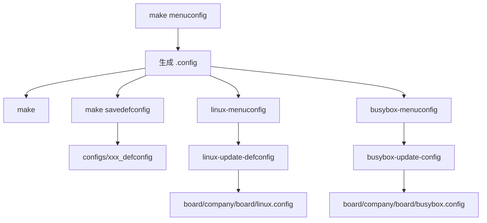

# Buildroot配置系统

## 简介

本文说明 Buildroot 的配置系统，包括 `menuconfig`、`.config`、`defconfig`、板级配置文件与 `br2-external`。

## 背景

Buildroot 的配置方式与 Linux kernel、BusyBox 很接近，都是 Kconfig 风格。对嵌入式团队来说，这种方式的价值在于：

- 配置项清晰可审计
- 可以导出最小 `defconfig`
- 易于版本管理
- 易于把一个产品配置复制到多个派生型号

## 原理

Buildroot 通过 `make menuconfig`、`make nconfig` 等界面生成 `.config`。顶层 Makefile 读取该配置，然后驱动后续全部构建动作。

官方推荐使用：

- `make menuconfig` 或 `nconfig` 调整配置
- `make savedefconfig` 导出最小配置
- 把 `defconfig` 放在 `configs/<boardname>_defconfig`

这样便于重复构建和团队协作。

## 组成

配置系统主要由以下部分构成：

- `.config`：当前完整配置
- `defconfig`：去掉默认值后的精简配置
- `configs/<board>_defconfig`：推荐的长期保存位置
- `board/<company>/<boardname>/`：内核、BusyBox、overlay、后处理脚本等板级文件
- `br2-external`：外部扩展树，用于把项目定制从主树剥离

## 工作流程

## 实际应用

Buildroot 官方还推荐把项目文件整理成类似结构：

- `board/<company>/<boardname>/linux.config`
- `board/<company>/<boardname>/busybox.config`
- `board/<company>/<boardname>/post_build.sh`
- `board/<company>/<boardname>/rootfs-overlay/`

这种结构的好处是：

- 结构稳定
- 容易迁移版本
- 便于多个产品共享主树

## 光猫中的体现

光猫项目往往不是单一 SKU，而是“同平台多运营商、多区域、多功能组合”。因此非常需要：

- 一份基础 `defconfig`
- 多份板级差异文件
- 单独保存 Kernel / BusyBox / U-Boot 配置
- 把运营商差异放到 overlay 或外部配置树

这正是 Buildroot 配置系统擅长处理的工程形态。

## 注意事项

- 不要只提交 `.config` 而不保存 `defconfig`。
- 不要把长期定制仅保留在 `output/` 中。
- 对多产品线项目，优先考虑 `br2-external`，避免直接把大量私有内容塞回主树。

## 参考资料

- 官方链接：Buildroot Manual `https://buildroot.org/manual.html`
- 官方源码：Buildroot `https://gitlab.com/buildroot.org/buildroot`
- 论坛：恩山无线论坛 `https://www.right.com.cn/forum/`、ChinaDSL `https://www.chinadsl.net/`、吾爱破解 `https://www.52pojie.cn/`
- GPL源码：后续结合厂商 GPL Release 中的 `configs/` 与 `board/` 目录验证
- 博客：Bootlin Buildroot Slides `https://bootlin.com/doc/training/buildroot/buildroot-slides.pdf`

## 最后验证时间

更新时间：2026-07-12

适用版本：Buildroot 2026.05 配置机制

验证环境：Buildroot 官方手册第 4、9 章

作者：Codex
