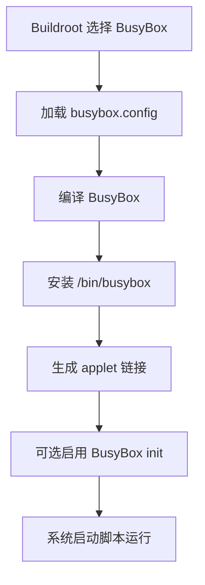

# BusyBox关系

## 简介

本文说明 Buildroot 与 BusyBox 的关系，以及 BusyBox 为什么几乎总会出现在光猫、路由器、AP 等设备里。

## 背景

BusyBox 被称为嵌入式 Linux 的“瑞士军刀”。它把大量常用 Unix 工具做成一个可裁剪、多调用入口的单一二进制，非常适合资源敏感设备。

## 原理

BusyBox 官方文档说明：

- 它把许多常见 Unix 工具组合进一个小型可执行文件
- 可以在编译时启用或关闭具体 applet
- 通过链接方式表现为多个命令

Buildroot 则负责：

- 选择是否启用 BusyBox
- 管理 BusyBox 配置文件
- 把 BusyBox 安装进目标 rootfs
- 让 BusyBox init 参与系统启动

## 组成

Buildroot 与 BusyBox 协作通常包括：

- `BR2_PACKAGE_BUSYBOX`
- BusyBox 配置文件
- `/bin/busybox`
- BusyBox applet 链接
- BusyBox init 与 `/etc/inittab`

## 工作流程

## 实际应用

BusyBox 适合嵌入式设备的原因非常直接：

- 体积小
- 可裁剪
- 常用命令覆盖面高
- 与 init、shell、网络工具可一体化配置

这比在小设备里引入整套 GNU 用户态通常更划算。

## 光猫中的体现

在 ONT 中，BusyBox 几乎天然合适：

- Flash 与 RAM 紧张
- 需要 shell、网络、文件工具的基本能力
- 启动链路希望尽量简单
- 设备维护命令常常只需要 BusyBox 级别能力

很多光猫甚至把大量维护命令都建立在 BusyBox applet 之上。

## 注意事项

- BusyBox 命令行为和 GNU 全功能工具并不完全一致。
- 调试时不要想当然地套用 PC 上工具的全部参数。
- BusyBox 功能缺失时，优先确认是未编译进 applet，还是该 applet 被裁剪了特性。

## 参考资料

- 官方链接：BusyBox 文档 `https://busybox.net/BusyBox.html`、Buildroot Manual `https://buildroot.org/manual.html`
- 官方源码：BusyBox `https://git.busybox.net/busybox/`、Buildroot `https://gitlab.com/buildroot.org/buildroot`
- 论坛：恩山无线论坛 `https://www.right.com.cn/forum/`、ChinaDSL `https://www.chinadsl.net/`、吾爱破解 `https://www.52pojie.cn/`
- GPL源码：后续结合厂商 GPL Release 中的 BusyBox 配置文件验证
- 博客：Bootlin `https://bootlin.com`

## 最后验证时间

更新时间：2026-07-12

适用版本：BusyBox 与 Buildroot 通用协作机制

验证环境：BusyBox 官方文档、Buildroot 官方手册

作者：Codex
