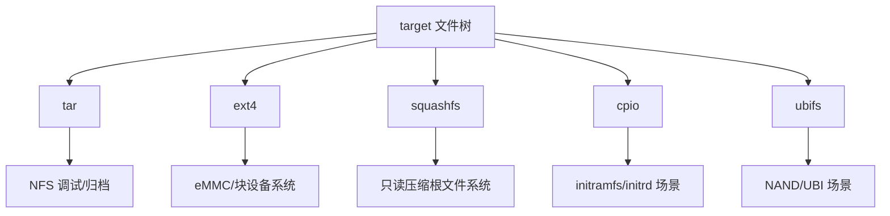

# Filesystem生成

## 简介

本文说明 Buildroot 中根文件系统镜像的生成形式，以及常见文件系统格式在嵌入式设备中的使用背景。

## 背景

同样是 Linux 系统，不同设备的存储介质和升级模型差异很大，因此输出镜像格式也不同。对 ONT、路由器、AP 来说，系统是否适合 Flash 与升级链路，往往比“是否像通用 Linux”更重要。

## 原理

Buildroot 在目标文件树完成后，会把 `target/` 中的内容转换为一个或多个镜像格式。常见格式包括：

- `tar`
- `cpio`
- `ext2/3/4`
- `squashfs`
- `ubifs`

选择哪种格式，本质上由以下因素决定：

- 启动方式
- Flash 类型
- 是否只读
- 是否需要压缩
- 是否需要在线升级友好

## 组成

常见关系如下：

## 工作流程

1. Buildroot 先形成 `target/`
2. 再根据配置选择输出文件系统格式
3. 生成一个或多个 rootfs 镜像
4. 再由厂商脚本按产品要求封装

## 实际应用

大致规律：

- `ext4`：适合块设备、eMMC、开发调试方便
- `squashfs`：适合只读、压缩比高、常见于路由器与光猫
- `ubifs`：适合 NAND 场景
- `cpio`：适合 initramfs
- `tar`：适合归档、NFS 调试、后续二次处理

## 光猫中的体现

光猫很常见的模式是：

- 只读压缩 rootfs
- 单独可写配置分区
- 固件再带厂商头部、校验或签名

这意味着 Buildroot 负责“生成标准 rootfs”，但真正的上线固件还需要结合：

- 分区布局
- 升级策略
- 厂商封装格式

## 注意事项

- 文件系统格式的选择和 Flash 类型强相关。
- 只看 `rootfs.tar` 不能推断产品最终刷机格式。
- 某些厂商会先生成 `squashfs`，再与 kernel、dtb、header 重新拼装。

## 参考资料

- 官方链接：Buildroot Manual `https://buildroot.org/manual.html`
- 官方源码：Buildroot `https://gitlab.com/buildroot.org/buildroot`
- 论坛：恩山无线论坛 `https://www.right.com.cn/forum/`、ChinaDSL `https://www.chinadsl.net/`、吾爱破解 `https://www.52pojie.cn/`
- GPL源码：后续结合厂商 GPL Release 中的镜像封装脚本验证
- 博客：Bootlin Buildroot Slides `https://bootlin.com/doc/training/buildroot/buildroot-slides.pdf`

## 最后验证时间

更新时间：2026-07-12

适用版本：Buildroot 通用 rootfs 输出机制

验证环境：Buildroot 官方手册与嵌入式常见文件系统使用经验整理

作者：Codex
