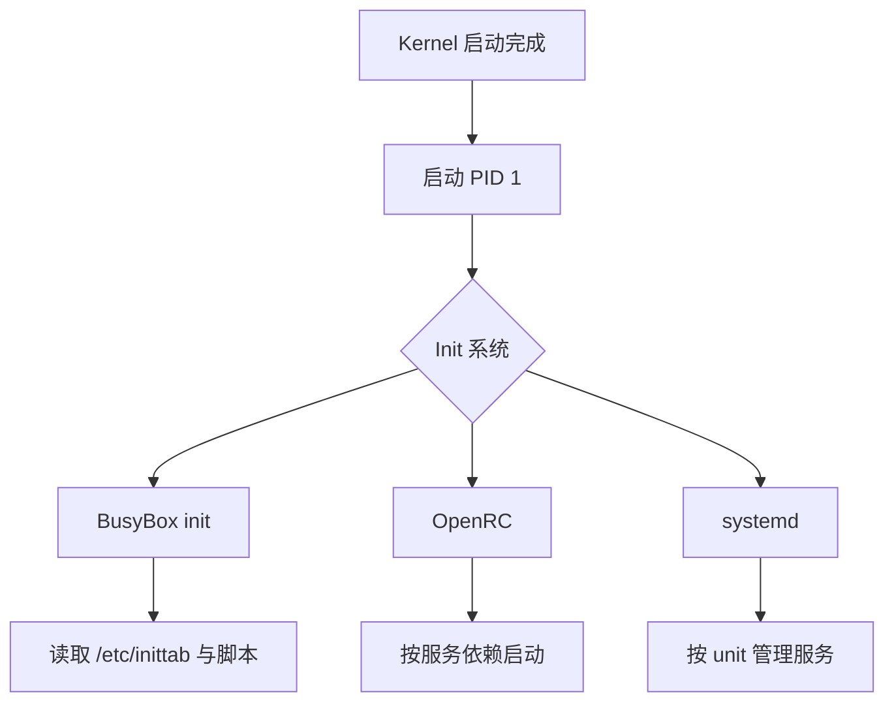

# Init系统

## 简介

本文说明 Buildroot 支持的 init 系统，以及 BusyBox init、OpenRC、systemd 在嵌入式设备中的差异。

## 背景

内核启动后，第一个用户态进程就是 `init`。它决定：

- 系统怎么启动服务
- 启动脚本如何组织
- `/dev` 如何管理
- 服务如何重启

在嵌入式设备中，init 的选择通常直接反映了系统复杂度和资源预算。

## 原理

Buildroot 官方文档说明，它支持三类 init 系统选择。默认方案通常是 BusyBox init，它体积小，足以满足大多数嵌入式系统。

与 init 相关的另一条线是 `/dev` 管理：

- `devtmpfs only`
- `devtmpfs + mdev`
- `udev` / `systemd-udevd`

这些选择会影响系统复杂度和启动路径。

## 组成

常见方案：

- BusyBox init：体积小，适合资源敏感设备
- OpenRC：较轻量的服务管理层
- systemd：功能强，但体积和复杂度更高

## 工作流程

## 实际应用

对于多数嵌入式网络设备：

- BusyBox init 足够
- 若需要更清晰服务管理，可考虑 OpenRC
- 若系统非常复杂、依赖大量现代 Linux 用户态特性，才更可能考虑 systemd

## 光猫中的体现

光猫、家用路由器、AP 往往追求：

- 启动快
- 体积小
- 进程模型简单
- 可预测

因此 BusyBox init 很常见。很多 ONT 的 `/etc/inittab`、`rcS`、厂商启动脚本都围绕这一模型组织。

## 注意事项

- 不要把 PC/服务器上的 systemd 经验直接投射到 ONT 设备。
- 选择 init 时，必须同时考虑 `/dev` 管理、热插拔、firmware 加载等问题。
- BusyBox init 简单，但大型系统里脚本复杂度可能会转移到 `init.d` 和厂商脚本中。

## 参考资料

- 官方链接：Buildroot Manual `https://buildroot.org/manual.html`
- 官方源码：Buildroot `https://gitlab.com/buildroot.org/buildroot`
- 论坛：恩山无线论坛 `https://www.right.com.cn/forum/`、ChinaDSL `https://www.chinadsl.net/`、吾爱破解 `https://www.52pojie.cn/`
- GPL源码：后续结合厂商 GPL Release 中的 `/etc/inittab` 与启动脚本验证
- 博客：Bootlin Buildroot Slides `https://bootlin.com/doc/training/buildroot/buildroot-slides.pdf`

## 最后验证时间

更新时间：2026-07-12

适用版本：Buildroot 2026.05 init 机制

验证环境：Buildroot 官方手册第 6、9、18 章，BusyBox 文档

作者：Codex
