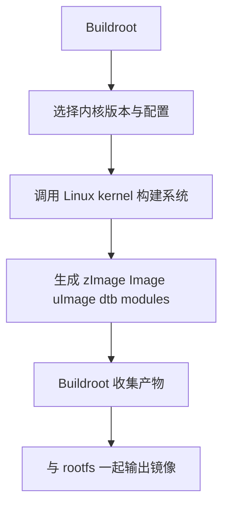

# Kernel关系

## 简介

本文说明 Buildroot 与 Linux kernel 的关系，重点区分“Buildroot 负责构建集成”与“Kernel 负责内核态实现”这两条边界。

## 背景

很多人会把 Buildroot 和 Linux kernel 混为一体。实际上，它们属于不同层面：

- Linux kernel 是操作系统内核
- Buildroot 是构建系统

Buildroot 可以构建 kernel，但不等于 kernel。

## 原理

Buildroot 对内核主要做三件事：

- 提供配置入口
- 调用内核构建
- 把输出纳入最终镜像

而 kernel 自己负责：

- 驱动模型
- 调度
- 内存管理
- 网络栈
- 中断
- 文件系统实现

## 组成

二者关系可概括为：

## 工作流程

在工程实践中通常是：

1. 在 Buildroot 里启用 Linux kernel
2. 指定内核源码来源和配置文件
3. 通过 `linux-menuconfig` 调整内核选项
4. 用 `linux-update-defconfig` 保存配置
5. 让 Buildroot 在主流程中统一调用内核构建

## 实际应用

这带来几个工程好处：

- 内核版本和用户态依赖可以随系统一起固化
- CI 可以一次性复现完整固件
- 板级配置更容易与根文件系统一起管理

## 光猫中的体现

在光猫中，kernel 常常是厂商 SDK 的核心部分，负责：

- PON 驱动
- 交换与网络加速
- Wi-Fi 驱动适配
- Flash / UBI / MTD
- 平台 GPIO 与 LED

Buildroot 则把这些内核能力与用户态守护进程、配置、镜像格式串联起来。

## 注意事项

- 内核问题不要误归因到 Buildroot。
- Buildroot 升级版本不等于内核同步升级版本。
- 某些厂商 SDK 的 Buildroot 很新，但内核仍然很旧，这是常见现象。

## 参考资料

- 官方链接：Buildroot Manual `https://buildroot.org/manual.html`、Linux Kernel 文档 `https://www.kernel.org/doc/html/latest/`
- 官方源码：Buildroot `https://gitlab.com/buildroot.org/buildroot`、Linux kernel `https://git.kernel.org/pub/scm/linux/kernel/git/torvalds/linux.git`
- 论坛：恩山无线论坛 `https://www.right.com.cn/forum/`、ChinaDSL `https://www.chinadsl.net/`、吾爱破解 `https://www.52pojie.cn/`
- GPL源码：后续结合厂商 GPL Release 中的 `linux/`、`kernel/` 目录验证
- 博客：Bootlin `https://bootlin.com`

## 最后验证时间

更新时间：2026-07-12

适用版本：Buildroot 与 Linux kernel 通用关系

验证环境：Buildroot 官方手册、Linux kernel 官方文档

作者：Codex
