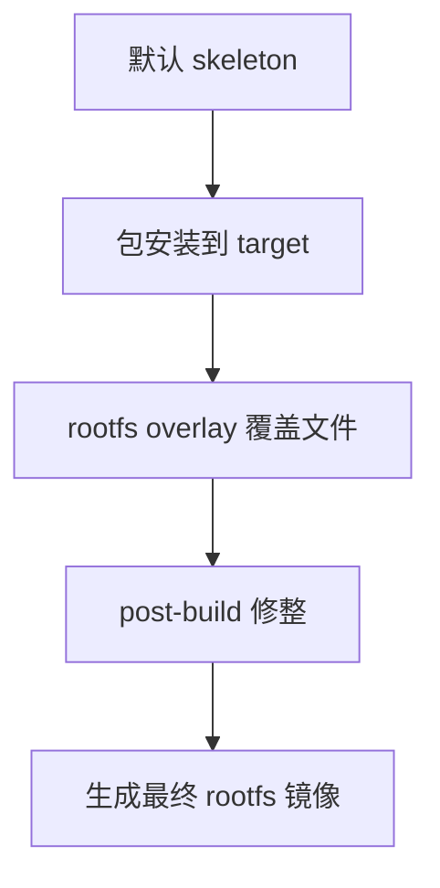

# Overlay机制

## 简介

本文说明 Buildroot 的 `root filesystem overlay`、`post-build` 与自定义 skeleton 三种 Rootfs 定制方式之间的关系。

## 背景

嵌入式设备的定制大多不是“新增一个大功能”，而是修改系统细节：

- 覆盖默认配置文件
- 替换 `/etc/inittab`
- 预置脚本和证书
- 删除无用文件
- 调整默认目录结构

Buildroot 官方推荐优先使用 overlay 和 post-build，而不是直接手改 `output/target/`。

## 原理

官方手册明确说明：

- overlay 是一个文件树，会在目标文件系统构建完成后直接拷贝到目标文件系统上
- post-build 脚本在 rootfs 镜像组装前执行
- 如果默认 skeleton 与需求完全不符，可以使用自定义 skeleton

这三者的定位不同：

- overlay：适合静态文件覆盖
- post-build：适合脚本化修改
- custom skeleton：适合重定义基础目录骨架

## 组成

常见相关配置：

- `BR2_ROOTFS_OVERLAY`
- `BR2_ROOTFS_POST_BUILD_SCRIPT`
- `BR2_ROOTFS_SKELETON_CUSTOM`
- `BR2_ROOTFS_SKELETON_CUSTOM_PATH`

## 工作流程

## 实际应用

Overlay 适合放：

- `/etc` 默认配置
- 启动脚本
- 证书、模板、网页静态资源
- 产品版本文件

post-build 适合做：

- 删除文件
- 修改权限
- 生成符号链接
- 根据配置动态写文件

custom skeleton 适合：

- 基础文件层级和默认骨架与官方 skeleton 差异极大

## 光猫中的体现

在 ONT 中，overlay 十分常见，因为厂商通常需要：

- 预置网络默认值
- 植入运营商相关默认配置
- 放置管理页面资源
- 安装初始化脚本
- 布置私有数据库默认模板

这类内容如果每次手改 `target/`，几乎无法维护；用 overlay 则更可控。

## 注意事项

- overlay 不应成为“胡乱堆文件”的目录，应保持清晰层次。
- 当启用 `merged /usr` 时，overlay 不能随意放 `/bin`、`/lib`、`/sbin`。
- post-build 是有用的，但过度依赖会掩盖包定义本身的问题。

## 参考资料

- 官方链接：Buildroot Manual `https://buildroot.org/manual.html`
- 官方源码：Buildroot `https://gitlab.com/buildroot.org/buildroot`
- 论坛：恩山无线论坛 `https://www.right.com.cn/forum/`、ChinaDSL `https://www.chinadsl.net/`、吾爱破解 `https://www.52pojie.cn/`
- GPL源码：后续结合厂商 GPL Release 中的 `rootfs-overlay/` 和 `post_build.sh` 验证
- 博客：Bootlin Buildroot Slides `https://bootlin.com/doc/training/buildroot/buildroot-slides.pdf`

## 最后验证时间

更新时间：2026-07-12

适用版本：Buildroot 2026.05 overlay 机制

验证环境：Buildroot 官方手册第 9 章

作者：Codex
