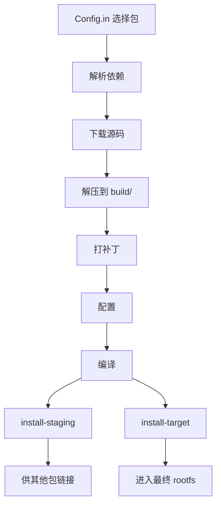

# Package机制

## 简介

本文说明 Buildroot 的包机制，包括包描述文件、依赖关系、下载、解压、补丁、配置、编译、安装到 staging 和 target 的过程。

## 背景

Buildroot 真正的“生产力核心”在于它的包基础设施。因为无论是 BusyBox、dropbear、hostapd、pppd、dnsmasq 还是厂商私有程序，最终都要变成 Buildroot 可以调度的包。

## 原理

官方手册给出了包的典型阶段：

- `source`
- `depends`
- `extract`
- `patch`
- `configure`
- `build`
- `install-staging`
- `install-target`

也就是说，Buildroot 负责调度流程、依赖和目录约定，而具体如何构建由包所使用的基础设施决定，例如 autotools、CMake、Meson、Python、Cargo 等。

## 组成

一个 Buildroot 包通常由以下文件组成：

- `Config.in`
- `<pkg>.mk`
- `<pkg>.hash`
- 可能存在的补丁目录

`.mk` 中一般会描述：

- 版本
- 源码名与下载地址
- 是否安装到 staging
- 是否安装到 target
- 依赖关系
- 配置参数
- 使用哪类包基础设施

## 工作流程

## 实际应用

包机制让 Buildroot 可以很好地支持以下需求：

- 把开源包加入产品构建
- 维护私有补丁
- 通过 `.hash` 做源码校验
- 以依赖顺序构建复杂系统
- 独立重编译某个包进行调试

官方还提供了诸如：

- `make <package>-rebuild`
- `make <package>-reconfigure`
- `make <package>-dirclean`
- `make <package>-graph-depends`

这些目标非常适合日常开发定位问题。

## 光猫中的体现

在光猫项目中，包机制常见于：

- 厂商把私有服务封装成 Buildroot 包
- 将 `omci`、TR-069 客户端、Web 服务、配置守护进程纳入依赖系统
- 对某些开源包做固定补丁，以适配 SoC 驱动或运营商行为

这也是很多 GPL 代码包里能看到 `package/<vendor-app>/` 的原因。

## 注意事项

- 能通过包机制表达的定制，尽量不要放到 post-build 中硬改。
- 不是所有目标包都需要 `install-staging`，通常库更需要。
- 包依赖顺序错误时，问题常表现为交叉链接失败或头文件缺失。

## 参考资料

- 官方链接：Buildroot Manual `https://buildroot.org/manual.html`
- 官方源码：Buildroot `https://gitlab.com/buildroot.org/buildroot`
- 论坛：恩山无线论坛 `https://www.right.com.cn/forum/`、ChinaDSL `https://www.chinadsl.net/`、吾爱破解 `https://www.52pojie.cn/`
- GPL源码：后续结合厂商 GPL Release 中的 `package/` 私有包目录验证
- 博客：Bootlin Buildroot Slides `https://bootlin.com/doc/training/buildroot/buildroot-slides.pdf`

## 最后验证时间

更新时间：2026-07-12

适用版本：Buildroot 2026.05 包机制

验证环境：Buildroot 官方手册第 8、18 章

作者：Codex
