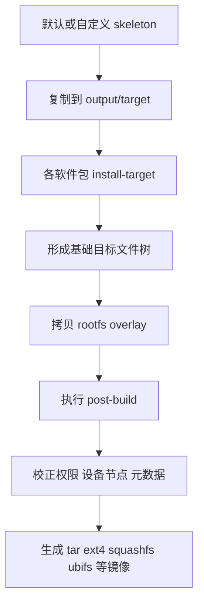

# Rootfs生成过程

## 简介

本文说明 Buildroot 如何生成目标根文件系统，以及 skeleton、package install、overlay、post-build 与最终镜像之间的关系。

## 背景

很多嵌入式项目的核心不是内核，而是 Rootfs。因为真正决定设备功能的，往往是：

- `/etc` 里的默认配置
- `/bin`、`/sbin`、`/usr/bin` 里的工具与服务
- 启动脚本
- 库文件
- Web 管理页面

## 原理

Buildroot 生成 Rootfs 的过程不是“复制一个发行版模板”，而是按步骤组装：

1. 先准备 skeleton
2. 再把各个包安装进 `output/target/`
3. 然后叠加 overlay
4. 再执行 post-build 修整
5. 最后生成 rootfs 镜像

官方手册明确指出：

- 根文件系统镜像建立在 target skeleton 之上
- skeleton 在包安装前复制到 `output/target`
- `target/` 接近完整 rootfs，但不应用作最终刷机内容

## 组成

Rootfs 生成链路的关键元素：

- `system/skeleton`
- `output/target/`
- 包的 `install-target`
- `BR2_ROOTFS_OVERLAY`
- `BR2_ROOTFS_POST_BUILD_SCRIPT`
- rootfs image generator

## 工作流程

## 实际应用

在工程实践里，Rootfs 生成过程最常承载这些需求：

- 预置默认网络配置
- 加入启动脚本
- 删除不需要的文档、locale、样例文件
- 注入产品版本号
- 调整 `/etc/inittab`、`init.d`、`profile`
- 预置 Web UI、CLI 或私有守护进程

## 光猫中的体现

光猫的 Rootfs 往往非常“产品化”：

- 大量默认配置来自运营商模板
- 私有管理进程、TR-069、OMCI 代理、Web 管理服务都落在 Rootfs 中
- 常见为只读 rootfs + 可写配置分区组合
- rootfs 体积必须严格受 Flash 约束

这也是为什么 Buildroot 在 ONT 中通常不仅是“编译工具”，更是“系统装配线”。

## 注意事项

- 不要直接改 `output/target/` 作为长期定制方式。
- 对 `merged /usr` 场景，overlay 中目录布局要注意 `/bin`、`/sbin`、`/lib` 符号链接限制。
- Rootfs 过度依赖 post-build 脚本会降低可维护性，优先修包定义本身。

## 参考资料

- 官方链接：Buildroot Manual `https://buildroot.org/manual.html`
- 官方源码：Buildroot `https://gitlab.com/buildroot.org/buildroot`
- 论坛：恩山无线论坛 `https://www.right.com.cn/forum/`、ChinaDSL `https://www.chinadsl.net/`、吾爱破解 `https://www.52pojie.cn/`
- GPL源码：后续结合厂商 GPL Release 的 overlay 与 post_build 脚本验证
- 博客：Bootlin Buildroot Slides `https://bootlin.com/doc/training/buildroot/buildroot-slides.pdf`

## 最后验证时间

更新时间：2026-07-12

适用版本：Buildroot 2026.05 Rootfs 生成机制

验证环境：Buildroot 官方手册第 8、9 章

作者：Codex
