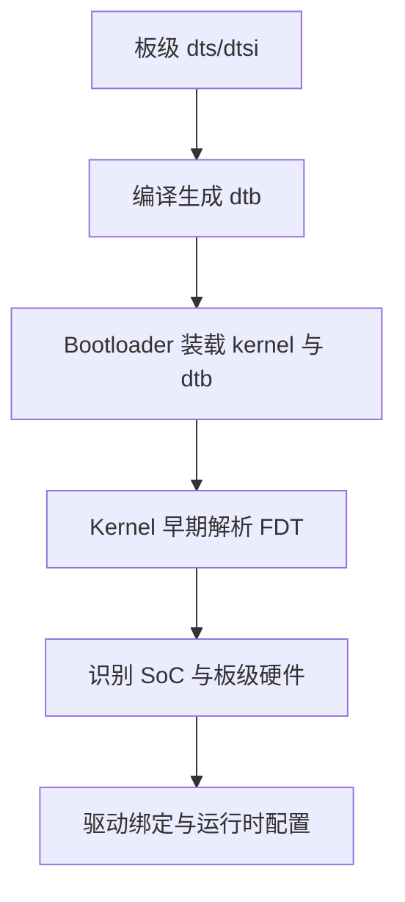

# 设备树(DeviceTree)

## 简介

本文说明设备树在 Buildroot 工程中的位置，以及它为什么对嵌入式 Linux 尤其是 ONT 设备十分重要。

## 背景

Buildroot 本身不发明设备树，但它常常负责把设备树源码、内核配置和最终镜像组织到一起。要理解 Buildroot 在产品中的作用，必须理解 DeviceTree。

## 原理

Linux kernel 官方文档说明，DeviceTree 是一种描述硬件的数据结构和语言，用来把硬件描述从内核硬编码中分离出来。Bootloader 可以把 dtb 传给内核，内核再根据其中的 `compatible`、内存、总线、外设节点等信息完成平台识别和早期配置。

这意味着：

- 同一内核可以适配多个板级变体
- 板级差异更多地体现在 dtb 而不是大量硬编码
- 启动参数、initrd 位置等也可通过 `/chosen` 节点传入

## 组成

设备树相关对象包括：

- `.dts` / `.dtsi`
- `dtb`
- Bootloader 传递的 FDT
- 内核中的设备树解析逻辑

## 工作流程

## 实际应用

设备树在 Buildroot 工程里通常表现为：

- kernel config 指向 dtb 构建目标
- `board/` 中保存板级 dts 补丁或配置
- 最终镜像同时带 kernel 和 dtb

## 光猫中的体现

光猫硬件通常集成：

- SoC
- PON MAC/PHY
- 交换芯片
- Wi-Fi 芯片
- GPIO 指示灯
- Flash / eMMC
- UART、I2C、SPI、USB

这些差异很多都需要通过设备树向内核表达。厂商在同一 SoC 平台上做多个型号或多个运营商版本时，设备树尤为关键。

## 注意事项

- 设备树描述硬件，不应替代驱动逻辑本身。
- 同一平台不同板级的差异，优先收敛到 dts/dtsi，而不是散落到用户态脚本。
- 设备树和 Bootloader、Kernel 版本常常存在耦合关系。

## 参考资料

- 官方链接：Linux Kernel Devicetree 文档 `https://docs.kernel.org/devicetree/usage-model.html`
- 官方源码：Linux kernel `https://git.kernel.org/pub/scm/linux/kernel/git/torvalds/linux.git`
- 论坛：恩山无线论坛 `https://www.right.com.cn/forum/`、ChinaDSL `https://www.chinadsl.net/`、吾爱破解 `https://www.52pojie.cn/`
- GPL源码：后续结合厂商 GPL Release 中的 `arch/*/boot/dts/` 验证
- 博客：Bootlin Linux/embedded 技术资料 `https://bootlin.com`

## 最后验证时间

更新时间：2026-07-12

适用版本：Linux Kernel 通用设备树模型

验证环境：Linux kernel 官方 Devicetree 文档

作者：Codex
