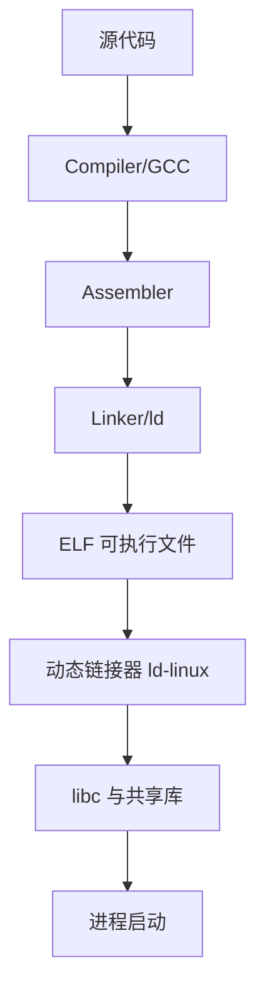

# EmbeddedRuntime

## 简介

本目录用于系统整理 Linux 嵌入式运行环境，重点解释一个可执行文件为什么能运行、为什么不能运行，以及 CPU 架构、ABI、ELF、动态链接器、libc、sysroot、toolchain、SDK 之间的关系。

## 背景

对 Java、Go、Python、运维背景的开发人员来说，嵌入式 Linux 最容易困惑的不是语法，而是运行环境边界：

- 为什么一个二进制复制到另一台设备上会报错
- 为什么同样是 ARM，程序却不兼容
- 为什么 Buildroot / OpenWrt 都离不开 toolchain、sysroot、libc
- 为什么 `file`、`readelf`、`ldd` 能看出程序能不能运行

## 基本概念

Linux 嵌入式运行环境不是单一组件，而是一整条链：

- CPU 架构与指令集
- ABI 与调用约定
- ELF 文件格式
- 动态链接器
- libc
- 交叉工具链
- sysroot
- SDK
- Rootfs

## 工作原理



## 设计目的

本目录的目标不是解释零散概念，而是帮助读者建立一套判断框架：

- 看一个 ELF，能判断架构、位宽、端序、ABI、解释器、依赖库
- 看一个 SDK，能理解它和 sysroot、toolchain 的关系
- 看一个 Rootfs，能理解其中的运行环境边界

## 优缺点

优点：

- 把 Buildroot、OpenWrt、ONT、路由器里的底层运行机制串起来
- 能直接指导后续固件分析、交叉编译与兼容性判断

缺点：

- 内容偏底层
- 对纯应用开发者来说，第一次阅读会比框架文档更抽象

## 典型应用

- 分析 `busybox`、`dropbear`、`pppd` 等嵌入式程序
- 判断某个二进制为何无法在另一台设备上运行
- 理解 Buildroot / OpenWrt 的工具链和 Rootfs 组织方式
- 分析光猫、路由器、AP、IoT 网关的运行时环境

## 在 Buildroot 中的位置

Buildroot 会生成或导入 toolchain，维护 sysroot，选择 libc，并把可执行文件、共享库、动态链接器一起组装进 Rootfs。

## 在 OpenWrt 中的位置

OpenWrt 同样依赖交叉工具链和目标 libc，并在其构建系统中维护 `staging_dir`、目标 Rootfs、共享库与包依赖关系。

## 在光猫中的体现

光猫的 Web 服务、CLI、TR-069、OMCI 代理、网络守护进程，本质上都运行在这套嵌入式运行环境之上。只要运行环境不匹配，程序就无法启动。

## 实际案例

最常见的三个问题：

- `No such file or directory`：文件存在，但动态链接器路径不存在
- `Exec format error`：CPU 架构或 ELF 类型不匹配
- `not found` / `symbol not found`：libc 或共享库 ABI 不兼容

## 实践操作

建议先熟悉以下命令：

```bash
uname -a
cat /proc/cpuinfo
file /bin/busybox
readelf -h /bin/busybox
readelf -l /bin/busybox
readelf -d /bin/busybox
ldd /bin/busybox
strings /lib/libc.so.6 2>/dev/null | head
gcc -v
```

观察重点：

- `uname -a`：看内核和架构
- `/proc/cpuinfo`：看 CPU 型号与特性
- `file`：看 ELF 类型、位宽、端序、架构
- `readelf -l`：看解释器 `interpreter`
- `readelf -d`：看 `NEEDED` 共享库
- `ldd`：看运行时依赖解析结果

## 前置知识

- Linux 基础
- 进程与文件系统基础

## 后续知识

- Buildroot
- OpenWrt
- Firmware
- Rootfs
- DBus / ubus

## 知识等级

★★★★★ 必须掌握

对光猫分析、OpenWrt、Linux 嵌入式开发都非常重要。

## 参考资料

- 官方文档：Buildroot Manual `https://buildroot.org/manual.html`、Linux Kernel 文档 `https://docs.kernel.org/`、glibc Manual `https://sourceware.org/glibc/manual/`、musl `https://musl.libc.org/`、uClibc-ng `https://uclibc-ng.org/`、GCC 文档 `https://gcc.gnu.org/onlinedocs/`、Binutils 文档 `https://sourceware.org/binutils/docs/`
- 官方源码：Buildroot `https://gitlab.com/buildroot.org/buildroot`、OpenWrt `https://github.com/openwrt/openwrt`、Linux kernel `https://git.kernel.org/pub/scm/linux/kernel/git/torvalds/linux.git`
- 标准：ELF gABI `https://refspecs.linuxfoundation.org/elf/gabi4+/contents.html`
- GPL源码：后续结合厂商 GPL Release 中的 toolchain、rootfs、libc 与 SDK 布局验证
- 论坛：恩山无线论坛 `https://www.right.com.cn/forum/`、ChinaDSL `https://www.chinadsl.net/`、吾爱破解 `https://www.52pojie.cn/`
- 博客：Bootlin `https://bootlin.com/`

## 最后验证时间

更新时间：2026-07-12

适用版本：Linux Embedded 通用运行环境

验证环境：官方文档整理与通用嵌入式 Linux 工程经验

作者：Codex
