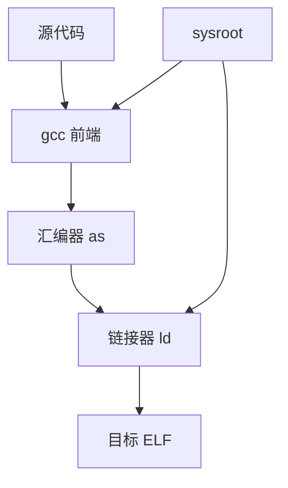

# Toolchain

## 简介

本文说明 toolchain 的构成，以及为什么它不是“一个 gcc 可执行文件”，而是一整套面向目标平台的二进制生成系统。

## 背景

很多嵌入式项目会直接说“给我一套 toolchain”。这里真正需要的不是某个编译器，而是包含编译、汇编、链接、目标头文件、目标库和相关工具的一整套环境。

## 基本概念

典型交叉 toolchain 包含：

- `gcc`
- `binutils`（`as`、`ld`、`objdump`、`readelf`、`strip` 等）
- libc
- 启动文件与目标头文件
- sysroot

## 工作原理



编译器和链接器必须知道目标 CPU、ABI、libc、动态链接器和库路径，否则产物就不属于目标系统。

## 设计目的

- 在宿主机上生成目标机二进制
- 固定目标 ABI
- 把目标头文件、库和工具统一组织

## 优缺点

优点：

- 可复现
- 可跨架构开发
- 适合批量构建嵌入式系统

缺点：

- 调试难度高于本地编译
- 与目标运行环境强耦合

## 典型应用

- Buildroot 内部或外部工具链
- OpenWrt 工具链
- 芯片厂商 SDK

## 在 Buildroot 中的位置

Buildroot 的核心能力之一就是生成或导入交叉 toolchain，并用它构建 Rootfs、Kernel 和用户态包。

## 在 OpenWrt 中的位置

OpenWrt 也会生成适用于目标平台的交叉工具链，用于编译包和镜像。

## 在光猫中的体现

光猫 GPL 代码包里常见的 `toolchain/`、`staging_dir/`、`cross-compiler` 目录，本质都是围绕这套运行环境展开。

## 实际案例

程序不能直接复制运行，往往不是语言层问题，而是原程序由某套特定 toolchain 针对另一种 CPU、ABI 和 libc 构建。

## 实践操作

```bash
gcc -v
which ld
which readelf
gcc -print-sysroot
```

怎么看：

- `gcc -v`：看目标三元组和配置
- `which ld/readelf`：看当前使用哪套 binutils
- `gcc -print-sysroot`：看 toolchain 绑定的目标开发根

## 前置知识

- Sysroot
- ABI
- glibc / musl / uClibc

## 后续知识

- SDK
- 交叉编译
- GCC
- Binutils

## 知识等级

★★★★★ 必须掌握

对 Buildroot、OpenWrt 和嵌入式 Linux 开发都非常核心。

## 参考资料

- 官方文档：Buildroot Manual `https://buildroot.org/manual.html`、GCC `https://gcc.gnu.org/onlinedocs/`、Binutils `https://sourceware.org/binutils/docs/`
- 官方源码：Buildroot `https://gitlab.com/buildroot.org/buildroot`、OpenWrt `https://github.com/openwrt/openwrt`
- 标准：ELF gABI `https://refspecs.linuxfoundation.org/elf/gabi4+/contents.html`
- GPL源码：后续结合交叉工具链目录验证
- 论坛：恩山无线论坛 `https://www.right.com.cn/forum/`、ChinaDSL `https://www.chinadsl.net/`、吾爱破解 `https://www.52pojie.cn/`
- 博客：Bootlin `https://bootlin.com/`

## 最后验证时间

更新时间：2026-07-12

适用版本：Linux Embedded toolchain 通用知识

验证环境：Buildroot / GCC / Binutils 官方资料整理

作者：Codex
