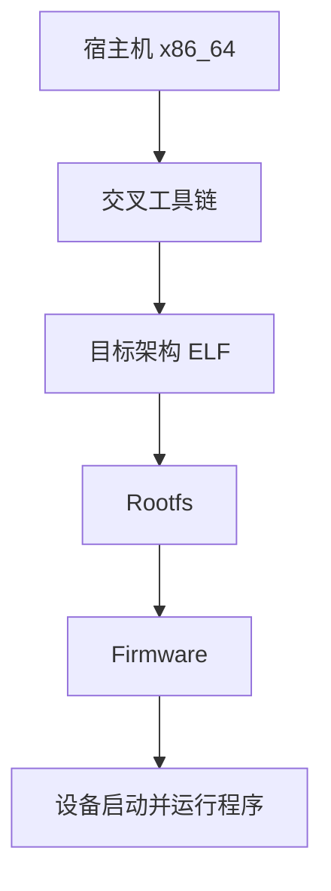

# 交叉编译

## 简介

本文说明交叉编译的原理，以及为什么 Buildroot / OpenWrt / 光猫 / 路由器几乎都离不开它。

## 背景

嵌入式设备常见开发机是 x86_64 Linux，而目标机可能是 ARM、MIPS、RISC-V。开发机本地编译出来的程序默认属于开发机自己，不属于目标设备。

## 基本概念

交叉编译指：

- 编译器运行在宿主机
- 输出二进制运行在另一种目标平台

## 工作原理



## 设计目的

- 让开发者无需在目标设备上本地编译
- 让弱性能设备也能获得高效构建能力
- 让整个产品系统可自动化批量生成

## 优缺点

优点：

- 编译速度快
- 适合 CI
- 适合量产固件构建

缺点：

- 环境边界复杂
- 宿主机和目标机混用头文件/库时问题隐蔽

## 典型应用

- Buildroot
- OpenWrt
- 芯片厂商 SDK
- 几乎所有嵌入式 Linux 产品线

## 在 Buildroot 中的位置

Buildroot 的核心工作流就是交叉编译：先生成或导入工具链，再用它构建整套目标系统。

## 在 OpenWrt 中的位置

OpenWrt 的包构建和镜像构建同样建立在交叉编译之上。

## 在光猫中的体现

光猫的 Web 服务、网管进程、命令行工具、共享库，几乎都是在 PC 或构建服务器上交叉编译得到，再被放入 Rootfs。

## 实际案例

你在 Ubuntu 上直接 `gcc hello.c -o hello`，默认得到的是宿主机 ELF。把它复制到 ARM 光猫，当然无法运行。不是代码错，而是你根本没有为目标架构编译。

## 实践操作

```bash
gcc -v
file hello
readelf -h hello
```

怎么看：

- `gcc -v`：看默认 target
- `file hello`：确认产物是不是目标架构
- `readelf -h`：进一步确认 `Machine`

## 前置知识

- Toolchain
- Sysroot
- CPU架构

## 后续知识

- GCC
- Binutils
- SDK

## 知识等级

★★★★★ 必须掌握

对 Buildroot、OpenWrt 和 Linux 嵌入式开发都是基础能力。

## 参考资料

- 官方文档：Buildroot Manual `https://buildroot.org/manual.html`、GCC `https://gcc.gnu.org/onlinedocs/`
- 官方源码：Buildroot `https://gitlab.com/buildroot.org/buildroot`、OpenWrt `https://github.com/openwrt/openwrt`
- 标准：ELF gABI `https://refspecs.linuxfoundation.org/elf/gabi4+/contents.html`
- GPL源码：后续结合交叉工具链和目标程序验证
- 论坛：恩山无线论坛 `https://www.right.com.cn/forum/`、ChinaDSL `https://www.chinadsl.net/`、吾爱破解 `https://www.52pojie.cn/`
- 博客：Bootlin `https://bootlin.com/`

## 最后验证时间

更新时间：2026-07-12

适用版本：Linux Embedded 交叉编译通用知识

验证环境：Buildroot / GCC / ELF 实践整理

作者：Codex
