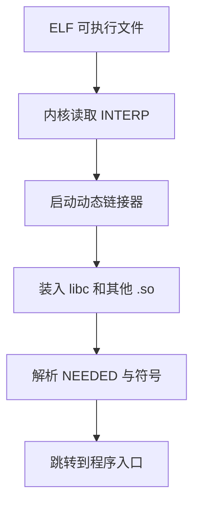

# 动态链接

## 简介

本文说明动态链接的原理，以及为什么嵌入式 Linux 程序常常依赖动态链接器和共享库共同启动。

## 背景

在 PC 上，开发者常把“可执行文件”理解成完整程序。但在嵌入式 Linux 中，很多程序只是入口，真正运行还依赖：

- 动态链接器
- libc
- 其他共享库

## 基本概念

动态链接指程序在运行时由动态链接器装入所需共享库，并解析符号引用。

## 工作原理



## 设计目的

- 共享公共库代码
- 减小单个可执行文件体积
- 便于多个程序复用同一套运行库

## 优缺点

优点：

- 节省 Rootfs 空间
- 便于多个程序共享 libc 等基础库

缺点：

- 运行时依赖多
- 动态链接器路径和共享库版本必须匹配

## 典型应用

- BusyBox 以外的大多数共享库程序
- OpenWrt / Buildroot 生成的普通用户态程序

## 在 Buildroot 中的位置

Buildroot 会把动态链接器和共享库一并装入 Rootfs，因此动态链接程序只有在完整目标 Rootfs 中才能可靠运行。

## 在 OpenWrt 中的位置

OpenWrt 依赖包管理与 Rootfs 共同维护共享库依赖，动态链接在其运行环境中更常见。

## 在光猫中的体现

光猫里的多数管理进程、Web 服务、网络守护进程都依赖动态链接。拷贝时若只拿可执行文件，不带匹配 `.so`，通常不能运行。

## 实际案例

程序文件明明存在，却报 `No such file or directory`，常见根因之一并不是可执行文件缺失，而是它依赖的解释器路径或共享库路径不存在。

## 实践操作

```bash
readelf -l busybox
readelf -d busybox
ldd busybox
```

怎么看：

- `readelf -l`：看 `Requesting program interpreter`
- `readelf -d`：看 `NEEDED`
- `ldd`：看最终解析到哪些 `.so`

## 前置知识

- ELF文件格式
- ABI

## 后续知识

- 动态链接器(ld-linux)
- glibc
- musl

## 知识等级

★★★★★ 必须掌握

对分析 Rootfs、调试兼容性、理解 Buildroot/OpenWrt 都非常关键。

## 参考资料

- 官方文档：ELF gABI Dynamic Linking `https://refspecs.linuxfoundation.org/elf/gabi4+/contents.html`
- 官方源码：Binutils 文档 `https://sourceware.org/binutils/docs/`
- 标准：ELF Program Interpreter / Dynamic Linker `https://refspecs.linuxfoundation.org/elf/gabi4+/contents.html`
- GPL源码：后续结合 GPL Rootfs 中动态程序与共享库验证
- 论坛：恩山无线论坛 `https://www.right.com.cn/forum/`、ChinaDSL `https://www.chinadsl.net/`、吾爱破解 `https://www.52pojie.cn/`
- 博客：Bootlin `https://bootlin.com/`

## 最后验证时间

更新时间：2026-07-12

适用版本：Linux 动态链接通用知识

验证环境：ELF 标准与 readelf/ldd 实践整理

作者：Codex
