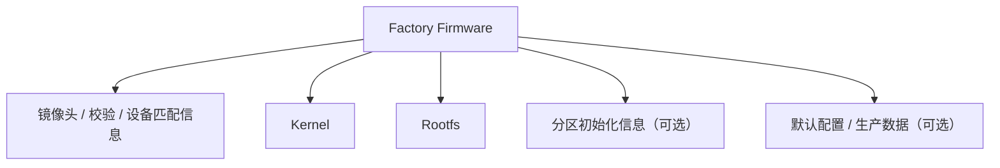

# Factory Firmware

## 简介

Factory Firmware 指面向“首次刷写、生产写入、救援恢复或从非目标系统迁移到目标系统”的固件交付形式。它通常更强调完整性、初始化能力与设备兼容性，而不只是对现有系统做增量更新。

## 背景

嵌入式设备在生命周期中通常至少会面对两种刷写场景：

- 设备出厂或救援时，需要从一个较低层级的状态写入完整系统
- 设备正常运行后，只需要在线升级运行系统

这两类目标不同，所以 Firmware 形态也常不同。Factory Firmware 更接近“建立系统初始状态”的镜像。

## 基本概念

### Factory 的含义

这里的 `Factory` 更接近：

- 工厂写入
- 首次写入
- 从其它系统切换到目标系统
- 恢复到可启动的基础系统

它不一定意味着“包含整颗 Flash 的原始镜像”，但通常比日常升级包更完整。

### Factory Firmware 不一定包含 Bootloader

有些场景下它会包含 Bootloader 或分区初始化信息；也有很多场景不会，因为 Bootloader 一旦损坏会显著增加设备变砖风险。因此是否包含 Bootloader，取决于设备设计、升级路径与发布目标。

## 常见结构



## 工作原理

Factory Firmware 的典型使用流程如下：

1. 升级工具或恢复工具读取镜像头
2. 校验目标设备、版本限制、长度与校验值
3. 视设计需要重建分区、擦除目标区域或写入完整镜像段
4. 写入 Kernel、Rootfs，以及可选的其它系统段
5. 首次启动后再创建 Overlay 或初始化可写数据区

## 为什么它和 Upgrade Firmware 不同

Factory Firmware 更偏向“构造基础系统”，Upgrade Firmware 更偏向“在已有系统上替换运行内容”。

因此 Factory Firmware 更常见的特点是：

- 更适合从 Web 恢复、Bootloader 恢复、量产工具刷机
- 可能包含更多初始化信息
- 可能要求目标设备处于更早期的刷写状态

## 为什么很多项目要提供 Factory Firmware

因为存在以下需求：

- 从原厂系统切换到新系统
- 恢复损坏但仍可进入恢复模式的设备
- 在生产阶段快速写入基础系统
- 避免依赖旧系统中的升级逻辑

## 与 Rootfs、Overlay 的关系

Factory Firmware 往往会写入新的只读 Rootfs。首次启动时，系统再根据设计创建 Overlay、数据分区或配置存储区。因此“首次启动为什么要初始化 Overlay”这一现象，常常与 Factory Firmware 的使用路径直接相关。

## 设计目的

- 建立可启动的基础系统
- 适配量产与恢复场景
- 支持从不同初始状态迁移到目标系统
- 降低对刷机前已有系统状态的依赖

## 优缺点

### 优点

- 更适合首次部署与救援恢复
- 更容易覆盖旧系统带来的不确定性
- 便于初始化新的分区或文件系统布局

### 缺点

- 文件通常更大
- 写入动作更重，耗时更长
- 如果设计不当，可能覆盖更多已有数据

## 典型应用

- 路由器从原厂系统切换到 OpenWrt
- Buildroot 项目在工厂量产时写入完整系统镜像
- 光接入设备通过恢复模式重新写入基础运行系统

## 在 Buildroot 中的位置

Buildroot 通常生成的是 Kernel、Rootfs 与若干文件系统镜像。Factory Firmware 往往需要在这些产物之上，结合板级脚本、分区布局和封装工具进一步生成。

因此可以把 Buildroot 看成“生成原材料”，而 Factory Firmware 是“面向刷写路径的最终封装物”。

## 在 OpenWrt 中的位置

OpenWrt 中的 `factory` 镜像通常用于：

- 从原厂系统刷入 OpenWrt
- 通过恢复界面或特定工具写入

它和 `sysupgrade` 的主要区别，不在于“有没有 Rootfs”，而在于“面向什么刷写入口、携带什么封装要求、能否被当前环境接受”。

## 在光猫中的体现

在通用的运营商接入设备场景中，Factory Firmware 往往对应：

- 更接近恢复镜像
- 更强调设备识别与完整性校验
- 用于基础系统重建，而不只是在线替换某个运行分区

## 实际案例

### 案例一：首次刷入新系统必须用 Factory Firmware

原因通常不是 Rootfs 内容不同，而是：

- 原系统的升级程序只接受某种特定封装
- 需要额外的镜像头或设备校验字段
- 需要进行首次布局初始化

### 案例二：恢复出厂后再次进入系统，会重新生成可写层

这意味着 Factory 路径通常只负责恢复只读基础系统，而运行时可写数据在首次启动阶段再创建。

## 实践操作

### 1. 用 `binwalk` 查看 Factory Firmware 的分段

```bash
binwalk factory.bin
```

作用：

- 识别固件中是否同时存在 header、Kernel、Rootfs、压缩段

怎么看：

- 如果看到多个已识别段，说明 Factory Firmware 可能是多 section 封装
- 如果只看到某个文件系统段，不代表没有外层封装，可能是识别规则有限

### 2. 对比 Factory 与 Upgrade 镜像大小和识别结果

```bash
ls -lh factory.bin upgrade.bin
binwalk factory.bin
binwalk upgrade.bin
```

作用：

- 观察两者封装层与内容层的差异

怎么看：

- Factory 常常更大，或包含不同的头部与元数据
- 两者可能都含 Rootfs，但外层格式不同

## 前置知识

- [Firmware 文件结构](./Firmware文件结构.md)
- [Rootfs](./Rootfs.md)
- [Overlay 机制](./Overlay机制.md)

## 后续知识

- [Upgrade Firmware](./UpgradeFirmware.md)
- [SquashFS](./SquashFS.md)
- [UBI](./UBI.md)

## 知识等级

★★★★ 建议掌握

重要性说明：

- 对 Linux Embedded：有助于理解系统交付与部署路径
- 对 Buildroot：帮助理解构建产物如何进入量产与恢复流程
- 对 OpenWrt：帮助理解为什么要区分 `factory` 与 `sysupgrade`
- 对光猫逆向：有助于识别不同升级包的用途与风险
- 对 Firmware 分析：属于高频知识

## 参考资料

- Buildroot User Manual
- OpenWrt 固件与升级文档
- Linux MTD / UBI 官方资料
- 常见嵌入式设备 GPL 发布内容

## 最后验证时间

- 2026-07-12
