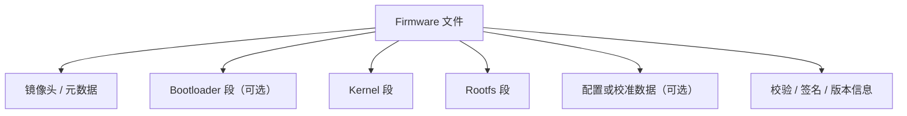
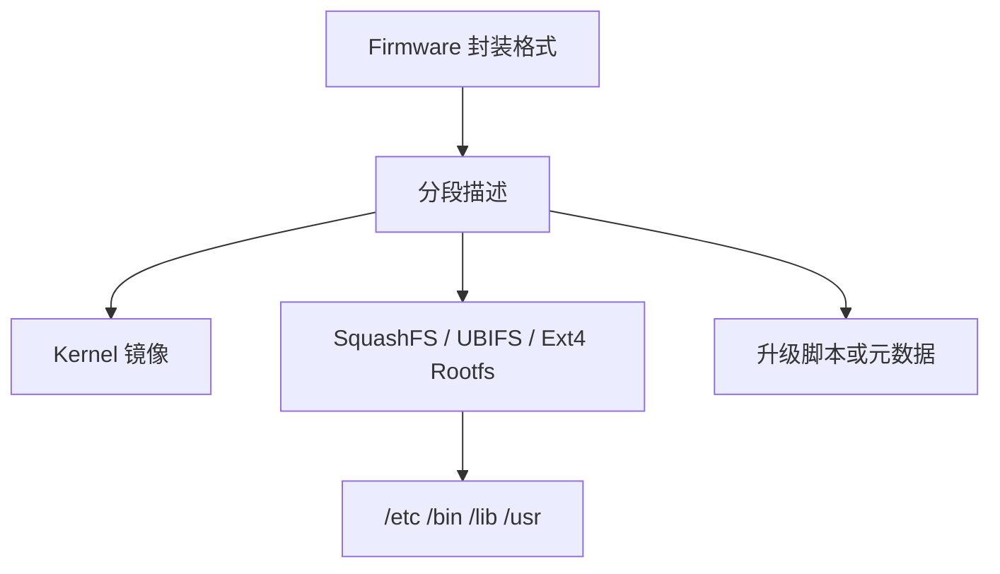

# Firmware 文件结构

## 简介

Firmware 文件结构描述的是一个嵌入式固件镜像如何组织 Bootloader、Kernel、Rootfs、配置分区、升级元数据以及校验信息。对于 Linux Embedded 场景，理解 Firmware 的结构比单独理解某个文件系统更重要，因为分析升级包、拆包 Rootfs、定位 Overlay、识别 Flash 分区时，面对的对象通常首先是一个 Firmware 文件。

## 背景

桌面 Linux 安装介质更接近“把完整系统写入块设备”，而嵌入式 Linux 固件更接近“把不同职责的镜像按分区或容器格式封装后再写入 Flash”。这使得 Firmware 既是“交付物”，也是“存储布局说明书”。

在路由器、光接入设备、NAS、IoT 设备中，升级文件往往不是一个单纯的文件系统镜像，而是下列对象的组合：

- Bootloader 或 Bootloader 更新段
- Kernel 镜像
- Rootfs 镜像
- 配置保留区或默认配置
- 分区表信息
- 校验、签名、版本、设备标识等元数据

## 基本概念

### Firmware 不等于 Rootfs

Rootfs 是系统运行时挂载为 `/` 的根文件系统。

Firmware 是设备升级、量产或恢复时使用的整体镜像封装，通常包含 Rootfs，但往往不止包含 Rootfs。

### Firmware 不等于 Flash 全量 Dump

有些分析资料会把从 Flash 读出的完整转储文件也叫作 Firmware。为了避免混淆，本知识库中更推荐区分：

- Firmware：厂商发布或构建系统生成的可刷写镜像
- Flash Dump：从设备存储介质直接导出的原始内容

## 常见分层



另一种常见理解方式是“封装层”和“内容层”：



## 工作原理

### 1. 构建阶段

构建系统先生成单独的系统组件：

- Kernel Image
- Rootfs Image
- 可选的 Device Tree
- 可选的 UBI / UBIFS 容器

然后再把这些组件封装成设备可接受的 Firmware。

### 2. 升级阶段

升级程序读取 Firmware 头部信息，校验目标设备、版本、长度、校验值，再把不同段写入对应 Flash 分区。

### 3. 启动阶段

设备启动后并不会“运行 Firmware 文件”，而是由 Bootloader 从 Flash 中加载 Kernel，再由 Kernel 挂载 Rootfs，最后通过 Overlay、配置分区或可写数据分区完成运行时系统组装。

## 常见内容组合

### 组合一：Kernel + SquashFS Rootfs

这是很多只读根文件系统设备的常见方案：

- Rootfs 为 SquashFS，只读、压缩率高
- 可写配置进入 Overlay
- 升级时通常替换整个 Rootfs 分区

### 组合二：UBI + UBIFS

用于原始 NAND Flash 较常见：

- Flash 先交给 UBI 管理擦写与坏块
- Rootfs 或数据卷位于 UBI volume
- 文件系统常使用 UBIFS

### 组合三：Ext4 Rootfs

更常见于 eMMC、SSD、SATA、SD 卡等块设备：

- Firmware 可能直接提供 ext4 镜像
- 也可能通过 tar、cpio、initramfs 等形式交付

## 为什么 Factory Firmware 和 Upgrade Firmware 经常不同

Factory Firmware 面向“首次写入”或“救援恢复”，常常需要包含更完整的信息，例如：

- 分区初始化所需信息
- 多个镜像段
- 更适合量产写入的布局

Upgrade Firmware 面向“系统已存在时的升级”，通常更关注：

- 是否可以在线升级
- 是否保留配置
- 是否只更新 Kernel 与 Rootfs

这也是为什么不能把两者简单视为同一种文件。

更多说明见 [FactoryFirmware](./FactoryFirmware.md) 与 [UpgradeFirmware](./UpgradeFirmware.md)。

## 为什么很多升级包不包含 Bootloader

Bootloader 是最底层启动组件，一旦写坏，设备可能失去正常自恢复能力。因此很多在线升级包只更新 Kernel 与 Rootfs，而不更新 Bootloader。对于运营商接入设备、家用路由器与 IoT 设备，这是一种常见风险控制策略。

## 与文件系统分析的关系

分析 Firmware 文件结构，通常是为了回答以下问题：

- Rootfs 在哪一段
- Rootfs 使用 SquashFS、UBIFS 还是 Ext4
- 配置是否单独存放
- 升级是否会覆盖 Overlay
- 分区是否通过 MTD 或 UBI 管理

如果只能看到一个 `squashfs` 文件，说明你已经进入 Rootfs 层；如果面对的是一个带头部与多个 section 的大文件，说明你还在 Firmware 层。

## 设计目的

Firmware 文件结构的目标不是“好看”，而是：

- 适合生产写入
- 适合升级校验
- 适合按分区刷写
- 适合在有限 Flash 上做版本替换
- 适合控制风险并保留关键数据

## 优缺点

### 优点

- 便于把多个系统组件一次性交付
- 便于升级程序进行设备匹配与完整性校验
- 便于按段写入不同 Flash 分区

### 缺点

- 封装层复杂，初学者容易把 Firmware 与 Rootfs 混淆
- 不同项目的头部与封装格式差异大
- 拆包时常需要结合分区布局与文件系统知识一起分析

## 典型应用

- Buildroot 构建产物被进一步封装成设备升级镜像
- OpenWrt 生成 sysupgrade、factory 等不同交付形式
- 路由器、光接入设备、IoT 网关、NAS 控制板使用分段固件完成升级

## 在 Buildroot 中的位置

Buildroot 主要负责生成 Kernel、Rootfs 和若干文件系统镜像，例如 `tar`、`cpio`、`ext4`、`squashfs`、`ubifs`。是否再进一步打包成某种最终 Firmware，往往由设备项目自己的 post-image 脚本、板级集成逻辑或外部打包工具完成。

也就是说，Buildroot 很擅长生成“构成 Firmware 的部件”，但“最终 Firmware 封装格式”未必由 Buildroot 统一定义。

## 在 OpenWrt 中的位置

OpenWrt 会同时处理：

- Rootfs 类型选择
- 分区布局适配
- 设备升级格式适配

因此在 OpenWrt 中，“文件系统镜像”和“Firmware 交付格式”联系得非常紧密。理解 Firmware 文件结构，有助于理解为什么 OpenWrt 同时区分 `factory` 与 `sysupgrade` 产物。

## 在光猫中的体现

在光接入设备中，常见现象包括：

- 升级包只包含系统运行需要的镜像段，不一定带 Bootloader
- Rootfs 往往是只读压缩镜像
- 用户配置与运营配置可能位于独立可写区域
- 恢复出厂常常通过清空可写配置区或 Overlay 实现

这些都是 Firmware 结构与文件系统设计共同决定的结果。

## 实际案例

### 案例一：解包后先看到 SquashFS，不代表整个 Firmware 就是 SquashFS

很多分析过程中，`binwalk` 会在某个偏移处识别出 SquashFS。这通常表示：

- Firmware 外层存在封装头或多个 section
- SquashFS 只是 Rootfs 其中一段

### 案例二：升级后系统更新了，但配置没有丢失

这通常意味着：

- Rootfs 被替换
- 可写配置位于 Overlay、独立数据分区或独立 UBI volume
- 升级逻辑有意避开配置区域

## 实践操作

### 1. 用 `binwalk` 识别固件中的文件系统与压缩段

```bash
binwalk firmware.bin
```

作用：

- 识别已知文件格式、压缩格式、文件系统与镜像头

怎么看：

- 如果输出中有 `Squashfs filesystem`，通常表示某个偏移处开始是 Rootfs 段
- 如果有 `uImage header`、`FIT image` 或压缩 kernel 特征，说明还包含 Kernel 段

### 2. 用 `unsquashfs` 解出 Rootfs

```bash
unsquashfs rootfs.squashfs
```

作用：

- 解压 SquashFS，查看实际的根目录内容

怎么看：

- 解出后通常能看到 `/bin`、`/etc`、`/lib`、`/usr`
- 这一步分析的是 Rootfs 内容，不是整个 Firmware 封装结构

### 3. 用 `ubireader`、`ubinfo` 或相关工具分析 UBI / UBIFS

```bash
ubinfo /dev/ubi0
```

作用：

- 查看 UBI 设备中的 volume、擦除块与可用空间信息

怎么看：

- 如果 Rootfs 位于 UBI volume，Firmware 里通常不只是“一个普通文件系统镜像”，而是带 UBI 层的组织方式

## 前置知识

- [Linux 文件系统概述](./Linux文件系统概述.md)
- [Rootfs](./Rootfs.md)
- [Flash 存储特点](./Flash存储特点.md)
- [MTD](./MTD.md)

## 后续知识

- [Factory Firmware](./FactoryFirmware.md)
- [Upgrade Firmware](./UpgradeFirmware.md)
- [Overlay 机制](./Overlay机制.md)
- [OpenWrt 基础](../OpenWrt/README.md)

## 知识等级

★★★★★ 必须掌握

重要性说明：

- 对 Linux Embedded：直接决定如何理解系统镜像与启动产物
- 对 Buildroot：帮助区分“生成 Rootfs”与“封装 Firmware”的边界
- 对 OpenWrt：帮助理解 factory 与 sysupgrade 的交付差异
- 对光猫逆向：是拆包、分段、定位 Rootfs 与配置区的基础
- 对 Firmware 分析：属于核心基础知识

## 参考资料

- Linux Kernel Documentation: Filesystems
- Buildroot User Manual
- OpenWrt 文档中的固件布局与升级说明
- Linux MTD / UBI 官方文档
- BusyBox 与常见嵌入式升级工具资料

## 最后验证时间

- 2026-07-12
