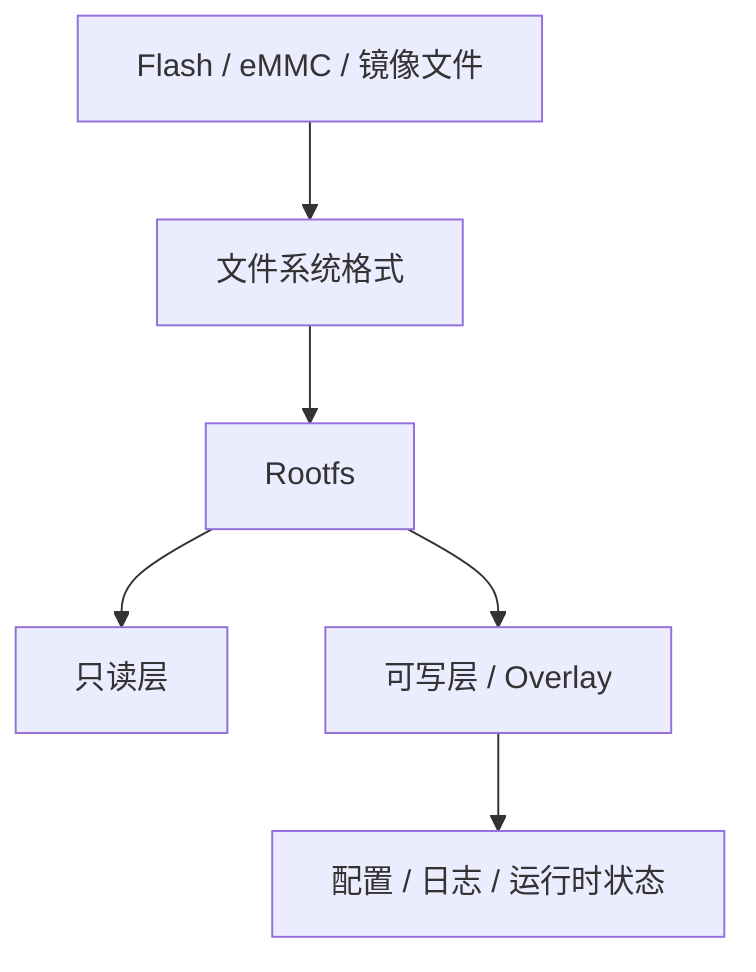

# Filesystem

## 简介

本目录用于整理 Linux Embedded 场景中的文件系统、Rootfs、Flash 介质、固件封装和 Overlay 设计，解释为什么路由器、光猫、NAS、IoT 设备往往不会沿用桌面 Linux 的存储组织方式。

## 背景

后续分析 Buildroot、OpenWrt、运营商设备固件和升级包时，最容易混淆的不是命令怎么用，而是：哪个分区是只读 Rootfs，哪个区域是可写 Overlay，哪个镜像能直接刷，哪个文件系统只能跑在 raw flash 上。

## 基本概念

- 块设备文件系统：如 `ext4`、`f2fs`
- raw flash 文件系统：如 `JFFS2`、`UBIFS`
- 只读压缩文件系统：如 `SquashFS`
- 运行时伪文件系统：如 `procfs`、`sysfs`、`devtmpfs`、`tmpfs`
- 组织机制：`Rootfs`、mount、Overlay、firmware layout

## 工作原理



## 设计目的

- 为后续 Buildroot、OpenWrt、Firmware 分析提供统一文件系统视角
- 解释嵌入式设备为何偏爱只读 Rootfs + 可写 Overlay
- 建立 raw flash、块设备、镜像封装之间的分层关系

## 优缺点

优点：

- 能把镜像、分区、文件系统、挂载关系串成完整链路
- 便于后续定位配置丢失、升级失败、空间不足等问题

缺点：

- 涉及概念多，且同时跨越内核、存储和固件封装
- 不同设备最终实现会有差异，需要结合实际分区表验证

## 典型应用

- 分析 Buildroot 输出镜像
- 理解 OpenWrt Overlay
- 解包光猫或路由器固件
- 判断某个分区应挂载什么文件系统

## 在 Buildroot 中的位置

Buildroot 的 `Filesystem images` 菜单决定最终输出哪些根文件系统格式，因此 Filesystem 章节会直接承接 `../Buildroot/Filesystem生成.md` 与 `../Buildroot/Rootfs生成过程.md`。

## 在 OpenWrt 中的位置

OpenWrt 的只读 `SquashFS` + 可写 Overlay 是本目录最重要的现实样本之一；首次启动、恢复出厂、升级保留配置都与此强相关。

## 在光猫中的体现

光猫、Mesh、IoT 设备常见模式是：只读压缩 Rootfs 保证稳定，可写层单独承载配置和状态；NAS 和部分高端网关则更常使用块设备文件系统。

## 实际案例

为什么很多设备升级后系统文件变了但配置还在？因为升级替换的是 Rootfs 镜像，而配置通常落在独立可写层。

## 实践操作

```bash
cat /proc/filesystems
mount
cat /proc/mounts
df -h
findmnt 2>/dev/null | head -n 30
```

怎么看：

- `/proc/filesystems`：看内核支持哪些文件系统类型
- `mount` / `/proc/mounts`：看当前 Rootfs、Overlay、伪文件系统如何拼起来
- `df -h`：看可写层和只读层的容量感知
- `findmnt`：看挂载层级是否符合预期

## 前置知识

- [Buildroot/Filesystem生成](../Buildroot/Filesystem生成.md)
- [LinuxRuntime/README](../LinuxRuntime/README.md)
- [LinuxRuntime/Mount机制](../LinuxRuntime/Mount机制.md)
- [LinuxRuntime/VFS](../LinuxRuntime/VFS.md)

## 后续知识

- [OpenWrt/README](../OpenWrt/README.md)
- [LXC/README](../LXC/README.md)
- [../../Glossary.md](../../Glossary.md)
- [../../CrossReference.md](../../CrossReference.md)

## 知识等级

★★★★★ 必须掌握

## 参考资料

- 官方文档：Linux Kernel Filesystems Docs `https://docs.kernel.org/filesystems/index.html`
- 官方文档：Buildroot Manual `https://nightly.buildroot.org/manual.html`
- 官方文档：OpenWrt Flash Layout `https://openwrt.org/docs/techref/flash.layout`
- 官方源码：Linux kernel `https://git.kernel.org/pub/scm/linux/kernel/git/torvalds/linux.git`
- GPL源码：后续结合厂商固件分区脚本验证
- 论坛：恩山无线论坛 `https://www.right.com.cn/forum/`、ChinaDSL `https://www.chinadsl.net/`、吾爱破解 `https://www.52pojie.cn/`
- 博客：Bootlin `https://bootlin.com/`、LWN `https://lwn.net/`

## 最后验证时间

更新时间：2026-07-12

适用版本：Linux Embedded 文件系统通用知识

验证环境：Kernel / Buildroot / OpenWrt / MTD 文档整理

作者：Codex
