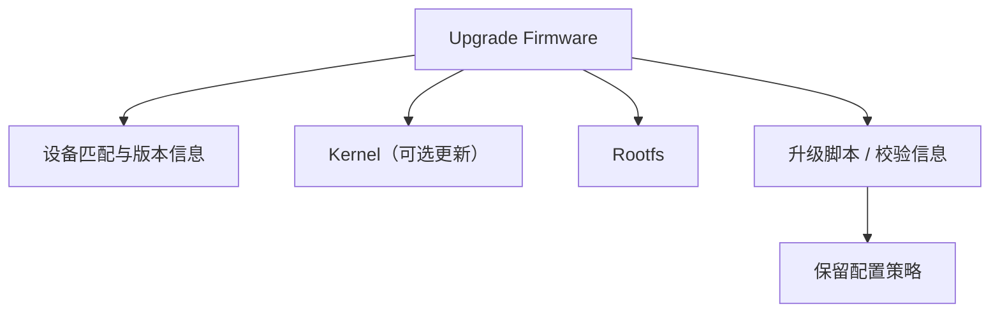

# Upgrade Firmware

## 简介

Upgrade Firmware 指面向“设备已经运行目标系统或兼容系统时”的升级固件。它的重点通常不是初始化整套系统，而是在尽量降低风险的前提下，替换运行系统、保留配置，并让升级路径可重复、可校验、可回滚或易恢复。

## 背景

嵌入式设备大量部署后，最常见的维护动作不是“首次刷入”，而是“在线升级”。因此 Upgrade Firmware 通常面向：

- Web 管理界面升级
- 命令行升级
- 自动化升级系统
- OTA 升级通道

这类升级包会强依赖“系统当前已经能正确执行升级程序”这一前提。

## 基本概念

### Upgrade Firmware 更像运行时升级载体

它通常包含升级逻辑需要的核心镜像内容，例如：

- Kernel
- Rootfs
- 校验信息
- 版本与设备匹配信息

但不一定包含 Factory 场景才需要的全部初始化信息。

### Upgrade Firmware 常常默认保留配置

很多设备升级后配置不丢失，并不是因为 Rootfs 被“局部修改”，而是因为：

- Rootfs 多半是只读整体替换
- 配置位于 Overlay、独立数据分区或独立 volume
- 升级逻辑刻意跳过这些可写区域

## 常见结构



## 工作原理

典型流程如下：

1. 当前系统下载或接收升级包
2. 升级程序检查设备标识、版本、完整性
3. 把 Rootfs 或相关镜像写入目标分区
4. 保留 Overlay、配置分区或数据 volume
5. 重启后挂载新的只读 Rootfs，并继续叠加旧的可写层

## 为什么升级不会直接修改 SquashFS

因为 SquashFS 是只读文件系统。运行中的配置变化通常写入 Overlay，而升级时若使用新的 SquashFS Rootfs，本质上是“替换整个只读镜像”，不是“直接在原 SquashFS 中修改某几个文件”。

## 为什么很多 Upgrade Firmware 不包含 Bootloader

在线升级的首要目标之一是降低不可恢复风险。Bootloader 属于启动链最底层组件，更新失败的代价高，因此大量 Upgrade Firmware 只更新：

- Kernel
- Rootfs
- 可选的少量相关分区

这也是很多设备升级包看起来“不完整”的原因，它们面向的是受控升级路径，而不是从零恢复整个设备。

## 与 Overlay 的关系

理解 Upgrade Firmware，最关键的是理解它和 Overlay 的关系：

- Rootfs 更新后，系统文件基础版本变化
- Overlay 保留用户配置与运行时改动
- 恢复出厂时，常常只删除 Overlay，而不是回退整个只读 Rootfs

## 设计目的

- 支持日常维护升级
- 尽量保留配置与用户数据
- 降低升级失败的设备损坏风险
- 适配在线升级与自动化升级流程

## 优缺点

### 优点

- 更适合日常在线升级
- 通常更安全，风险可控
- 更容易保留配置与数据

### 缺点

- 强依赖现有系统还能正常执行升级程序
- 对封装格式、设备匹配与版本校验更敏感
- 不适合处理底层布局被破坏的设备

## 典型应用

- OpenWrt `sysupgrade`
- 运行中的 Buildroot 设备通过升级脚本替换 Rootfs
- 路由器、接入设备、IoT 网关通过 Web 页面导入升级包

## 在 Buildroot 中的位置

Buildroot 负责生成升级会用到的 Kernel 和 Rootfs 镜像，但 Upgrade Firmware 往往由项目层额外打包。常见流程是：

1. Buildroot 生成 `squashfs`、`ubifs`、`ext4`、`cpio` 等镜像
2. 项目脚本把这些镜像封装成升级包
3. 设备内的升级程序识别该升级包并写入相应分区

## 在 OpenWrt 中的位置

OpenWrt 中 Upgrade Firmware 的核心意义非常典型：

- `sysupgrade` 面向“当前已运行 OpenWrt 或兼容升级环境”的系统
- 升级通常保留配置
- 首次启动时创建的 Overlay 会在后续升级中继续承担配置保存职责

这也是为什么在 OpenWrt 语境里，Overlay 的重要性几乎和 Rootfs 本身一样高。

## 在光猫中的体现

在通用的运营商接入设备中，Upgrade Firmware 常表现为：

- 体积相对更聚焦
- 以替换运行系统为目标
- 通常不触碰最底层启动组件
- 经常保留用户与运营配置所在的可写区域

## 实际案例

### 案例一：升级后系统版本变了，但 `/etc/config` 里的配置仍在

典型原因是：

- 新的只读 Rootfs 被替换
- 配置实际保存在 Overlay 或独立数据区

### 案例二：恢复出厂后升级前的配置消失

这通常不是因为 Rootfs 恢复了“老配置”，而是因为：

- 配置所在 Overlay 被删除或重建
- 只读 Rootfs 本来就不负责保存运行中写入的配置

## 实践操作

### 1. 在运行系统中观察升级前后的挂载关系

```bash
cat /proc/mounts
findmnt
```

作用：

- 确认 `/` 是否来自只读 Rootfs
- 确认可写配置是否来自 Overlay 或单独分区

怎么看：

- 升级前后如果只读层设备发生变化，而可写层仍保留，通常说明升级主要替换了 Rootfs

### 2. 比较升级包与 Rootfs 镜像

```bash
binwalk sysupgrade.bin
unsquashfs rootfs.squashfs
```

作用：

- 确认升级包中是否包含 SquashFS Rootfs

怎么看：

- 如果看到 `Squashfs filesystem`，说明升级包很可能包含只读根文件系统段

## 前置知识

- [Firmware 文件结构](./Firmware文件结构.md)
- [Factory Firmware](./FactoryFirmware.md)
- [Overlay 机制](./Overlay机制.md)
- [SquashFS](./SquashFS.md)

## 后续知识

- [UBI](./UBI.md)
- [UBIFS](./UBIFS.md)
- [常见问题](./常见问题.md)

## 知识等级

★★★★ 建议掌握

重要性说明：

- 对 Linux Embedded：帮助理解运行时升级机制
- 对 Buildroot：帮助理解生成产物如何进入升级链路
- 对 OpenWrt：属于理解系统维护方式的关键知识
- 对光猫逆向：有助于区分升级包与恢复包的用途
- 对 Firmware 分析：属于高频实战知识

## 参考资料

- Buildroot User Manual
- OpenWrt 升级与 sysupgrade 文档
- Linux Kernel Documentation
- Linux MTD / UBI 文档

## 最后验证时间

- 2026-07-12
