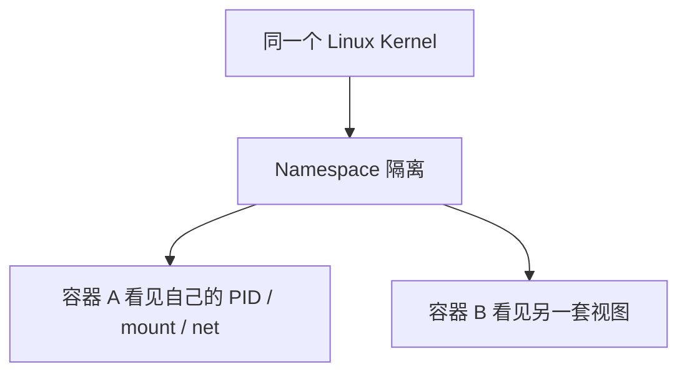

# Namespace

## 简介

本文说明 namespace 的作用，以及为什么容器里还能看到 `/proc`、`/dev`、`/sys`，同时又像拥有“自己的系统视图”。

## 背景

很多人把容器误解成虚拟机。实际上，容器共享同一内核，但通过 namespace 获得一组相对隔离的资源视图。

## 基本概念

常见 namespace 包括：

- PID
- mount
- network
- UTS
- IPC
- user
- cgroup

## 工作原理



## 设计目的

在共享同一内核的前提下提供资源视图隔离，为容器和轻量沙箱提供基础。

## 优缺点

优点：

- 轻量
- 启动快

缺点：

- 不是完整虚拟机隔离
- 仍共享同一内核

## 典型应用

- LXC
- Docker
- 沙箱化服务

## 在 Buildroot 中的位置

Buildroot 可以构建带 namespace 支持的内核和用户态，但是否启用取决于产品需求。

## 在 OpenWrt 中的位置

OpenWrt 和其他嵌入式系统若支持容器或更强隔离，也会依赖 namespace。

## 在光猫中的体现

复杂网关若引入 LXC 或应用隔离，常通过 namespace 提供视图隔离。

## 实际案例

为什么容器里还有 `/proc`、`/sys`、`/dev`？因为容器共享同一内核，只是看到的是按 namespace 和挂载视图组织后的 API 文件系统实例。

## 实践操作

```bash
ls /proc/self/ns
readlink /proc/self/ns/*
ps
mount
```

怎么看：

- `/proc/self/ns`：看当前进程属于哪些 namespace
- `ps`、`mount`：在不同容器里比较可见视图

## 前置知识

- Mount机制
- PID与进程
- VFS

## 后续知识

- Cgroup
- LXC
- UnixDomainSocket

## 知识等级

★★★★★ 必须掌握

## 参考资料

- 官方文档：Linux man-pages `https://man7.org/linux/man-pages/`
- 官方源码：Linux kernel `https://git.kernel.org/pub/scm/linux/kernel/git/torvalds/linux.git`
- 标准：user_namespaces(7) `https://man7.org/linux/man-pages/man7/user_namespaces.7.html`
- GPL源码：后续结合容器配置与挂载视图验证
- 论坛：恩山无线论坛 `https://www.right.com.cn/forum/`、ChinaDSL `https://www.chinadsl.net/`、吾爱破解 `https://www.52pojie.cn/`
- 博客：LWN `https://lwn.net/`

## 最后验证时间

更新时间：2026-07-12

适用版本：Linux namespace 通用知识

验证环境：man7、LXC 文档、运行时实践整理

作者：Codex
