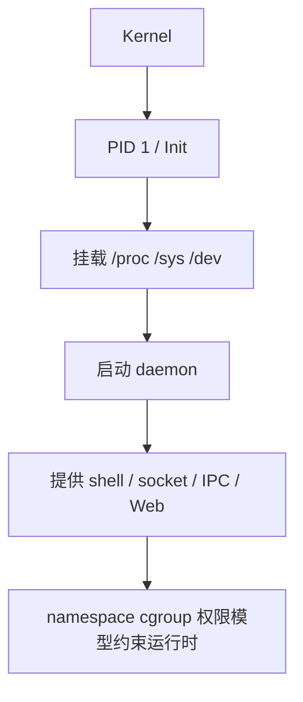

# LinuxRuntime

## 简介

本目录用于整理 Linux 系统启动完成后的运行机制，解释系统中到底有哪些对象正在运行，以及它们为什么会以 `/proc`、`/sys`、`/dev`、socket、mount、namespace、cgroup 这些形式出现。

## 背景

后续分析 Buildroot、OpenWrt、光猫、路由器、LXC、Docker 时，都会反复遇到同一批基础问题：

- 为什么 `ps` 看到的是进程树
- 为什么 `/proc` 没有真正文件
- 为什么 `/sys` 写一个值会改变驱动行为
- 为什么 mount 之后目录内容像被“换掉”
- 为什么 socket 也能表现为文件
- 为什么容器里还有 `/proc`、`/sys`、`/dev`

## 基本概念

本目录主要覆盖五条主线：

- 启动后系统是谁带起来的：`PID 1`、init、daemon
- 运行中的程序是什么：进程、线程、session、TTY、shell
- 用户态如何进入内核：system call、signal、environment
- 内核如何向用户态暴露状态：`/proc`、`/sys`、`/dev`、mount、VFS
- 系统如何做隔离与约束：namespace、cgroup、权限、capability

## 工作原理



## 设计目的

目标不是讲 Linux 命令怎么用，而是解释 Linux 为什么这样设计，从而为后续章节提供统一引用基础。

## 优缺点

优点：

- 把运行时对象串成一个整体
- 后续写 DBus、LXC、OpenWrt 时不必重复解释基础概念

缺点：

- 偏底层
- 对只熟悉应用框架的读者来说抽象度较高

## 典型应用

- 分析 Buildroot / OpenWrt Rootfs
- 分析光猫和路由器运行时服务
- 理解容器中的 `/proc`、`/sys`、`/dev`

## 在 Buildroot 中的位置

Buildroot 最终交付的不只是文件系统镜像，而是一套可启动运行时：init、挂载点、daemon、socket、权限边界都要一起成立。

## 在 OpenWrt 中的位置

OpenWrt 同样依赖这些机制，只是用户态更多围绕 `procd`、`ubus`、热插拔和网络服务组织。

## 在光猫中的体现

光猫中的 Web 管理、CLI、TR-069、DBus、容器、网络守护进程，全部建立在这些运行机制之上。

## 实际案例

最常见的误解是把 `/proc`、`/sys`、`/dev` 都当普通目录来理解。实际上它们是 Linux 运行时接口面，而不是单纯的磁盘内容。

## 实践操作

```bash
ps -ef
pstree
mount
ls /proc | head
ls /sys | head
ls /dev | head
find / -type s 2>/dev/null | head
```

怎么看：

- `ps` / `pstree`：看系统运行成了什么进程树
- `mount`：看哪些目录是运行时挂上去的
- `/proc`、`/sys`、`/dev`：看内核如何把状态暴露给用户态
- `find -type s`：看本地 Unix socket 如何表现为文件

## 前置知识

- Buildroot
- Embedded Runtime

## 后续知识

- DBus
- OpenWrt
- LXC
- Filesystem

## 知识等级

★★★★★ 必须掌握

## 参考资料

- 官方文档：Linux Kernel Docs `https://docs.kernel.org/`、Buildroot Manual `https://buildroot.org/manual.html`、OpenWrt Docs `https://openwrt.org/docs/start`
- 官方源码：Linux kernel `https://git.kernel.org/pub/scm/linux/kernel/git/torvalds/linux.git`、OpenWrt `https://github.com/openwrt/openwrt`
- 标准：Linux man-pages `https://man7.org/linux/man-pages/`
- GPL源码：后续结合 init 脚本、socket、容器配置验证
- 论坛：恩山无线论坛 `https://www.right.com.cn/forum/`、ChinaDSL `https://www.chinadsl.net/`、吾爱破解 `https://www.52pojie.cn/`
- 博客：Bootlin `https://bootlin.com/`、LWN `https://lwn.net/`

## 最后验证时间

更新时间：2026-07-12

适用版本：Linux 系统运行机制通用知识

验证环境：Kernel 文档、man7、Buildroot / OpenWrt 文档整理

作者：Codex
