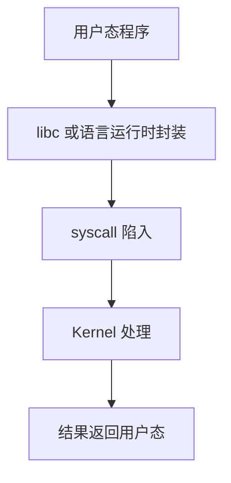

# SystemCall

## 简介

本文说明系统调用的作用，以及为什么用户态程序最终都必须通过 system call 才能真正访问内核资源。

## 背景

Java、Go、Python 程序看起来是在调用库函数，但真正读文件、发网络包、创建进程、挂载文件系统时，最终都要落到系统调用。

## 基本概念

系统调用是用户态进入内核态、请求内核服务的标准入口。

## 工作原理



## 设计目的

保护内核，提供统一资源访问边界，解耦用户态与内核实现细节。

## 优缺点

优点：边界明确、接口统一。

缺点：调试需要看用户态和内核态两边。

## 典型应用

- `open`
- `read`
- `write`
- `socket`
- `fork`
- `execve`
- `mount`

## 在 Buildroot 中的位置

Buildroot 产出的所有用户态程序，本质上都依赖系统调用访问文件、网络、设备和进程控制。

## 在 OpenWrt 中的位置

OpenWrt 的 `procd`、`ubus`、网络守护进程也都建立在系统调用之上。

## 在光猫中的体现

光猫里的 Web、CLI、DBus、容器、网络栈管理，最终都要靠系统调用落到内核对象上。

## 实际案例

为什么写 `/sys` 一个值会影响驱动？因为写文件最终变成 `write()`，内核把这个写操作交给对应内核属性处理函数。

## 实践操作

```bash
cat /proc/self/syscall 2>/dev/null
strace -V 2>/dev/null
```

怎么看：`/proc/self/syscall` 可看当前线程系统调用状态，`strace` 可观察用户态进入内核的过程。

## 前置知识

- Embedded Runtime

## 后续知识

- Proc文件系统
- Sysfs
- Socket

## 知识等级

★★★★★ 必须掌握

## 参考资料

- 官方文档：Linux Kernel Docs `https://docs.kernel.org/`、Buildroot Manual `https://buildroot.org/manual.html`、OpenWrt Docs `https://openwrt.org/docs/start`
- 官方源码：Linux kernel `https://git.kernel.org/pub/scm/linux/kernel/git/torvalds/linux.git`、OpenWrt `https://github.com/openwrt/openwrt`
- 标准：Linux man-pages `https://man7.org/linux/man-pages/`
- GPL源码：后续结合 Rootfs、init 脚本、socket、容器配置和运行时目录验证
- 论坛：恩山无线论坛 `https://www.right.com.cn/forum/`、ChinaDSL `https://www.chinadsl.net/`、吾爱破解 `https://www.52pojie.cn/`
- 博客：Bootlin `https://bootlin.com/`、LWN `https://lwn.net/`


## 最后验证时间

更新时间：2026-07-12

适用版本：Linux 系统运行机制通用知识

验证环境：Kernel 文档、man7、Buildroot / OpenWrt 文档整理

作者：Codex
