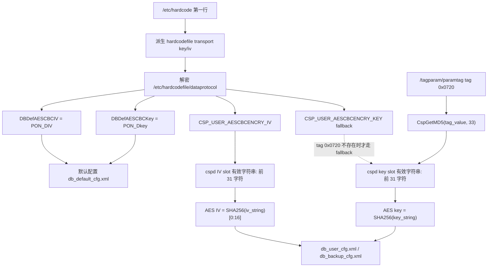

# AES 加密分析

结论均来自 `libhardcode.so` 和 `cspd` 的调用关系。

## 已验证

- 算法：AES。
- 模式：CBC，调用 OpenSSL `AES_cbc_encrypt`。
- Key size：256 bit。
- Key material：`SHA256(key_string)`。
- IV material：`SHA256(iv_string)` 的前 16 字节。
- Padding：zero padding。若明文长度刚好 16 字节对齐，仍额外追加一个
  16 字节零块。
- 解密后不按 padding 内容裁剪，而是使用块头中的 plain length。

## Key/IV 来源

`cspd` 引用以下 hardcode 参数名：

- `DBDefAESCBCKey`
- `DBDefAESCBCIV`
- `CSP_USER_AESCBCENCRY_KEY`
- `CSP_USER_AESCBCENCRY_IV`

`CspHardCodeParamGet` 从 `/etc/hardcode` 和 `/etc/hardcodefile/*` 获取参数。

## Key/IV 派生流程



已验证：本 G7615 样本的用户配置使用 `tag 0x0720` 路径，不使用 LOID
或 `paramtag` 中的其它业务字段参与 DB AES key 派生。

## hardcodefile 解密

已验证：

`/etc/hardcodefile/*` 本身也是 60 字节头 + AES-CBC block 的 version 3
容器，但解开后不是内层 deflate，而是 `key=value` 文本。

`/etc/hardcode` 第一行用于派生 hardcodefile transport key/iv：

- key string：第 5..20 字符逐字节 `+3`，再拼接第 64 字节之后的产品串。
- IV string：第 7..38 字符逐字节 `+1`。

本样本派生结果：

- hardcodefile key string：`fhh884;e674i73g;CU_G7610`
- hardcodefile IV string：`f6629c452g51e94g2dd6f8d3bd4742ff`

## DB key/iv 实测值

从 `dataprotocol` 解出的 DB 参数：

| 参数 | 值 | 验证状态 |
|---|---|---|
| `DBDefAESCBCKey` | `PON_Dkey` | 已验证，可解 `db_default_cfg.xml` |
| `DBDefAESCBCIV` | `PON_DIV` | 已验证，可解 `db_default_cfg.xml` |
| `CSP_USER_AESCBCENCRY_KEY` | `8cc72b05705d5c46f412af8cbed55aad` | 已确认来源；cspd 内存 fallback slot 有效值为前 31 字符 |
| `CSP_USER_AESCBCENCRY_IV` | `667b02a85c61c786def4521b060265e8` | 已确认来源；cspd 内存有效值为前 31 字符 |

## 用户配置个性化 key

新设备上，用户配置文件的 AES-CBC seed key 不能简单取
`/etc/hardcodefile/dataprotocol` 解出的 `CSP_USER_AESCBCENCRY_KEY`。
当前 G7615 已验证：该 hardcode 项只是 fallback；实际命中的是
`setmac show2` 中的 `INDIVKEY`，其 ID 为 `1824`，也就是 `0x0720`。
`setmac show2` 会把它显示为星号，但真实 32 字节 seed 存在
`/tagparam/paramtag` 中，直接读取该文件即可解析出来。

`setmac` 对 `INDIVKEY` 的遮蔽逻辑和 tagparam 文件格式见
`setmac与tagparam.md`。核心结论是：`setmac` 不读写
`db_user_cfg.xml`，它读写的是 `/tagparam/paramtag`；但 `cspd` 会读取
其中的 `0x0720` 来派生 user DB AES key。

因此同型号不同设备的 user DB key 大概率不同。用本机 `INDIVKEY` 派生出的
工具通常只能解本机的 `db_user_cfg.xml` / `db_backup_cfg.xml`；跨机器是否
可用取决于 `INDIVKEY` 是否一致，不能假设固定。

`PdtDBSetUserCfgAESCBCEncryKey` 的逻辑已确认：

1. 先读取 `CSP_USER_AESCBCENCRY_KEY` 和 `CSP_USER_AESCBCENCRY_IV`。
2. 将二者写入 user key/iv 槽位。
3. 若板型不在排除列表中，尝试读取 tag `0x0720`。
4. 若 tag `0x0720` 存在，对其 32 字节值加结尾 `NUL` 后按长度 `33`
   调用 `CspGetMD5(input, 33, out16)`，生成 MD5 hex。
5. cspd key slot 中实际可见的 32 字符 hex 字符串会成为前 31 字符加
   `NUL` padding；AES helper 使用该有效 slot string 做 SHA256。
6. 若 tag `0x0720` 不存在，则走 PON SN/MAC fallback 拼接路径，再 MD5。

本样本 `tagparam/paramtag` 中 tag `0x0720` 为：

```text
cKZF6ufRy2ecKZHfYPh7FfP9cUDPzbuE
```

对应完整 MD5 candidate：

```text
e64c0347a55b5f2423fa487c3e646ac9
```

cspd 内存 key slot 中实际用于 AES 的有效 key string：

```text
e64c0347a55b5f2423fa487c3e646ac
```

对应有效 IV string：

```text
667b02a85c61c786def4521b060265e
```

`md5(seed)` 的 `strlen` 对照值为
`f934d3ec223c0174290a85aef5c2caac`，但这不是 `cspd` 在该调用点传入的
长度。

使用上述有效 key/IV 已验证可解 `db_user_cfg.xml` 和 `db_backup_cfg.xml`；
使用 hardcode fallback slot `8cc72b05705d5c46f412af8cbed55aa` 未命中。

## 与业务数据的关系

以下结论针对当前 G7615 样本和已定位的 `cspd` 调用路径：

- `INDIVKEY` / `tag 0x0720` / ID `1824`：已验证，参与用户/备份 DB key 派生。
- `CSP_USER_AESCBCENCRY_IV`：已验证，参与用户/备份 DB IV 派生。
- `DBDefAESCBCKey` / `DBDefAESCBCIV`：已验证，仅用于默认配置。
- LOID / 宽带注册号：未见参与 DB AES key/iv 派生；它属于业务配置数据。
- 型号字符串：未见参与 DB AES key/iv 派生；U 盘备份封套中保存型号用于版本/
  型号类校验。
- SN/MAC：存在 fallback 分支，但本样本未走该路径。

## 非结论

当前没有证据表明这里使用 ECB、CTR、CFB 或 PKCS#7 padding。

设备唯一派生方面，已确认 user key 由 tag `0x0720` 派生并经过 cspd slot
有效字符串截断；PON SN/MAC fallback 分支存在，但本 G7615 样本未使用。

## 外部工具交叉验证

`yuleniwo/zxcfg` 的实现支持 `paramtag`，并使用 `ID_INDIVKEY = 1824`
即 `0x0720` 作为 user DB 个性化 seed。其流程为
`MD5(seed, 33) -> SHA256(hex[0:31])`，与当前 G7615 样本和 `cspd`
分析结果一致。

这只能说明算法和 tag ID 一致，不能推出不同设备上的 tag 值固定。跨机器
是否通用仍需比较各自的 `tag 0x0720` seed 或最终 `user_key_string`。
