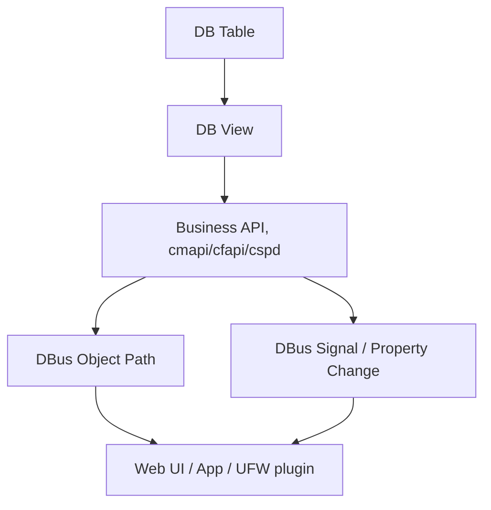

# DB 与 DBus 映射

## 简介

本文整理 ZTE 配置数据库与 DBus 业务对象之间的关系。目标是帮助后续从 Web 页面、DBus 对象、`sendcmd DB` 表三者之间建立索引。

核心结论：

- DBus 不是数据库。
- DBus 是业务 API 和对象通知层。
- DB 表和 View 是运行时配置模型。
- `cspd` 和 `cmapi/cfapi` 类库负责把 DB View 转换成 DBus 对象、属性和信号。

## 映射层级



常见映射链：

```text
DB Table / View
    -> IGD.* ViewName
    -> cspd / cmapi business function
    -> /com/cuc/igd1/... DBus object path
    -> Web 页面或插件
```

## 证据来源

本次静态分析使用：

- `strings -t x bin/cspd`
- `strings -t x lib/libcmapi.so`
- `strings -t x lib/libcfapi.so`
- `strings -t x lib/libdbcspview.so`
- `nm -D bin/cspd`

高置信度证据包括：

- 同一模块中同时出现 `dbAPIGetView` / `dbAPISetView` 和 DBus object path。
- 函数名中出现 `*_dbus_object_sync`、`notify_dbus_*`。
- DB ViewName 和 DBus object path 在同一业务上下文相邻出现。

低置信度证据包括：

- 仅凭名称相似推断，例如 `WLANCfg` 对应 WLAN 页面。
- 仅凭 `IGD.*` 对象名推断 DBus path。

## DBus 不是数据库

DBus 的作用：

- 暴露业务对象。
- 暴露属性读写。
- 发送状态变化信号。
- 连接 Web、App、UFW 容器和宿主业务服务。

数据库的作用：

- 保存运行时配置和状态。
- 提供表、字段、ViewName。
- 提供持久化来源。

因此：

- DBus `GetAll` 读取的值可能来自 DB，也可能来自驱动、运行时状态或缓存。
- DBus `Set` 可能最终写 DB，也可能只是触发业务动作。
- DBus signal 通常只是通知，不一定代表配置已经保存到 Flash。

## 已确认 DBus 相关组件

`cspd` 中存在：

| 字符串/符号 | 说明 |
| --- | --- |
| `StartGdbusServer` | 启动 gdbus server 的线索 |
| `gdbus-server bootfirst` | gdbus server 启动阶段 |
| `CfNotifyDbusSignal` | 发送 DBus signal |
| `Cm_notify_dbus_pro_change` | 通知 DBus 属性变化 |
| `CmWanc_dbus_object_sync` | WAN connection DBus 对象同步 |
| `CmWancppp_dbus_object_sync` | WAN PPP DBus 对象同步 |
| `CmWancDbusPropertyChange` | WAN DBus 属性变化 |
| `notify_dbus_add_*_object` | 动态添加 DBus 对象 |
| `common_notify_dbus_pro_change` | 通用属性变化通知 |

`libcmapi.so` 中存在：

- `CmDbusCallUfwPause`
- `CmDbusCallUfwFramGetall`
- `CmDbusCallUfwUpdateMTDInfo`
- `CmDbusCallUfwSwitch`
- `CmDbusCallUfwRestore`
- `CmDbusCallUfwUpgrade`
- `CmDbusNotifySetOther`
- `GetAll`
- `/com/cuc/ufw1`
- `/com/cuc/igd1/Info/MngPlat`

这说明 DBus 不只是 Web 管理面，也连接 UFW / 插件框架。

## 映射候选表

### 网络和 WAN

| DB Table / View | DBus Object Path | Web / 业务页面 | 置信度 | 说明 |
| --- | --- | --- | --- | --- |
| `WANCPPP` | `/com/cuc/igd1/Info/Network/WANConnectionDb/` | 宽带拨号 / PPPoE | 中 | `cspd` 中有 `CmWancppp_dbus_object_sync` 和该路径 |
| `WANCIP` | `/com/cuc/igd1/Info/Network/WANConnectionDb/` | DHCP / Static WAN | 中 | `CmWanc_dbus_object_sync`，具体 IP/PPP 子类型待验证 |
| `RouteIFInfo` | `/com/cuc/igd1/Transfer/Layer3ForwardingIPv4Config` | IPv4 路由 | 中 | `routeNotifyDbusList` 与该路径相邻 |
| `RouteIFInfo` / IPv6 route | `/com/cuc/igd1/Transfer/Layer3ForwardingIPv6Config` | IPv6 路由 | 中 | `route6NotifyDbusList` 与该路径相邻 |
| `InterfaceInfo` | `/com/cuc/igd1/Info/Network` | 网络接口状态 | 低 | 路径存在，具体字段映射待验证 |
| `LANInfo` / `LAND` | `/com/cuc/igd1/Config/LANHosts` | LAN 主机 / 终端列表 | 中 | `notify_dbus_oper_lanhost_object` 和路径相邻 |

### Wi-Fi

| DB Table / View | DBus Object Path | Web / 业务页面 | 置信度 | 说明 |
| --- | --- | --- | --- | --- |
| `WLANBase` | `/com/cuc/igd1/Config/WLAN/Devices` | Wi-Fi 设备 / Radio | 中 | `IGD.LD1.WLANBase%d`、`/Config/WLAN/Devices` 同时出现 |
| `WLANCfg` | `/com/cuc/igd1/Config/WLAN/Devices/` | SSID / BSS 设置 | 中 | `dbViewWLANCfgFun` 和 WLAN DBus 路径存在 |
| `WLANPSK` | `/com/cuc/igd1/Config/WLAN/Devices/` | Wi-Fi 密码 | 低 | 与 `IGD.LD1.WLAN%d.PSK1` 名称一致，属性映射待验证 |
| `WLANWEP` | `/com/cuc/igd1/Config/WLAN/Devices/` | WEP | 低 | 与 `IGD.LD1.WLAN%d.WEP%d` 名称一致 |
| `WLANWPS` | `/com/cuc/igd1/Config/WLAN/Devices/` | WPS | 低 | 与 `IGD.LD1.WLAN%d.WPS` 名称一致 |
| `WLANWMM` | `/com/cuc/igd1/Config/WLAN/Devices/` | WMM | 低 | 与 `IGD.LD1.WLAN%d.WMM%d` 名称一致 |
| Wi-Fi 状态 | `/com/cuc/igd1/Info/WiFi` | Wi-Fi 信息 / 扫描 | 中 | `com.cuc.igd1.WiFiInfo` 和 `/Info/WiFi` 存在 |

### 管理和平台

| DB Table / View | DBus Object Path | Web / 业务页面 | 置信度 | 说明 |
| --- | --- | --- | --- | --- |
| `DevInfo` | `/com/cuc/igd1/Info/MngPlat` | 管理平台信息 | 低 | `libcmapi.so` 中有该路径，具体 DB 表待验证 |
| `MgtServer` | `/com/cuc/igd1/Info/MngPlat` | TR-069 / 管理平台 | 低 | `MgtServer` 字符串与平台路径存在，但映射未确认 |
| `DevAuthInfo` | 未确认 | Web 登录 / 设备认证 | 低 | DB 字符串确认，DBus path 未确认 |
| `TelnetCfg` | 未确认 | 远程/本地维护入口 | 低 | DB 表确认，DBus path 未确认 |
| `PROCSTAT` | `IGD.PROCSTAT` | 进程状态 | 中 | `libcmapi.so` 中有 `IGD.PROCSTAT` |

### 防火墙、家长控制、转发

| DB Table / View | DBus Object Path | Web / 业务页面 | 置信度 | 说明 |
| --- | --- | --- | --- | --- |
| `FWDMZ` / firewall tables | `/com/cuc/igd1/Config/ParentalControlConfig` | 家长控制 | 低 | `notify_dbus_add_FWPM_process_object` 附近出现 |
| firewall user/process tables | `/com/cuc/igd1/Config/ParentalControlCTR` | 家长控制策略 | 低 | 具体表待验证 |
| traffic forward | `/com/cuc/igd1/Transfer/TrafficForward` | 流量转发 | 中 | `notify_dbus_oper_traffic_forward_object` |
| traffic mirror | `/com/cuc/igd1/Transfer/TrafficMirror` | 镜像 | 中 | `notify_dbus_oper_traffic_mrirror_object` |
| traffic monitor | `/com/cuc/igd1/Transfer/TrafficMonitoringConfig` | 流量监控 | 中 | `com.cuc.igd1.TrafficMonitoringConfig` |
| traffic detail | `/com/cuc/igd1/Transfer/TrafficDetailProcess` | 流量明细 | 中 | `notify_dbus_add_traffic_detail_process_object` |
| fast path | `/com/cuc/igd1/Transfer/FastPathSpeedUp` | 加速 | 中 | `notify_dbus_add_fast_path_speed_up_object` |

### 诊断

| DB Table / View | DBus Object Path | Web / 业务页面 | 置信度 | 说明 |
| --- | --- | --- | --- | --- |
| `Pingdiag` | `/com/cuc/igd1/Diagnostics/IPPing` | Ping 诊断 | 高 | `com.cuc.igd1.IPPingDiagnostics` 和 `IGD.PINGDIAG` 同时出现 |
| TraceRoute | `/com/cuc/igd1/Diagnostics/TraceRoute` | Traceroute | 中 | `com.cuc.igd1.TraceRouteDiagnostics` 和路径存在 |
| AutoDiagnostics | `/com/cuc/igd1/Transfer/AutoDiagnostics/Monitor` | 自动诊断 | 中 | `webNotifyAutoDiaReDnsCheat` 附近出现 |
| SpeedTest | `/com/cuc/igd1/Network/SpeedTestTry` | 测速 | 中 | 路径确认，DB 表可能为 `DlTest`，待验证 |

### 存储

| DB Table / View | DBus Object Path | Web / 业务页面 | 置信度 | 说明 |
| --- | --- | --- | --- | --- |
| `FTPUser` | `/com/cuc/igd1/Storage/FTPServers` | FTP 服务 | 中 | `notify_dbus_add_ftpuser_object` |
| `SambaUser` | `/com/cuc/igd1/Storage/SambaServer/Accounts` | Samba 账号 | 中 | `notify_dbus_add_sambauser_object` |
| USB device | `/com/cuc/igd1/Storage/USB/Devices` | USB 存储 | 中 | `usbNotify_dbus_add_object` |

### 语音

| DB Table / View | DBus Object Path / IGD Object | Web / 业务页面 | 置信度 | 说明 |
| --- | --- | --- | --- | --- |
| `VoIPSIP` | `IGD.SV.VS1.VC` | 语音基础配置 | 低 | IGD 对象存在，DBus path 未确认 |
| `VoIPExt` | `IGD.SV.VS1.EXT` | 语音扩展 | 中 | `GetVPExt:[IGD.SV.VS1.EXT]` |
| `VoIPLine` / `VoIPVPLine` | `IGD.SV.VS1.VP1.VN` | 语音线路 | 低 | 对象名存在，具体表待验证 |
| `VoIPH248*` | `IGD.SV.VS1.VP1.VZ` / `IGD.SV.VS1.VP1.DM` | H.248 | 低 | 对象名存在，映射待验证 |

### UFW / 插件框架

| DB / 业务对象 | DBus Object Path | 说明 |
| --- | --- | --- |
| UFW framework | `/com/cuc/ufw1` | `CmDbusCallUfwPause`、`CmDbusCallUfwSwitch`、`CmDbusCallUfwRestore`、`CmDbusCallUfwUpgrade` |
| Management platform | `/com/cuc/igd1/Info/MngPlat` | `GetPlatformServers` |
| Plugin bundle | `com.cn.plugin` | 插件 bundlecache 相关，具体 DB 表待验证 |

## 为什么 DBus 可能比 sendcmd 更接近真实业务

`sendcmd DB p`：

- 走 DB 调试打印路径。
- 输出为文本。
- 敏感字段可能被 `******` 脱敏。
- 更适合看表是否存在、字段大致结构、运行时值是否改变。

DBus：

- 走业务对象和属性接口。
- 返回 typed value。
- Web UI 可能直接依赖这些值。
- 某些接口为显示或编辑需要返回真实值。
- 可能触发对象添加、删除、属性变化通知。

因此分析 Web 页面时，优先级通常是：

1. 前端页面和 JS。
2. DBus service/object/interface。
3. 业务 API 和 `cmapi/cfapi`。
4. DB View / Table。
5. `sendcmd` 用于验证和补充。

## 验证方法

推荐验证步骤：

1. 使用 `dbus-send`、`gdbus` 或实机 DBus introspection 列出 `/com/cuc/igd1` 下对象。
2. 对目标对象执行 `org.freedesktop.DBus.Properties.GetAll`。
3. 在 Web 页面修改同一配置。
4. 同时观察 DBus signal 和 `sendcmd 1 DB p <Table>`。
5. 如果 DBus 属性变化和 DB 字段变化一致，再提升映射置信度。

## 待验证

- 每个 DBus object path 的具体 interface 名称。
- 每个 DBus 属性到 DB field 的一一映射。
- DBus `Set` 后是否立即 `dbAPISave`。
- 哪些 DBus 值来自 DB，哪些来自驱动或运行时状态。
- Web 页面是否全部走 DBus，还是部分走 CGI / 私有 IPC。

更新时间：2026-07-13
