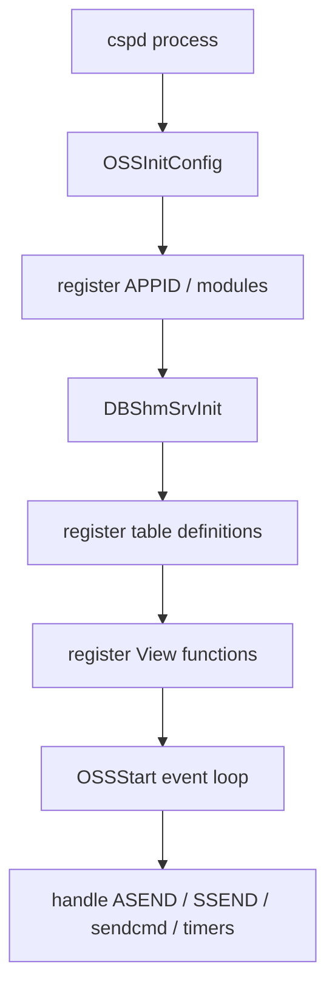
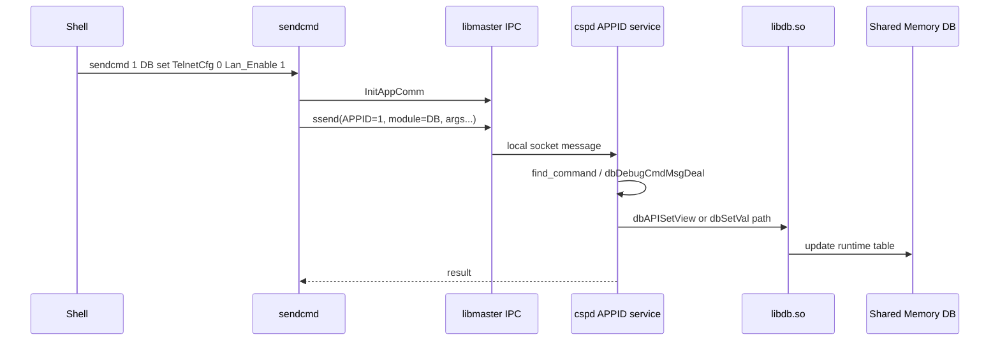

# cspd 分析

## 定位

`cspd` 是 ZTE Buildroot 光猫中的核心业务服务进程之一。在 G7615 中，它同时表现出以下角色：

- 配置数据库服务端。
- 多业务模块宿主进程。
- `sendcmd` 命令处理目标之一。
- DBus 通知和对象同步的业务发起方。
- 配置保存、恢复、升级迁移、区域定制处理的执行者。
- 产品表、业务表、View 扩展的注册者。

因此，`cspd` 不应被理解成单一 daemon。更准确的说法是：它是 ZTE CSP 业务框架中的大型业务容器，DB 是其中最核心的子系统之一。

## 分析方法

本次只做静态分析：

- `file`
- `nm -D`
- `objdump -p`
- `objdump -R`
- `strings -t x`

未执行目标 ARM 程序，未修改二进制。

## ELF 画像

| 项目 | 结果 |
| --- | --- |
| 文件 | `bin/cspd` |
| ELF | 32-bit LSB executable |
| 架构 | ARM EABI5 |
| Interpreter | `/lib/ld-linux.so.3` |
| Kernel ABI | for GNU/Linux 4.19.0 |
| BuildID | `d591141da8459cc2f39fc8d6ace3a020c0d855a1` |
| 状态 | stripped，但保留大量动态符号 |

`cspd` 的依赖非常多，说明它不是一个小工具，而是业务中心。

关键依赖分组：

| 依赖 | 说明 |
| --- | --- |
| `libdb.so` | 配置数据库核心库 |
| `libdbcspview.so` | DB View 扩展库 |
| `libcmapi.so` / `libcfapi.so` | 配置管理 API / 配置框架 API |
| `lib*cmapi.so` / `lib*cfapi.so` | WAN、LAN、DNS、DHCP、QoS、防火墙、路由、隧道等业务 API |
| `liboss.so` / `libcommfun.so` | ZTE OSS/消息/通用函数框架 |
| `libhardcode.so` | 硬编码参数、个性化参数、密钥或产品参数来源 |
| `libssl.so.1.0.0` / `libcrypto.so.1.0.0` | 加密、证书、升级或远程业务相关能力 |
| `libjson-c.so` | JSON 业务消息 |
| `libtagparamuserapi.so` | tagparam / flash 个性化参数 |
| `libleduserapi.so` / `libkeyuserapi.so` | LED、按键业务 |

## 为什么说 cspd 是 DB Server

`objdump -R bin/cspd` 显示 `cspd` 直接调用：

| 符号 | 说明 |
| --- | --- |
| `DBShmSrvInit` | DB 服务端共享内存初始化 |
| `dbAPIGetView` | 读取 View |
| `dbAPISetView` | 写入 View |
| `dbAPIAddView` | 新增 View |
| `dbAPIDelView` | 删除 View |
| `dbAPILstView` | 列出 View |
| `dbAPIQryView` | 查询 View |
| `dbAPISave` | 保存 DB |
| `dbAPIGetUsrPath` | 获取用户配置路径 |
| `dbAPIGetDefPath` | 获取默认配置路径 |
| `dbAPIGetUsrBackPath` | 获取备份配置路径 |
| `dbcGetView` / `dbcSetView` / `dbcAddView` / `dbcQryView` | 更底层 View 操作 |

其中 `DBShmSrvInit` 是关键证据。普通 DB 客户端一般只需要 `DBShmCliInit` 或 `dbAPI*`，而 `cspd` 导入服务端初始化函数，说明它负责创建或初始化共享内存 DB。

## 启动和业务框架

`cspd` 导入：

- `OSSInitConfig`
- `OSSStart`
- `SELF`
- `SENDER`
- `ASEND`
- `SSEND`
- `find_command`

这些符号说明它运行在 ZTE OSS 消息框架之上。典型模型是：



`cspd` 字符串中可见：

- `dbAPIMsgDeal`
- `dbDebugCmdMsgDeal`
- `dbNomalStateDeal`
- `_dbTimeoutSave`
- `dbSaveTimerDelay`
- `dbTimer2Check`

这说明 DB 子系统既处理同步 API 消息，也有定时保存和状态机。

## sendcmd 为什么最终能调用 cspd

`sendcmd` 不是直接链接 `libdb.so` 的 DB 修改工具。它依赖 `libmaster.so`：

- `InitAppComm`
- `ssend`
- `FreeAppComm`

`libmaster.so` 字符串显示：

- `/var/tmp/`
- `socket (%s) in using`
- `bind socket (%s) error`
- `APPID[0x%08lx] recvfrom EVENT[0x%04x] to APPID[0x%08lx]`
- `APPID[0X%08lX] send EVENT[0X%04X] to APPID[0X%08lX]`

`sendcmd` 的帮助字符串显示：

```text
sendcmd :
  -pc show        : show all APPID info
  -pc             : show command list of program manage
  [APPID]         : show command list of APPID program
```

因此工作机制是：



已确认事实：

- `sendcmd` 通过 `libmaster.so` 的本地 socket/APPID 消息框架发送命令。
- `cspd` 中存在 DB 调试命令处理入口 `dbDebugCmdMsgDeal`。
- `cspd` 中存在 `p [tablename]`、`set [tablename][rownum][dm][dmvalue]`、`saveasy`、`reject` 等 DB 命令字符串。

待验证：

- `APPID=1` 到 `cspd` 的注册表或运行时映射尚未从当前静态文件中完整恢复。
- 具体消息头结构、事件 ID 和命令参数结构需要结合 `libmaster.so` 反编译或运行时抓取。

## DB 命令处理

`cspd` 的 DB 调试命令集包括：

| 命令 | 说明 |
| --- | --- |
| `all` | 打印所有表 |
| `p [tablename]` | 打印表信息 |
| `pv` | 打印 View 信息 |
| `rreset` | 远程恢复 |
| `lreset` | 本地恢复 |
| `lplreset` | 长按本地恢复 |
| `debug [0/1]` | 调试关键参数文件，不重启 |
| `set [tablename][rownum][dm][dmvalue]` | 设置表字段值 |
| `addr [tablename]` | 给表增加 Row |
| `delr [tablename][rownum]` | 删除表中 Row |
| `pti [tablename]` | 打印表详细信息 |
| `fc [bin-file-name]` | 压缩用户配置成 bin |
| `fuc [bin-file-name]` | 解压 bin 成用户配置 |
| `bckinterval [0]` | 设置备份间隔，`0` 表示同步 |
| `bcktype [0/1/2]` | 备份类型，`0` 不备份，`1` 全量，`2` 部分 |
| `backup` | 立即备份 |
| `partrst [ModName]` | 模块级部分恢复 |
| `prtpdt` | 打印产品接口 |
| `pcl` | 打印配置列表 |
| `pvf [ViewID]` | 打印 View 函数 |
| `pshm` | 打印共享内存池信息 |
| `pstate` | 打印状态机信息 |
| `saveasy` | 异步保存 |
| `dbStati` | 显示或清空 DB 统计 |
| `reject` | 拒绝 DB 保存 |
| `unreject` | 取消拒绝 DB 保存 |

这组命令说明 DB 子系统的设计明显面向研发、产测和现场维护，不只是 Web 后端。

## 配置文件路径和加密个性化

`cspd` 中确认存在：

| 字符串 | 说明 |
| --- | --- |
| `/userconfig/cfg/db_user_cfg.xml` | 用户配置包 |
| `/userconfig/cfg/db_default_cfg.xml` | 默认配置包 |
| `/userconfig/cfg/db_backup_cfg.xml` | 备份配置包 |
| `/var/tmp/db_user_cfg.xml` | 临时解密或中间用户配置 |
| `/var/tmp/db_user_cfg.bin` | 临时二进制用户配置 |
| `/var/tmp/db_reload_cfg.xml` | reload 中间配置 |
| `/var/tmp/debug-decry-cfg` | 调试解密输出 |
| `/var/tmp/sign-cfg` | 签名或验签中间文件 |
| `DBDefAESCBCKey` | 默认 AES CBC key hardcode 项 |
| `DBDefAESCBCIV` | 默认 AES CBC IV hardcode 项 |
| `CSP_USER_AESCBCENCRY_KEY` | 用户配置 AES key hardcode 项 |
| `CSP_USER_AESCBCENCRY_IV` | 用户配置 AES IV hardcode 项 |

这说明配置文件处理不是 `libdb.so` 单独完成，而是 `cspd` 结合 hardcode、tagparam、加密库和 DB 序列化共同完成。

## 产品表和 Schema 注册

`cspd` 导出了 194 个 `dbDef*` 符号。例如：

- `dbDefTelnetCfg`
- `dbDefDevInfo`
- `dbDefMgtServer` 未以该符号形式出现，但字符串中有 `MgtServer`
- `dbDefWANCPPP`
- `dbDefWLANBase`
- `dbDefWLANCfg`
- `dbDefWLANPSK`
- `dbDefVoIPSIPServer`
- `dbDefGPONCFG`
- `dbDefOMCICFG`
- `dbDefQOSQueue`
- `dbDefDHCPSHostCfg`

这些函数很可能负责：

- 创建表。
- 创建字段。
- 设置默认值。
- 设置字段类型、主键、是否保存、最大行数。
- 注册产品差异化默认值。

自动提取结果见：

- [cspd_dbdef_tables.csv](/Users/builduser/tmp/g7615/all/docs/03-Vendors/ZTE/Architecture/artifacts/cspd_dbdef_tables.csv)

## View 注册和扩展

`cspd` 和 `libdbcspview.so` 中可见大量 View 函数：

- `dbViewWANCPPPFun`
- `dbAddWANCPPPView`
- `dbDelWANCPPPView`
- `dbSetWANCPPPView`
- `dbGetWANCPPPView`
- `dbLstWANCPPPView`
- `dbQryWANCPPPView`

这些函数说明 View 是独立于表的业务访问层。一个 View 可能对应一个表，也可能组合多个表。

自动提取结果见：

- [db_view_operations.csv](/Users/builduser/tmp/g7615/all/docs/03-Vendors/ZTE/Architecture/artifacts/db_view_operations.csv)

## DBus 关系

`cspd` 字符串中存在大量 DBus 通知和对象路径：

- `StartGdbusServer`
- `gdbus-server bootfirst`
- `CfNotifyDbusSignal`
- `Cm_notify_dbus_pro_change`
- `CmWanc_dbus_object_sync`
- `CmWancppp_dbus_object_sync`
- `/com/cuc/igd1/Config/WLAN/Devices`
- `/com/cuc/igd1/Info/WiFi`
- `/com/cuc/igd1/Info/Network/WANConnectionDb/`
- `/com/cuc/igd1/Transfer/Layer3ForwardingIPv4Config`
- `/com/cuc/igd1/Config/LANHosts`
- `/com/cuc/igd1/Diagnostics/IPPing`

这说明 `cspd` 不是被 DBus 替代，而是在很多场景中作为业务状态来源和 DBus 对象同步发起方。

典型关系：


## Plugin / Module 支持

`cspd` 中有以下插件和模块线索：

- `CuInformLoader plugin exe end`
- `CuInformLoader plugin exe failure`
- `/usr/plugin/bundlecache/`
- `/usr/plugin/bundlecache/%s/bundle.info`
- `/usr/plugin/bundlecache/prebundle`
- `com.cn.plugin`
- `ModuleContrl`
- `Module Pid`
- `Add Module(%lu) attention WAND_ID(%s) and WAND_Type(%d)`

结论：

- `cspd` 支持模块化业务，不只是固定 DB 服务。
- 插件或预置 bundle 可能通过 DBus、消息框架或配置数据库参与业务。
- 插件是否能直接访问 DB，需要逐个插件和 API 权限验证。

## 保存与状态机

`cspd` 中保存相关字符串：

- `_dbTimeoutSave`
- `dbSaveTimerDelay`
- `dbTimer2Check`
- `dbTimer2Check, need save !`
- `Save(%d)CfgSav(%d)iRet(%d)`
- `db web restore default`
- `db rms restore factory`

说明：

- DB 保存不是只有手动 `sendcmd 1 DB save`。
- Web 恢复默认、RMS 远程恢复、重启前保存、定时器超时保存都可能触发保存。
- `reject` / `unreject` 会影响保存状态，适合调试但不应作为常规配置手段。

## 设计思想

`cspd` 的设计可以概括为：

- 一个进程承载多个高内聚业务模块，降低跨进程通信成本。
- 通过 OSS APPID 消息框架接入 `sendcmd`、模块消息和同步请求。
- 通过 `libdb.so` 统一配置读写。
- 通过 `libdbcspview.so` 和内部 `dbDef*` 函数提供表/视图 schema。
- 通过 DBus 把运行时对象同步给 Web、UFW、插件和外部管理组件。
- 通过定时器、状态机和 hardcode/tagparam 完成保存、恢复、升级迁移和个性化。

## 待验证

- `APPID=1` 到 `cspd` 的精确注册来源。
- `sendcmd` 消息结构体和 `EVENT` 编号。
- `find_command` 的命令表注册结构。
- `DB` 命令从文本参数到 `dbAPI*` 的准确调用路径。
- 插件调用 DB 的权限边界。
- `StartGdbusServer` 是否在 `cspd` 内启动独立 DBus 服务，还是调用外部 `gdbus-server`。

## 参考

- `bin/cspd`
- `bin/sendcmd`
- `lib/libmaster.so`
- `lib/libdb.so`
- `lib/libdbcspview.so`
- [db_dynamic_symbols.csv](/Users/builduser/tmp/g7615/all/docs/03-Vendors/ZTE/Architecture/artifacts/db_dynamic_symbols.csv)

更新时间：2026-07-13
