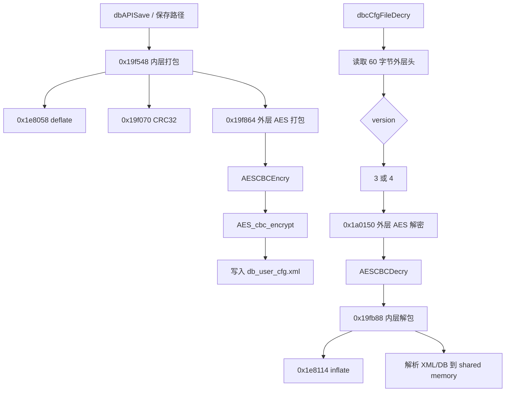

# db_user_cfg.xml 文件格式

本文记录 ZTE G7615 `db_user_cfg.xml` 类配置数据库容器格式。结论来源于样本文件、
`cspd`/`libhardcode.so` 反汇编、运行态 `cspd` 内存和离线解包验证。

状态说明：

- **已验证**：有样本、代码路径或运行态内存证据支持。
- **待验证**：字段存在或行为可见，但完整语义仍需更多样本或写回测试确认。

## 容器层次

version 3/4 文件的已验证结构如下：

```text
db_user_cfg.xml
└── 外层 AES 容器
    ├── 0x00..0x3b  60 字节外层头
    ├── 12 字节外层块头
    └── AES-CBC 密文
        └── 内层 CRC/zlib 容器
            ├── 0x00..0x3b  60 字节内层头
            ├── 12 字节内层块头
            └── zlib/deflate 数据
                └── XML 配置数据库文本
```

## 外层文件头

已验证字段：

| 偏移 | 大小 | 含义 |
|---:|---:|---|
| `0x00` | 4 | Magic，大端 `0x01020304` |
| `0x04` | 4 | 容器版本。样本中出现 `3` 和 `4` |
| `0x08` | 52 | 保留字段；已观察样本中为 0 |

代码按小端加载首 word，并与 `0x04030201` 比较，因此磁盘字节序是
`01 02 03 04`。

## 外层块头

已验证字段：

| 偏移 | 大小 | 含义 |
|---:|---:|---|
| `+0x00` | 4 | AES padding 前的明文长度 |
| `+0x04` | 4 | 已存储密文长度 |
| `+0x08` | 4 | continuation/next 字段；`0` 表示最后一块 |

块 payload 紧跟 12 字节块头。加密时每块补齐到 16 字节边界；解密时不按
padding 内容裁剪，而是只写出块头记录的明文长度。

已观察样本：

| 文件 | 大小 | 版本 | 外层块 |
|---|---:|---:|---|
| `userconfig/cfg/db_user_cfg.xml` | 41272 | 4 | `(plain=41198, stored=41200, next=0)` |
| `userconfig/cfg/db_backup_cfg.xml` | 41272 | 4 | 与旧 user 样本一致 |
| live `db_user_cfg.xml` | 46264 | 4 | `(plain=46190, stored=46192, next=0)` |
| live `db_backup_cfg.xml` | 45240 | 4 | `(plain=45156, stored=45168, next=0)` |
| `userconfig/cfg/db_default_cfg.xml` | 6328 | 3 | `(plain=6251, stored=6256, next=0)` |
| `etc/db_default_cfg.xml` | 5352 | 3 | `(plain=5275, stored=5280, next=0)` |

已检查的 `/etc/db_default*_cfg.xml` 文件均使用相同 magic 和 version `3`。

## 已验证 key/iv

默认配置：

- key string：`PON_Dkey`
- IV string：`PON_DIV`
- 验证结果：可解 `userconfig/cfg/db_default_cfg.xml`。

用户配置和备份配置：

- tag `0x0720`：`cKZF6ufRy2ecKZHfYPh7FfP9cUDPzbuE`
- cspd 调用：`CspGetMD5(seed, 33, out16)`
- 完整 MD5 hex：`e64c0347a55b5f2423fa487c3e646ac9`
- 运行态 `cspd` 内存中的有效 key string：
  `e64c0347a55b5f2423fa487c3e646ac`
- 运行态 `cspd` 内存中的有效 IV string：
  `667b02a85c61c786def4521b060265e`
- 验证结果：可解旧样本和 live dump 中的 `db_user_cfg.xml`、
  `db_backup_cfg.xml`，并通过 `--strict-crc`。

version 4 fallback slot 存在，但本样本未使用：

- fallback key string：`8cc72b05705d5c46f412af8cbed55aa`
- fallback IV string：`667b02a85c61c786def4521b060265e`
- 验证结果：未命中当前 user/backup 样本。

注意：`cspd` key/iv slot 间距为 33 字节。运行态内存显示 32 字符 hex 值实际以
31 个可见字符加 `NUL` padding 的形式参与 `SHA256(key_string)` /
`SHA256(iv_string)` 派生。

## 内层文件头

部分字段已验证：

| 偏移 | 大小 | 含义 | 状态 |
|---:|---:|---|---|
| `0x00` | 4 | Magic `0x01020304` | 已验证 |
| `0x04` | 4 | 内层版本/标志；样本中为 `0` | 待验证 |
| `0x08` | 4 | XML 解压后总长度 | 已验证 |
| `0x0c` | 4 | 第一块之后的 next/偏移相关字段 | 待验证 |
| `0x10` | 4 | split block size，通常为 `65536` | 已验证 |
| `0x14` | 4 | content CRC32 | 已验证 |
| `0x18` | 4 | header CRC32，覆盖前 24 字节 | 已验证 |
| `0x1c` | 32 | 保留/未知 | 待验证 |

CRC 例程以 `0xffffffff` 初始化，最终存储按位取反后的结果。

## 内层块头

部分字段已验证：

| 偏移 | 大小 | 含义 | 状态 |
|---:|---:|---|---|
| `+0x00` | 4 | 解压后块长度 | 已验证 |
| `+0x04` | 4 | 压缩 payload 长度 | 已验证 |
| `+0x08` | 4 | continuation/next 字段 | 已验证为循环控制；完整语义待验证 |

## 算法

AES：

- 模式：AES-CBC，由 `libhardcode.so` 中 `AESCBCEncry`/`AESCBCDecry` 调用
  OpenSSL `AES_cbc_encrypt` 验证。
- Key size：256 bit，由 `AES_set_encrypt_key(..., 256, ...)` 验证。
- Key 派生：`SHA256(key_string)`。
- IV 派生：`SHA256(iv_string)` 前 16 字节。
- Padding：zero padding。若输入长度已 16 字节对齐，加密仍会追加一个完整零块。
- 解密裁剪：依赖块头明文长度，不使用 PKCS#7。

压缩：

- 格式：zlib/deflate。
- 依据：`cspd` deflate/inflate 调用路径和内置 zlib 1.1.3 字符串。
- 未发现 gzip、LZ4、LZO、LZMA、XZ 参与该路径的证据。

校验：

- 外层 magic 校验：存在。
- 内层 magic 校验：存在。
- 内层 header CRC32：存在。
- 内层 content CRC32：存在，覆盖压缩 payload 流。
- 文件级 MD5/SHA1/SHA256 完整性校验：该路径未发现。SHA256 只用于 AES
  key/iv material 派生。

## 调用关系



## 待验证项

- 内层头 `0x04` 的完整语义。
- 内层头 `0x0c` 与块 `next` 字段的精确定义。
- `dbpack.py` 生成文件在设备侧的写回接受情况。
