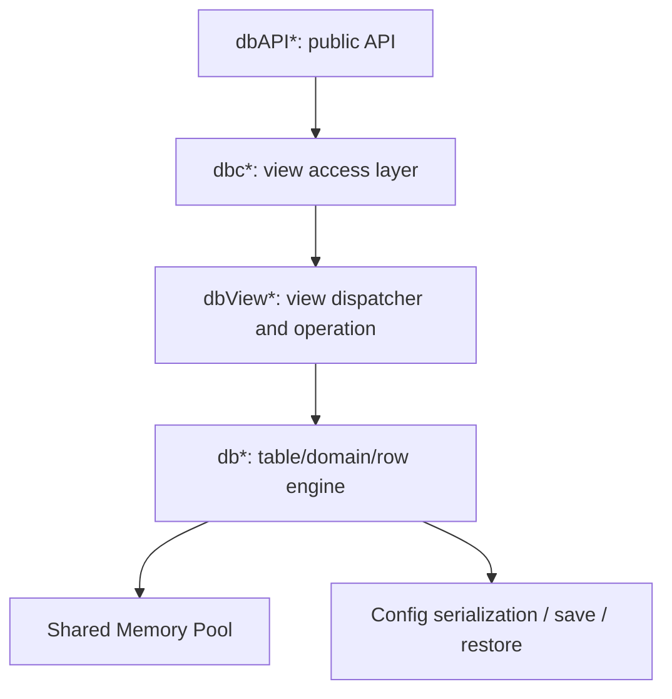
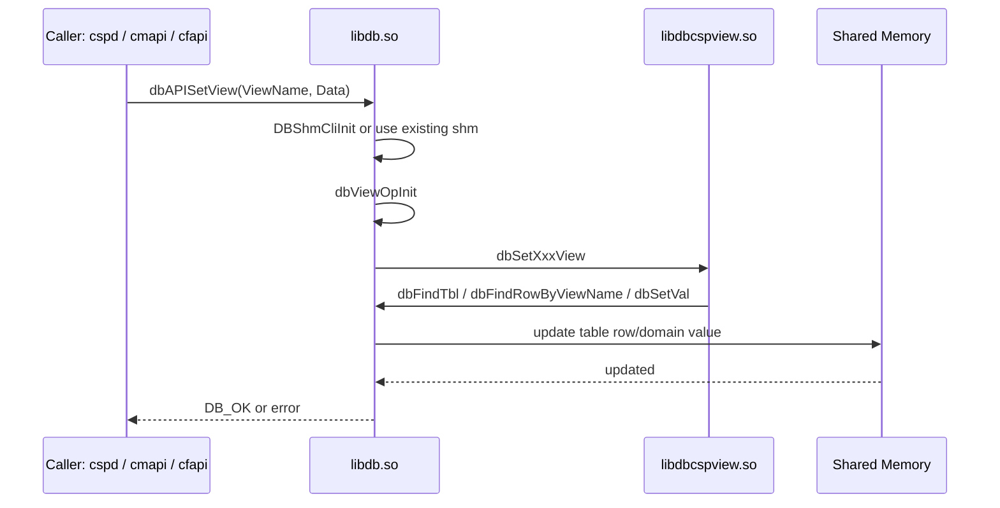
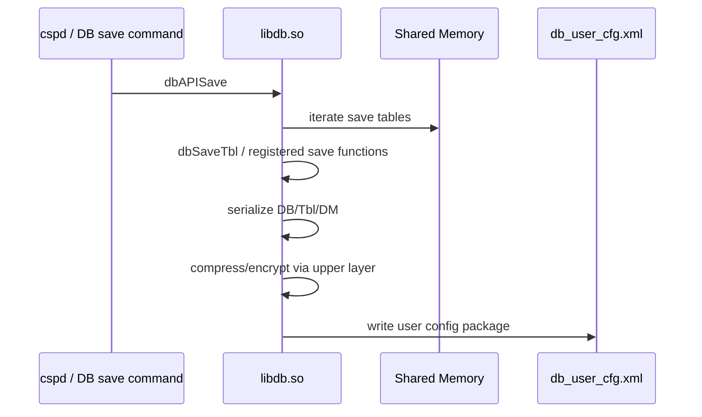

# libdb.so 分析

## 定位

`libdb.so` 是 ZTE Buildroot 光猫配置数据库的核心运行库。它不是一个普通配置文件解析库，而是同时承担以下职责：

- 对外提供 `dbAPI*` 配置访问接口。
- 初始化 DB 服务端和客户端的共享内存访问。
- 管理 Table、Domain、Row、View 这些内部数据结构。
- 提供 View 的增删改查封装。
- 提供保存、恢复、压缩、路径查询等持久化接口。
- 对部分敏感字段执行打印脱敏。
- 提供 AES 基础实现或被上层持久化流程复用的加解密能力。

在 G7615 中，`cspd`、`libdbcspview.so`、`libcmapi.so`、`libcfapi.so` 等组件都会直接或间接围绕 `libdb.so` 工作。

## 分析方法

本次只做静态分析，不执行目标 ARM 程序，不修改目标程序。

使用工具：

- `file`
- `nm -D`
- `objdump -p`
- `objdump -R`
- `strings -t x`

本环境未提供：

- `readelf`
- `llvm-readelf`
- `radare2`
- Ghidra / IDA 交互工程

因此本文不声称恢复了完整控制流，只基于 ELF 元数据、动态符号、重定位表、字符串和相邻字符串关系做架构分析。

生成的结构化索引：

- [db_dynamic_symbols.csv](/Users/builduser/tmp/g7615/all/docs/03-Vendors/ZTE/Architecture/artifacts/db_dynamic_symbols.csv)
- [cspd_dbdef_tables.csv](/Users/builduser/tmp/g7615/all/docs/03-Vendors/ZTE/Architecture/artifacts/cspd_dbdef_tables.csv)
- [db_view_operations.csv](/Users/builduser/tmp/g7615/all/docs/03-Vendors/ZTE/Architecture/artifacts/db_view_operations.csv)
- [db_string_inventory.csv](/Users/builduser/tmp/g7615/all/docs/03-Vendors/ZTE/Architecture/artifacts/db_string_inventory.csv)
- [db_schema_candidates.json](/Users/builduser/tmp/g7615/all/docs/03-Vendors/ZTE/Architecture/artifacts/db_schema_candidates.json)

## ELF 画像

G7615 中的 `libdb.so`：

| 项目 | 结果 |
| --- | --- |
| 文件 | `lib/libdb.so` |
| ELF | 32-bit LSB shared object |
| 架构 | ARM EABI5 |
| 状态 | stripped，但保留动态符号 |
| BuildID | `506aa00c8910ea18cae1f0f90557d3e957d37202` |
| 直接依赖 | `libc.so.6` |
| 运行时关键依赖 | `shmget`、`shmat`、`shmctl`、`dlopen`、`dlsym`、`SSEND` |

`objdump -p lib/libdb.so` 显示它自身依赖很少，很多能力通过调用者和动态加载的视图库完成。这符合它作为“核心库”的设计：核心 DB 逻辑在 `libdb.so`，具体业务 View 扩展在 `libdbcspview.so` 和 `cspd` 等模块中。

## 总体设计

`libdb.so` 可以理解为四层：



其中：

- `dbAPI*` 是业务模块调用的稳定入口。
- `dbc*` 是对 View 操作的中间封装。
- `dbView*` 负责把 ViewName、参数、查询条件分派到具体 View 函数。
- `dbCreateTbl`、`dbCreateDomainNew`、`dbAddRow`、`dbSetVal` 等函数构成底层表引擎。
- `DBShmSrvInit` / `DBShmCliInit` 建立共享内存 DB。

## 关键接口分组

### Public API

| 函数 | 推测职责 |
| --- | --- |
| `dbAPIAddView` | 新增一个 View 实例，通常对应新增一行或一个对象 |
| `dbAPIDelView` | 删除 View 实例 |
| `dbAPISetView` | 设置指定 View 的配置 |
| `dbAPIGetView` | 获取指定 View 的配置 |
| `dbAPILstView` | 列出某类 View 实例 |
| `dbAPIQryView` | 按条件查询 View |
| `dbAPIGetValByRow` | 按表、行、字段读取底层值 |
| `dbAPIGetTblRowCount` | 获取表行数 |
| `dbAPIGetViewInfo` | 获取 View 元信息 |
| `dbAPISave` | 触发 DB 保存 |
| `dbAPIRestore` | 恢复配置 |
| `dbAPIRestoreLocal` | 本地恢复配置 |
| `dbAPIRestoreRemote` | 远程恢复配置 |
| `dbAPICompress` | 压缩用户配置包或生成配置包 |
| `dbAPIGetDefCfg` | 获取默认配置内容或路径相关信息 |
| `dbAPIGetUsrCfg` | 获取用户配置内容或路径相关信息 |
| `dbAPIGetDefPath` | 获取默认配置路径 |
| `dbAPIGetUsrPath` | 获取用户配置路径 |
| `dbAPIGetUsrBackPath` | 获取备份配置路径 |
| `dbAPIDelTmpUsrCfg` | 删除临时用户配置 |
| `dbAPIDelUsrCfg` | 删除用户配置 |
| `dbAPIFlashCfgEnd` | 查询或通知配置写 Flash 结束 |
| `dbAPITimeOut` | 设置或处理 DB API 超时 |

注意：

- 函数参数结构未在本次静态分析中完整恢复。
- 表中职责来自函数名、字符串和调用关系推断，需要 GPL 源码或 Ghidra 进一步验证。

### Shared Memory API

| 函数 | 推测职责 |
| --- | --- |
| `DBShmOpenLib` | 打开 `libdbcspview.so`，加载 View 扩展函数 |
| `DBShmSrvInit` | 服务端初始化共享内存、表头、View 头、hash、内存池 |
| `DBShmCliInit` | 客户端连接共享内存 |
| `ossShmPoolSrvInit` | 初始化服务端共享内存池 |
| `ossShmPoolCliInit` | 初始化客户端共享内存池视图 |
| `ShmPoolLock` | 共享内存池锁 |
| `ShmPoolUnlock` | 共享内存池解锁 |

`objdump -R lib/libdb.so` 确认 `libdb.so` 使用：

- `shmget`
- `shmat`
- `shmctl`

这说明共享内存不是文档层面的推测，而是二进制依赖层面的事实。

### Table / Domain / Row Engine

| 函数 | 推测职责 |
| --- | --- |
| `dbCreateTbl` | 创建表定义 |
| `dbCreateDomainNew` | 创建字段定义 |
| `dbCreateOuterKey` | 创建外键或跨表关联 |
| `dbFindTbl` | 查找表 |
| `dbFindDmByName` | 查找字段 |
| `dbFindRowByNo` | 按行号查找行 |
| `dbAddRow` | 添加行 |
| `dbDelRow` | 删除行 |
| `dbDelRowFromTail` | 从表尾删除行 |
| `dbSetDmDefault` | 设置字段默认值 |
| `dbSetVal` | 设置字段值 |
| `dbSetValByRowNo` | 按行号设置字段值 |
| `dbSetValComm` | 通用设置字段值 |
| `dbSetValCommByRowNo` | 通用按行设置字段值 |
| `dbGetVal` | 获取字段值 |
| `dbGetValName` | 获取字段名称或字符串化值 |
| `dbGetValComm` | 通用获取字段值 |
| `dbCheckVal` | 校验字段值 |
| `dbValToStr` | 字段值转字符串 |
| `dbClearTbl` | 清空单表 |
| `dbClearAllTbl` | 清空所有表 |
| `dbPrintTbl` | 打印表 |
| `dbPrintAllTbl` | 打印所有表 |
| `dbPti` | 打印表的详细信息 |

`libdb.so` 中同时存在字段类型处理函数，例如：

- `StrToIP`
- `StrToIPv6`
- `StrToMAC`
- `IPToStr`
- `IPv6ToStr`
- `MACToStr`

这说明 DB 字段并不是全按字符串处理，而是有内部类型系统。

### View Layer

| 函数 | 推测职责 |
| --- | --- |
| `dbCreatViewFun` | 创建或注册 View 函数表 |
| `dbViewOpInit` | 初始化 View 操作上下文 |
| `dbSingleViewOpInit` | 初始化单实例 View 操作 |
| `dbViewPrmOp` | 处理 View 参数和字段参数 |
| `dbViewCommOp` | 通用 View 操作 |
| `dbViewNameQryOp` | 按 ViewName 查询 |
| `dbViewGetName` | 获取 ViewName |
| `dbViewGetAvailableName` | 获取可用 ViewName |
| `dbViewInsertRowByName` | 按 ViewName 插入行 |
| `dbViewGetList` | 获取 View 列表 |
| `dbViewGetQryList` | 获取查询结果列表 |
| `dbViewSetOpResult` | 设置 View 操作结果 |
| `dbViewGetOpResult` | 获取 View 操作结果 |
| `dbViewClrOpResult` | 清空 View 操作结果 |
| `dbViewMgrPrint` | 打印 View 管理信息 |

这解释了为什么 Web / DBus / TR-069 常用的是 `IGD.LD1.WLAN1`、`IGD.PINGDIAG.CFG1` 这类对象路径式字符串，而底层保存的是表、行、字段结构。

## 共享内存内部线索

`nm -D lib/libdb.so` 中存在以下全局对象：

| 符号 | 推测含义 |
| --- | --- |
| `g_ptTblHead` | 表头指针 |
| `g_ptViewHead` | View 头指针 |
| `g_pTblShmUse` | 表共享内存使用状态 |
| `g_pViewShmUse` | View 共享内存使用状态 |
| `g_pAddShmUse` | 新增操作共享内存使用状态 |
| `g_pTblHash` | 表 hash |
| `g_pViewHash` | View hash |
| `g_ptViewId` | View ID 表 |
| `g_szViewKey` | View hash 或查询 key |
| `g_bDBInited` | DB 是否初始化 |
| `g_pSetCount` | Set 统计 |
| `g_pGetCount` | Get 统计 |
| `g_pListCount` | List 统计 |

同时存在 `bget`、`brel`、`bpool`、`bstats` 这类内存池函数，说明共享内存内部不是简单结构体数组，而是有池化分配器。

## 加密与脱敏

`libdb.so` 导出：

- `AES_encode`
- `AES_decode`
- `init_AES`
- `end_AES`
- `cipher`
- `inv_cipher`

`cspd` 另有：

- `dbcCfgFileEncry`
- `dbcCfgFileDecry`
- `AESCBCEncry`
- `AESCBCDecry`
- `DBDefAESCBCKey`
- `DBDefAESCBCIV`

因此可以确认：

- 配置包处理链中存在 AES 相关逻辑。
- G7615 的 `db_user_cfg.xml` 不是明文 XML。
- 具体 CBC 封装、key/iv 来源和头格式主要在 `cspd` 或其他加密库中，还需要进一步反编译或 GPL 源码验证。

`libdb.so` 中存在：

```text
<DM name="%s" val="******"/>
```

这说明 DB 打印路径会对某些字段脱敏。结合字符串中出现的敏感表和字段，如 `TelnetCfg`、`MgtServer`、`DevAuthInfo`、`PassWord`、`AuthPassword`、`PreSharedKey`，可以解释为什么 `sendcmd 1 DB p ...` 可能只显示星号。

## 与 libdbcspview.so 的关系

`libdb.so` 中有：

- `DBShmOpenLib`
- `dlopen`
- `dlsym`
- 字符串 `libdbcspview.so`

`libdbcspview.so` 中则集中导出了大量具体 View 操作函数：

- `dbViewWANCPPPFun`
- `dbAddWANCPPPView`
- `dbDelWANCPPPView`
- `dbSetWANCPPPView`
- `dbGetWANCPPPView`
- `dbLstWANCPPPView`
- `dbQryWANCPPPView`

这说明 `libdb.so` 是核心引擎，`libdbcspview.so` 是一组可动态加载的 View 适配层。它们的分工大致是：

| 组件 | 职责 |
| --- | --- |
| `libdb.so` | 通用表引擎、共享内存、API、View 管理框架 |
| `libdbcspview.so` | 具体业务 View 的增删改查适配 |
| `cspd` | 注册产品表、驱动业务状态机、处理命令、保存恢复 |

## 读写数据流



## 保存数据流



## 设计思想

`libdb.so` 的设计目标不是简单保存配置，而是把多业务系统统一到一个运行时数据模型：

- 表结构适合持久化和版本迁移。
- View 结构适合 Web、TR-069、DBus、业务模块使用。
- 共享内存适合多进程快速读写。
- 保存和恢复集中在 DB 层，避免各模块自己写 Flash。
- 脱敏和字段类型校验集中处理，降低业务模块重复实现。

## 待验证

以下内容仍需 GPL 源码、Ghidra/IDA 或实机动态调试确认：

- `dbAPI*` 的准确参数结构。
- 共享内存 key、权限、大小和布局。
- Table / Domain / Row 结构体字段。
- ViewName 到 Table Row 的完整映射规则。
- 保存时的完整序列化、压缩、签名、加密顺序。
- `DBShmOpenLib` 对 `libdbcspview.so` 的加载时机和失败策略。

## 参考

- `lib/libdb.so`
- `bin/cspd`
- `lib/libdbcspview.so`
- `docs/03-Vendors/ZTE/Architecture/artifacts/*.csv`
- `docs/03-Vendors/ZTE/Architecture/artifacts/db_schema_candidates.json`

更新时间：2026-07-13
