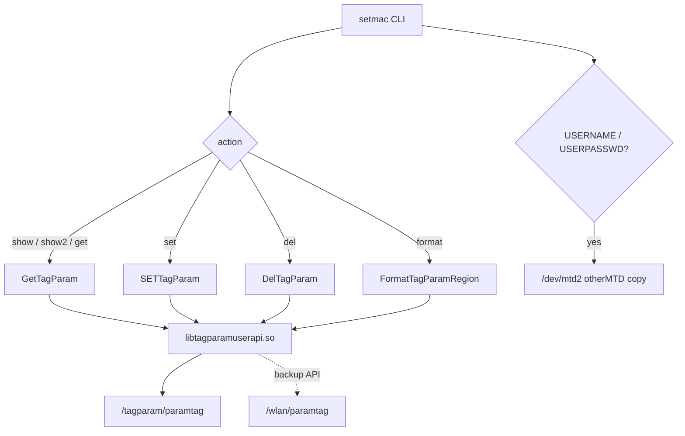
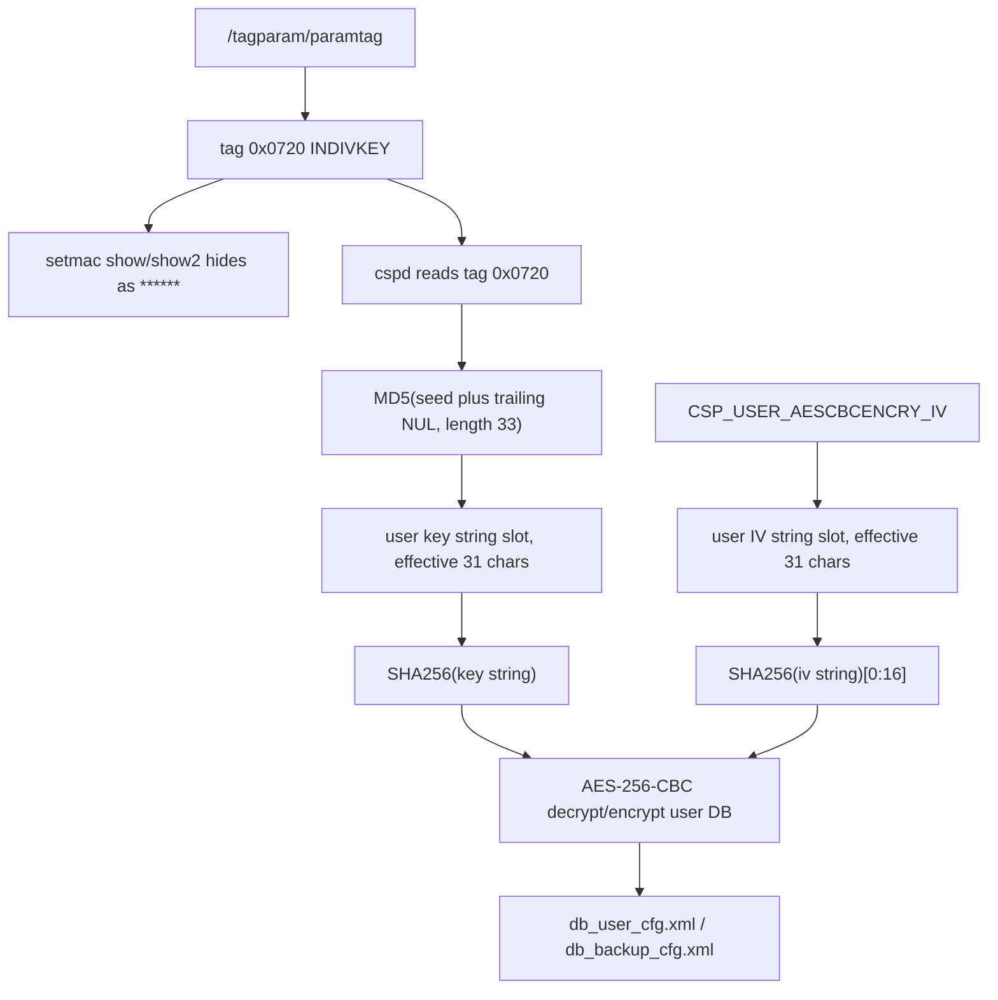

# setmac 与 tagparam

本文说明 G7615 固件中 `setmac` 的功能、数据源、特殊处理逻辑，以及它和
用户配置数据库 AES key 派生之间的关系。

结论来自以下二进制证据：

- `bin/setmac` 的动态符号和反汇编。
- `lib/libtagparamuserapi.so` 的导出符号、字符串和反汇编。
- 当前设备 `/tagparam/paramtag` 实测内容。

## 结论

`setmac` 不是配置数据库工具，也不读写
`/userconfig/cfg/db_user_cfg.xml`。它是 tag 参数区的命令行工具，主要通过
`libtagparamuserapi.so` 操作 `/tagparam/paramtag`。

`setmac` 能影响用户配置数据库解密，是因为 user DB 的 AES seed key 在当前
G7615 样本中来自 tag `0x0720`，即 `INDIVKEY`。这个 tag 被 `setmac show`
和 `setmac show2` 主动显示为 `******`，但真实值保存在
`/tagparam/paramtag` 中。

## 调用关系

`setmac` 的动态导入确认它把实际读写委托给 tagparam 库：

```text
setmac
  -> GetTagParam()
  -> SETTagParam()
  -> DelTagParam()
  -> FormatTagParamRegion()
  -> StrToMAC()
```

`libtagparamuserapi.so` 的主要导出：

```text
ReadParamTag
CheckSetTagParam
GetTagParam1
GetTagParam
DelTagParam
FormatTagParamRegion
SETTagParam1
SETTagParam
GetBakTagParam
CheckBakParamTag
```



## 数据源

已验证主数据源：

```text
/tagparam/paramtag
```

`libtagparamuserapi.so` 中还存在 backup API 使用的路径：

```text
/wlan/paramtag
```

`setmac` 对 `USERNAME` 和 `USERPASSWD` 有额外路径，会同步操作：

```text
/dev/mtd2
```

该路径来自 `setmac` 内部的 MTD helper 逻辑，相关字符串包括
`read OTHER_MTDDEV failed`、`erase OTHER_MTDDEV failed`、
`write OTHER_MTDDEV failed`。

## 命令功能

`setmac` 的帮助字符串：

```text
setmac <action type> [<para_id>] [<hex string para_val>]
setmac show
setmac show2
1-set param
2-get param
3-del param
4-format region
nocheck
```

功能说明：

| 命令 | 作用 | 备注 |
| --- | --- | --- |
| `setmac show` | 遍历内嵌 tag 表，显示已设置项 | `INDIVKEY` 显示为 `******` |
| `setmac show2` | 另一种显示格式，MAC 类字段更接近人可读格式 | `INDIVKEY` 同样显示为 `******` |
| `setmac 1 <id> <value>` | 设置 tag | 先查内嵌表、长度、校验函数，再调用 `SETTagParam` |
| `setmac 2 <id>` | 读取 tag | `INDIVKEY` 不输出真实值 |
| `setmac 3 <id>` | 删除 tag | 部分保护 tag 禁止删除 |
| `setmac 4` | 格式化 tag 参数区 | 高风险，只保留少量特殊 tag |
| `nocheck` | 设置时跳过内置校验 | 高风险，会绕过长度/格式/回调校验 |

## 内嵌 tag 表

`setmac` 在 `.data` 中内嵌 85 个 tag 定义。表起始虚拟地址为 `0x251c0`，
对应文件偏移 `0x51c0`。每项 36 字节。

结构如下：

```c
struct setmac_tag_desc {
    uint32_t tag_id;
    char     name[20];
    int32_t  min_len;
    int32_t  max_len;
    uint32_t validator_ptr;
};
```

完整导出见：

```text
docs/03-Vendors/ZTE/Architecture/artifacts/setmac_tag_table.csv
```

关键项：

| ID 十进制 | ID 十六进制 | 名称 | 说明 |
| ---: | --- | --- | --- |
| 1824 | `0x0720` | `INDIVKEY` | user DB 个性化 AES seed 来源 |
| 1537 | `0x0601` | `USERNAME` | 同步写入 `/dev/mtd2` |
| 1793 | `0x0701` | `USERPASSWD` | 同步写入 `/dev/mtd2` |
| 2196 | `0x0894` | `OperatorID` | 受保护，设置/读取/删除有特殊限制 |
| 2197 | `0x0895` | `ProductSn` | 存储时按字节 XOR `0x5a` |
| 2198 | `0x0896` | `CollusionFlag` | 禁止普通设置/读取/删除 |
| 2199 | `0x0897` | `CollusionVerFlag` | 格式化时保留 |
| 32769 | `0x8001` | `PONMAC` | 使用 MAC 校验回调 |
| 256 到 263 | `0x0100` 到 `0x0107` | `MAC1` 到 `MAC8` | 使用 MAC 校验回调 |

## 特殊处理逻辑

### INDIVKEY

`INDIVKEY` 的 ID 是 `1824`，即 `0x0720`。

`setmac` 在 `get`、`show` 和 `show2` 路径均检测该 ID，并只打印：

```text
******
```

这只是显示层遮蔽。真实值仍在 `/tagparam/paramtag` 的 tag `0x0720` 中。
当前 G7615 已验证该值参与 user DB AES key 派生。

### MAC 类字段

`PONMAC`、`MAC1` 到 `MAC8` 使用同一个校验回调，回调地址为
`0x11540`。设置时调用 `StrToMAC`，把形如 `01:02:03:04:05:06` 的输入
转换为 6 字节二进制后保存。

### ProductSn

`ProductSn` 的 ID 是 `0x0895`。设置时要求长度为 12，并对每个字节执行：

```text
stored_byte = input_byte ^ 0x5a
```

读取或显示时再执行同样的 XOR 恢复。

### OperatorID

`OperatorID` 的 ID 是 `0x0894`。设置路径会先检查该 tag 是否已经存在；
已存在时拒绝再次设置。写入时把输入作为十进制数解析，并与 `0x55aa`
执行 XOR 后格式化保存。

### USERNAME / USERPASSWD

`USERNAME` 和 `USERPASSWD` 除了写 `/tagparam/paramtag`，还会调用内部
MTD helper 操作 `/dev/mtd2`。删除和格式化路径也会同步处理该 secondary
copy。

### format

`setmac 4` 会调用 `FormatTagParamRegion()` 格式化 tag 参数区。`setmac`
会在格式化前读取以下 tag，并在格式化后恢复：

```text
0x0894 OperatorID
0x0895 ProductSn
0x0896 CollusionFlag
0x0897 CollusionVerFlag
```

其他 tag 不在这个保护列表中。这个命令有高风险，不建议在真实设备上随意
执行。

## paramtag 文件格式

`libtagparamuserapi.so` 读写固定 10240 字节区域。

头部结构：

```text
offset  size  meaning
0x00    4     magic: "TAGH"
0x04    4     version string, for example "0201"
0x08    4     generation / counter
0x0c    4     CRC32
0x10    4     used length, CRC 覆盖从 0x10 开始的 used length 字节
0x14    ...   tag records
```

单个 tag record：

```text
offset  size  meaning
0x00    2     tag id, little endian
0x02    2     max_len
0x04    2     real_len
0x06    n     value
...           4 字节对齐 padding
```

记录长度计算来自库函数：

```text
record_size = (real_len + 9) & ~3
```

`ReadParamTag()` 校验：

1. 读取 `/tagparam/paramtag`。
2. 检查 magic 是否为 `TAGH`。
3. 对 `buf + 0x10`、长度 `*(uint32_t *)(buf + 0x10)` 计算 CRC32。
4. 与头部 `0x0c` 的 CRC 比较。

## 与 user DB AES key 的关系

当前 G7615 已验证：



因此：

- `setmac` 本身不解密 DB。
- `INDIVKEY` 属于 tagparam，而不是 DB XML。
- 修改 `INDIVKEY` 会改变 user DB 的 AES key 派生结果。
- 如果只替换 `db_user_cfg.xml`，但目标设备 `INDIVKEY` 不同，user DB
  很可能无法解开。

## 安全操作建议

只读排查可使用：

```sh
setmac show
setmac show2
setmac 2 512
```

不要随意执行：

```sh
setmac 4
setmac 1 1824 ...
setmac 1 <id> <value> nocheck
```

如果目标是解包/重打包 user DB，应直接采集 `/tagparam/paramtag` 并由离线工具
解析 `INDIVKEY`，不要依赖 `setmac show2` 输出。

