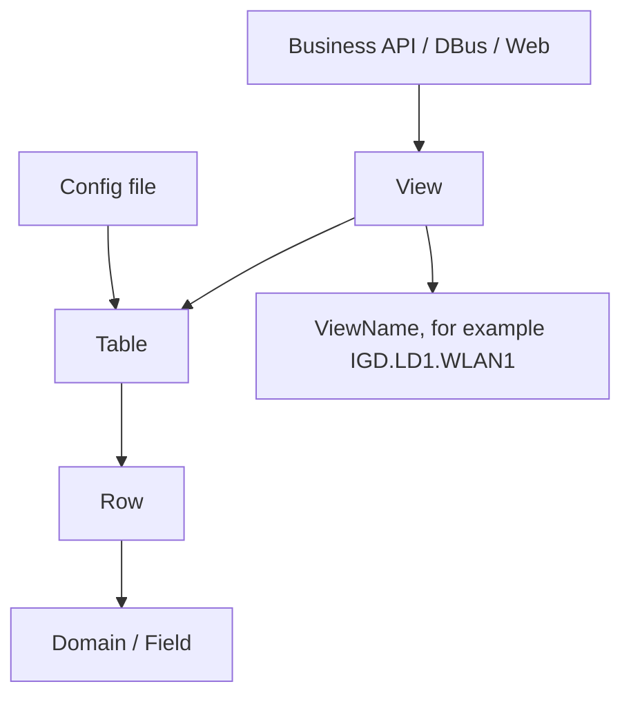

# 数据库 Schema

## 简介

本文整理 G7615 固件中可静态恢复的 ZTE 配置数据库 Schema 线索，并给出面向后续 ZTE Buildroot 光猫分析的通用 Schema 模型。

注意：

- 本文不是完整源码级 schema。
- 高置信度来源是动态符号中的 `dbDef*`、`dbView*Fun`、`dbAdd/Get/Set/Lst/Qry*View`。
- 字段名主要来自 `strings -t x` 的相邻字符串，需要结合 GPL 源码、反编译或实机 `sendcmd DB p` 验证。

## 自动生成索引

本次静态提取生成：

| 文件 | 内容 |
| --- | --- |
| [cspd_dbdef_tables.csv](/Users/builduser/tmp/g7615/all/docs/03-Vendors/ZTE/Architecture/artifacts/cspd_dbdef_tables.csv) | 从 `bin/cspd` 动态符号提取的 `dbDef*` 表候选，194 条 |
| [db_view_operations.csv](/Users/builduser/tmp/g7615/all/docs/03-Vendors/ZTE/Architecture/artifacts/db_view_operations.csv) | 从 `bin/cspd` 和 `libdbcspview.so` 提取的 View 操作候选，56 条 |
| [db_string_inventory.csv](/Users/builduser/tmp/g7615/all/docs/03-Vendors/ZTE/Architecture/artifacts/db_string_inventory.csv) | 从相关库和程序提取的路径、DBVIEW、IGD 对象、字段候选，3108 条 |
| [db_schema_candidates.json](/Users/builduser/tmp/g7615/all/docs/03-Vendors/ZTE/Architecture/artifacts/db_schema_candidates.json) | JSON 版 schema 候选，便于脚本引用 |
| [db-table-list.txt](/Users/builduser/tmp/g7615/all/db-tools/db-table-list.txt) | 给 `ztedbcli dump -f` 使用的运行时表名清单 |

生成运行时 dump 表名清单：

```bash
python3 db-tools/make_db_table_list.py -o db-tools/db-table-list.txt
```

设备端可以用该清单批量验证共享内存中的真实表值：

```sh
LD_LIBRARY_PATH=/lib:/usr/lib /tmp/ztedbcli \
  dump -f /tmp/db-table-list.txt \
  -o /tmp/runtime-db.xml
```

## Schema 模型

ZTE DB 至少包含四类对象：



| 对象 | 说明 |
| --- | --- |
| Table | 持久化和运行时的基础数据表 |
| Row | 表中的一行，通常对应一个实例 |
| Domain / Field | 字段定义，包含类型、默认值、是否保存、是否主键等属性 |
| View | 面向业务 API 的对象层，可能映射单表或多表 |
| ViewName | View 实例名，例如 `IGD.LD1.WLAN1` |

## 表定义来源

`cspd` 中导出的 `dbDef*` 符号是表定义的高置信度证据。命名规律：

```text
dbDef + TableName
```

例如：

| 符号 | 表候选 | 领域 |
| --- | --- | --- |
| `dbDefTelnetCfg` | `TelnetCfg` | 管理入口 / Telnet |
| `dbDefWANCPPP` | `WANCPPP` | WAN PPP |
| `dbDefWLANBase` | `WLANBase` | Wi-Fi Radio |
| `dbDefWLANCfg` | `WLANCfg` | Wi-Fi BSS / SSID |
| `dbDefWLANPSK` | `WLANPSK` | Wi-Fi PSK |
| `dbDefVoIPSIPServer` | `VoIPSIPServer` | 语音 SIP 服务器 |
| `dbDefGPONCFG` | `GPONCFG` | GPON |
| `dbDefOMCICFG` | `OMCICFG` | OMCI |
| `dbDefDHCPSHostCfg` | `DHCPSHostCfg` | DHCP Server |
| `dbDefQOSQueue` | `QOSQueue` | QoS |

## 表领域分组

### 设备和管理

| 表候选 | 说明 |
| --- | --- |
| `DevInfo` | 设备信息 |
| `DevInfoProduct` | 产品化设备信息 |
| `BoardInfo` | 板级信息 |
| `TelnetCfg` | Telnet 服务配置 |
| `TR069ClearPwd` | TR-069 密码清理或隐藏相关 |
| `ParamInfoTbl` | 参数属性或参数信息 |
| `AuthUserInfoProduct` | 认证用户产品默认信息 |
| `SecProtect` | 安全保护配置 |
| `AccessNotifyCfg` | 接入通知配置 |

### WAN / LAN / 路由

| 表候选 | 说明 |
| --- | --- |
| `WANCPPP` | PPP WAN 连接配置 |
| `WANCPPPStatus` | PPP WAN 连接状态 |
| `WANCIP` | IP WAN 连接配置 |
| `WANCIPPrvData` | IP WAN 租约或私有数据 |
| `WANCAuthExt` | WAN 认证扩展 |
| `LAND` | LAN Device |
| `LANInfo` | LAN 信息 |
| `LanPrefixCfg` | LAN IPv6 前缀 |
| `RouteIFInfo` | 路由接口信息 |
| `InterfaceInfo` | 接口基础信息 |
| `L2BAvailIF` | 二层桥可用接口 |
| `MLDWan` | MLD WAN 配置 |
| `FWIPTV` | IPTV 防火墙或业务配置 |

### Wi-Fi

| 表候选 | 说明 |
| --- | --- |
| `WLANBase` | Radio 基础配置 |
| `WLANCfg` | SSID / BSS 配置 |
| `WLANPSK` | PSK 配置 |
| `WLANWEP` | WEP 配置 |
| `WLANWMM` | WMM 配置 |
| `WLANWPS` | WPS 配置 |
| `WLANCountry` | 国家码 / 信道 |
| `WLANSetting` | Wi-Fi 设置 |
| `WlanTime` | Wi-Fi 时间策略 |
| `WLANBandSteering` | 双频合一 / band steering |
| `MultiAPCfg` | EasyMesh / MultiAP 配置 |
| `MultiAPMaster` | MultiAP 主控 |
| `MultiAPDomain` | MultiAP 域 |
| `MultiAPRoamCatonCfg` | 漫游卡顿配置 |

### 语音

| 表候选 | 说明 |
| --- | --- |
| `VoIPSIP` | SIP 总体配置 |
| `VoIPSIPServer` | SIP 服务器 |
| `VoIPSIPLine` | SIP 线路 |
| `VoIPSIPTimer` | SIP 定时器 |
| `VoIPH248MainCfg` | H.248 主配置 |
| `VoIPH248SubCfg` | H.248 子配置 |
| `VoIPH248LineCfg` | H.248 线路配置 |
| `VoIPVoiceProfile` | 语音 Profile |
| `VoIPVPLine` | Voice Profile Line |
| `VoIPDMTimerCfg` | 拨号定时器 |
| `VoIPCapabilitiesCodec` | 编解码能力 |
| `VoIPFaxT38Cfg` | T.38 Fax |
| `VoIPRTP*` / `VoIPRTCP*` | RTP/RTCP 配置 |
| `VoIPTONE*` / `VoIPRINGER*` | Tone/Ringer 配置 |

### 光接入 / PON

| 表候选 | 说明 |
| --- | --- |
| `GPONCFG` | GPON 配置 |
| `EPONProduct` | EPON 产品参数 |
| `EPONLlidConf` | EPON LLID |
| `EPONSilenceCount` | EPON 静默计数 |
| `OMCICFG` | OMCI 配置 |
| `OPTICAL` | 光模块/光功率信息 |
| `TCONT` | GPON TCONT |
| `TCONTQUEUE` | TCONT 队列 |
| `TCONTQUEUERATELIMIT` | TCONT 队列限速 |
| `GEMPORT` | GEM Port |

### 安全 / 防火墙 / QoS

| 表候选 | 说明 |
| --- | --- |
| `FWDMZ` | DMZ |
| `DMZProduct` | DMZ 产品默认 |
| `FwLevelProduct` | 防火墙级别 |
| `FalsifyDefend` | 防伪/攻击防护类配置 |
| `QOSQueue` | QoS 队列 |
| `QOSApp` | QoS 应用 |
| `QOSBasicCfgProduct` | QoS 基础产品配置 |
| `QOSQueueCfgProduct` | QoS 队列产品配置 |
| `QosConditionProduct` | QoS 条件 |
| `QosConfProduct` | QoS 配置 |
| `QosRuleProduct` | QoS 规则 |

### 应用 / 存储 / 诊断

| 表候选 | 说明 |
| --- | --- |
| `FTPUser` | FTP 用户 |
| `FTPServerCfgProduct` | FTP 服务产品配置 |
| `SambaUser` | Samba 用户 |
| `SAMBAUserProduct` | Samba 产品配置 |
| `DMSProduct` | DMS 媒体服务 |
| `Pingdiag` | Ping 诊断 |
| `DlTest` | 下载测速 |
| `SimulationPPPOE` | PPPoE 仿真 |
| `SimulationDHCP` | DHCP 仿真 |
| `P1905Cfg` | IEEE 1905 / Mesh |
| `P1905ComCfg` | P1905 公共配置 |
| `MQTTSrv` | MQTT 服务 |

## View 操作模型

View 操作函数一般成组出现：

```text
dbView<Name>Fun
dbAdd<Name>View
dbDel<Name>View
dbSet<Name>View
dbGet<Name>View
dbLst<Name>View
dbQry<Name>View
```

示例：

| View | Add | Del | Set | Get | List | Query |
| --- | --- | --- | --- | --- | --- | --- |
| `WANCPPP` | 是 | 是 | 是 | 是 | 是 | 是 |
| `WANCIP` | 是 | 是 | 是 | 是 | 是 | 是 |
| `WANCAuthExt` | 是 | 是 | 是 | 是 | 是 | 是 |
| `InterfaceInfo` | 是 | 是 | 是 | 是 | 是 | 是 |
| `RouteIFInfo` | 是 | 是 | 是 | 是 | 是 | 是 |
| `WLANCfg` | 是 | 是 | 是 | 是 | 是 | 是 |
| `BoardInfo` | 否 | 否 | 是 | 是 | 否 | 否 |
| `GPONCFG` | 否 | 否 | 是 | 是 | 否 | 否 |
| `OMCICFG` | 否 | 否 | 是 | 是 | 否 | 否 |

解释：

- 有 Add/Del/List/Query 的 View 多为多实例对象。
- 只有 Set/Get 的 View 多为单例配置或状态对象。
- Product 类 View 通常承载产品默认、端口能力或厂商预置项。

完整列表见 [db_view_operations.csv](/Users/builduser/tmp/g7615/all/docs/03-Vendors/ZTE/Architecture/artifacts/db_view_operations.csv)。

## 高置信度字段样例

以下字段来自 `libdbcspview.so` 中相邻字符串，置信度高于普通全局字符串搜索。

### InterfaceInfo

| 字段 |
| --- |
| `LOWLAYER_IF_ID` |
| `PHYLINK_ID` |
| `AliasName` |
| `IFType` |
| `WanLanPrority` |
| `IFState` |
| `WB_IF_NAME` |

### RouteIFInfo

| 字段 |
| --- |
| `IPAddr` |
| `SubMask` |
| `Gateway` |
| `DNS1` |
| `DNS2` |
| `DNS3` |
| `ConsultMtu` |
| `LLA_ID` |
| `GUA1` / `GUA2` / `GUA3` |
| `Gateway6` |
| `DNS1v6` / `DNS2v6` / `DNS3v6` |
| `v4Status` |
| `v6Status` |
| `SessionID` |

### WANCAuthExt

| 字段 |
| --- |
| `UserName` |
| `Password` |
| `DomainName` |

### WANCIP

| 字段 |
| --- |
| `IPAddress` |
| `SubnetMask` |
| `GateWay` |
| `Addressingtype` |
| `LastAckTime` |
| `LeaseTime` |
| `ConnStatus` |
| `DiagStatus` |

### WANCIPPrvData

| 字段 |
| --- |
| `FirstAckTime` |

### WANCPPP

| 字段 |
| --- |
| `ConnTrigger` |
| `AuthType` |
| `IdleTime` |
| `AutoDisconnTime` |
| `WarnDisconnTime` |
| `MaxMRU` |
| `EchoTime` |
| `EchoRetry` |
| `PPPoEACName` |
| `PPPoEServiceName` |
| `EnableProxy` |
| `MaxUser` |
| `EnablePassThrough` |
| `PassThroughViewName` |
| `ValidWANRx` |
| `ValidLANTx` |
| `HostTrigger` |
| `TtyDialNum` |
| `TtyAPN` |
| `TtyPDPType` |
| `PPPEncapsType` |
| `EncapsID` |
| `GUATrigger` |
| `DNSv6Trigger` |
| `PrefixTrigger` |
| `AFTRTrigger` |
| `DialOperation` |

### WANCPPPStatus

| 字段 |
| --- |
| `ConnStatus6` |
| `ConnError` |
| `LastErrorReason` |
| `ConnError6` |
| `LastErrorReason6` |
| `LastErrorCode` |
| `PeerMAC` |
| `RemoteIP` |
| `RemoteLLA` |
| `OnLineTime6` |
| `EncryProt` |
| `CompProt` |
| `DiagPhase` |
| `GUAAddr` |
| `DNSv6Addr1` |
| `DNSv6Addr2` |
| `PrefixAddr` |
| `AFTRAddr` |
| `Dnsv4Addr` |

### WLANCfg

| 字段 |
| --- |
| `LANDViewName` |
| `ValidIf` |
| `ESSID` |
| `ESSIDPrefix` |
| `ACLPolicy` |
| `BeaconType` |
| `ESSIDHideEnable` |
| `BeaconEnabled` |
| `WEPAuthMode` |
| `WEPLevel` |
| `WEPKeyIndex` |
| `WPAEncryptType` |
| `WPAAuthMode` |
| `11iEncryptType` |
| `11iAuthMode` |
| `WPAGroupRekey` |
| `WPAEAPServerIp` |
| `WPAEAPSecret` |
| `MaxUserNum` |
| `VapIsolationEnable` |
| `BasicEncryptionModes` |
| `LocalSetEnable` |
| `GuestEnable` |
| `MapAccessAttr` |
| `11rEnable` |
| `WPA3EncryptType` |
| `WPA3AuthMode` |
| `WmmEnable` |

### WLANBase / WLAN

| 字段 |
| --- |
| `SettingStatus` |
| `CardIsIn` |
| `MaxInterface` |
| `DeviceMode` |
| `CardMode` |
| `CardRev` |
| `Class` |
| `WlanMode` |
| `BandWidth` |
| `SideBand` |
| `11nMode` |
| `11nRate` |
| `SGIEnabled` |
| `GreenField` |
| `RadioStatus` |
| `Channel` |
| `AutoChannelEnabled` |
| `TxRate` |
| `BeaconInterval` |
| `TxPower` |
| `PreambleType` |
| `CountryCode` |
| `RtsCts` |
| `DTIM` |
| `Fragment` |
| `QosType` |
| `ApsdEnabled` |
| `BasicDataRates` |
| `OpDataRates` |
| `SSIDIsolationEnable` |
| `WdsMode` |
| `WdsInterface` |
| `PowerEnhance` |
| `11acMode` |
| `11axMode` |
| `MIMO` |
| `BandSteer` |

## 敏感字段和脱敏

`libdb.so` 中有敏感字段打印脱敏逻辑。已看到的敏感表/字段候选包括：

| 表或字段 | 说明 |
| --- | --- |
| `TelnetCfg` | Telnet 管理入口 |
| `TS_UName` / `TS_UPwd` | Telnet 用户名/密码候选 |
| `TSLan_UName` / `TSLan_UPwd` | LAN Telnet 用户名/密码候选 |
| `MgtServer` | TR-069 管理服务器 |
| `ConnectionRequestUsername` | TR-069 连接请求用户名 |
| `ConnectionRequestPassword` | TR-069 连接请求密码 |
| `DevAuthInfo` | 设备认证信息 |
| `AuthPassword` | 认证密码 |
| `WLANPSK` | Wi-Fi PSK |
| `PreSharedKey` | Wi-Fi 预共享密钥 |
| `KeyPassphrase` | Wi-Fi 密码短语 |

实践建议：

- `sendcmd DB p` 适合确认表结构和状态，不适合判断敏感值真实内容。
- 如果需要确认真实值，应优先分析 DBus / Web 业务 API 的权限和返回路径。

## Relationship 线索

从 `libdbcspview.so` 字符串可见：

| 字段 | 推测关系 |
| --- | --- |
| `WANCDViewName` | `WANCIP` / `WANCPPP` 关联 WANCD/WANC 基础连接 |
| `LANDViewName` | `WLANCfg` 关联 LAN Device |
| `PassThroughViewName` | `WANCPPP` 关联 passthrough 配置 |
| `RViewName` | 可能是 related view name，具体待验证 |
| `PortViewName` | 产品接口或端口 View 关联 |

这支持一个重要判断：View 层不只是表别名，它承担跨表关系建模。

## 如何继续验证 Schema

推荐验证路径：

1. 用 `sendcmd 1 DB p <TableName>` 打印表，验证表名和字段。
2. 用 `sendcmd 1 DB pti <TableName>` 查看表详细信息，验证字段类型、默认值、是否保存。
3. 用 DBus introspection 获取对象和属性。
4. 对照 Web 页面提交字段，建立 Web 参数到 DB View 字段的映射。
5. 如有 GPL 源码，搜索 `dbCreateTbl` 和 `dbCreateDomainNew`。

## 待验证

- 194 个 `dbDef*` 中哪些是实际启用表，哪些是条件编译或产品兼容表。
- 字段类型、默认值、是否保存、主键标志。
- View 和 Table 的完整关系。
- `DBVIEW_*` 常量编号。
- Product 表和运行时表的覆盖顺序。

更新时间：2026-07-13
