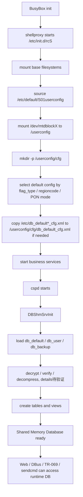
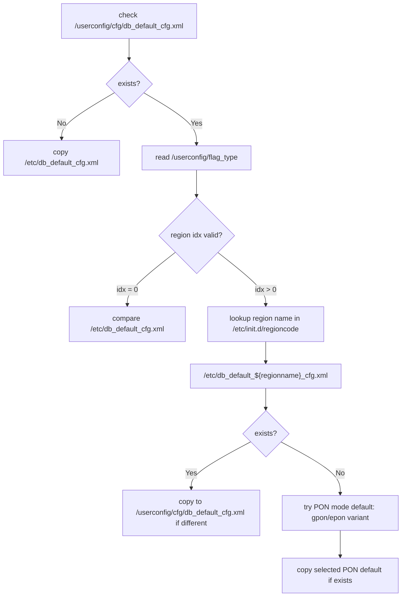
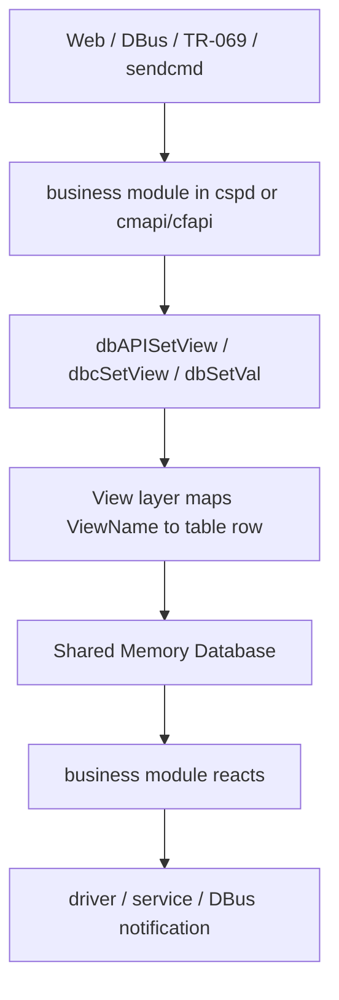
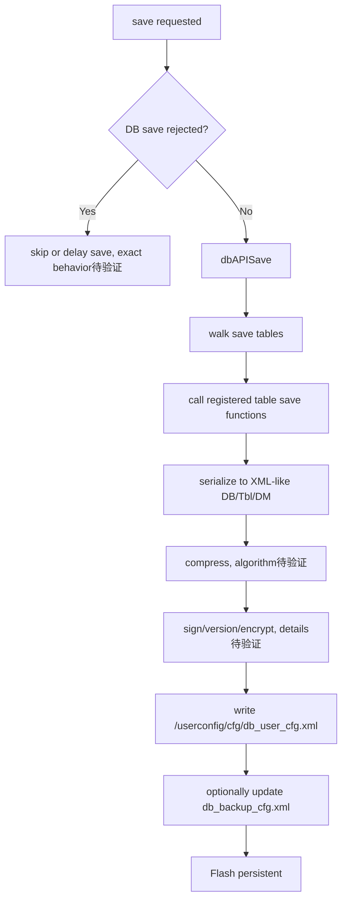
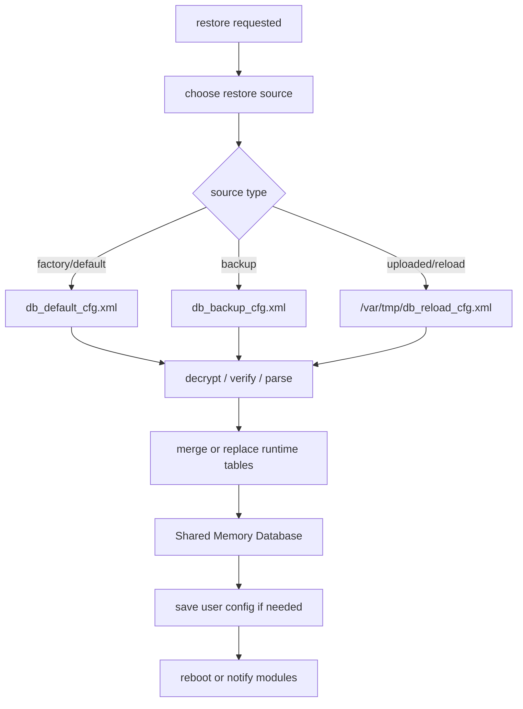

# 数据库生命周期

## 简介

本文说明 ZTE Buildroot 光猫配置数据库从启动加载、运行时修改、保存持久化、备份恢复到升级迁移的完整生命周期。

核心结论：

- 启动时从 Flash 挂载 `/userconfig`。
- 默认配置来自 `/etc/db_default*_cfg.xml`，会复制或同步到 `/userconfig/cfg/db_default_cfg.xml`。
- 用户配置来自 `/userconfig/cfg/db_user_cfg.xml`。
- DB Server 将配置包解密、校验、解析后加载进共享内存数据库。
- Web、DBus、TR-069、`sendcmd` 修改的是共享内存中的运行时配置。
- 只有保存动作触发后，运行时配置才会写回 `/userconfig/cfg/db_user_cfg.xml`。

## 启动前提

G7615 启动入口：

- `etc/inittab` 通过 `shellproxy` 启动 `/etc/init.d/rcS`。
- `etc/init.d/rcS` 先设置路径和环境变量，再调用 `/etc/default/S01userconfig`。
- `/etc/default/S01userconfig` 负责挂载 `/userconfig` 并创建 `/userconfig/cfg`。

关键环境变量：

```sh
export OVS_PATH="/usr/ovs"
export OVSDB_PATH="/userconfig/cfg"
export OVS_RUNDIR="/var/ovs/run"
export CFGDB="$OVSDB_PATH/conf.db"
```

注意：

- `OVSDB_PATH` 说明 `/userconfig/cfg` 是系统配置目录。
- ZTE DB 配置包路径由 `cspd` 和 DB API 另行使用，不应把 `OVSDB_PATH` 简化理解为“ZTE DB 本体”。

## 启动加载总流程



## /userconfig 挂载

G7615 已确认：

- `/etc/default/S01userconfig` 检查 `/dev/mtd5`。
- 成功时挂载 `/dev/mtdblock5` 到 `/userconfig`。
- 文件系统类型为 `jffs2`。
- 之后创建 `/userconfig/cfg`。

通用推测：

- 其他 ZTE 机型的 MTD 编号可能不同。
- 文件系统可能是 JFFS2、UBIFS 或其他可写 Flash 文件系统。
- `/userconfig` 作为持久化配置挂载点是高概率通用模式。

## 默认配置初始化

启动脚本中的默认配置变量：

| 变量 | 作用 |
| --- | --- |
| `USR_DB_DEFAULT_CFG_XML` | `/userconfig/cfg/db_default_cfg.xml` |
| `USR_DB_BACKUP_CFG_XML` | `/userconfig/cfg/db_backup_cfg.xml` |
| `USR_CFG_TYPE_FILE` | `/userconfig/flag_type` |
| `USR_CFG_ERR_FILE` | `/userconfig/regioncode_error.log` |
| `ETC_DB_DEFAULT_CFG_XML` | `/etc/db_default_cfg.xml` |
| `ETC_DB_REGIONCODE` | `/etc/init.d/regioncode` |

流程：



这解释了为什么同一型号不同省份、不同运营商或不同 PON 模式下默认配置可能不一样。

## DB Server 初始化

`cspd` 启动后会进入 ZTE OSS 业务框架，并初始化 DB。

已确认线索：

- `cspd` 导入 `DBShmSrvInit`。
- `cspd` 中存在 `dbAPIMsgDeal`、`dbDebugCmdMsgDeal`、`dbNomalStateDeal`。
- `libdb.so` 导出 `DBShmSrvInit`、`DBShmCliInit`。
- `libdb.so` 使用 `shmget`、`shmat`、`shmctl`。

初始化阶段大致包括：

1. 读取 DB 配置文件路径。
2. 打开或初始化共享内存。
3. 注册表定义。
4. 注册 View 函数。
5. 加载默认配置和用户配置。
6. 处理版本迁移、个性化参数、区域差异。
7. 启动 OSS 消息循环和定时保存逻辑。

## 运行时修改

运行时修改可以来自多个入口：

| 入口 | 典型路径 |
| --- | --- |
| Web UI | Web 后端或 DBus API |
| DBus | `Properties.Set`、业务方法、对象同步 |
| TR-069 | `SetParameterValues` 到业务 API |
| sendcmd | `sendcmd 1 DB set ...` |
| 业务模块 | 内部调用 `dbAPISetView` / `dbcSetView` |

运行时修改流程：



为什么立即生效：

- 修改发生在共享内存 DB。
- 业务模块可以马上读到新值。
- 一些模块会在 set 后立即调用驱动、更新配置文件或发 DBus 通知。

## 保存持久化

保存触发来源：

- `sendcmd 1 DB save`
- `sendcmd 1 DB saveasy`
- Web 保存配置动作
- TR-069 参数保存
- DB 定时器超时保存
- 重启前保存
- 恢复和升级迁移流程内部保存

`cspd` 中保存相关字符串：

- `_dbTimeoutSave`
- `dbSaveTimerDelay`
- `dbTimer2Check`
- `dbTimer2Check, need save !`
- `Save(%d)CfgSav(%d)iRet(%d)`

保存流程：



## Backup 生命周期

`cspd` 的 DB 命令支持：

- `bckinterval [0]`
- `bcktype [0/1/2]`
- `backup`

这说明备份是 DB 子系统的一等能力。

备份对象：

- `/userconfig/cfg/db_backup_cfg.xml`

已确认：

- 路径硬编码在 `cspd` 中。
- DB 命令中有全量/部分备份概念。

待验证：

- 全量备份和部分备份的表范围。
- 保存失败时是否自动回退到 backup。
- backup 与版本升级迁移之间的优先级。

## 恢复生命周期

恢复入口：

| 入口 | 字符串线索 |
| --- | --- |
| 远程恢复 | `rreset`、`db rms restore factory` |
| 本地恢复 | `lreset`、`db web restore default` |
| 长按恢复 | `lplreset` |
| 模块部分恢复 | `partrst [ModName]` |
| 配置文件 reload | `/var/tmp/db_reload_cfg.xml` |

恢复流程推测：



## 升级和版本迁移

`cspd` 中有大量版本迁移字符串：

- `upgrade user cfg with version %s`
- `DB upgrade check cfg start`
- `GetDefCfgId`
- `dbPdtTransferCfg`
- `dbGetCurrentVersion`
- `dbGetLastVersion`
- `dbSetLastVersion`
- `dbSetRegionUpdate`
- `dbShandongUpdateWANCPPP`
- `dbXinjiangMgtServerCfg`
- `dbGuangxiMgtServerCfg`
- `osgiPrebundleUpgradeUpdateDatabase`

这说明 DB 生命周期还包括升级迁移：

- 根据旧版本用户配置加载。
- 根据新版本默认表结构补字段、删字段或改默认值。
- 根据区域做特殊迁移。
- 根据插件或 prebundle 做配置迁移。

实践上，分析用户配置异常时不能只看当前 `db_user_cfg.xml`，还要看升级路径和版本迁移逻辑。

## 生命周期关键状态

| 状态 | 配置在哪里 | 是否持久化 | 说明 |
| --- | --- | --- | --- |
| 出厂默认 | `/etc/db_default*_cfg.xml` | 固件只读 | 默认来源 |
| 默认副本 | `/userconfig/cfg/db_default_cfg.xml` | 是 | 区域/PON 模式选择后的默认配置 |
| 用户配置 | `/userconfig/cfg/db_user_cfg.xml` | 是 | 用户修改后的配置包 |
| 备份配置 | `/userconfig/cfg/db_backup_cfg.xml` | 是 | 恢复或回退来源 |
| 运行时配置 | Shared Memory | 否 | 当前真实生效配置 |
| 临时解密配置 | `/var/tmp/db_*` | 否 | 调试、reload、保存中间产物 |

## 设计思想

ZTE DB 生命周期设计的核心是“运行时和持久化分离”：

- 运行时 DB 保证业务效率和一致性。
- 配置文件保证重启后恢复。
- 默认配置保证恢复出厂和首次启动。
- 备份配置保证异常回退。
- 区域配置和版本迁移保证同一套程序适配多省份、多型号、多运营商。

这也是分析配置问题时最容易踩坑的地方：直接改文件不一定影响运行时，直接改运行时不一定能重启保留。

## 待验证

- `db_user_cfg.xml` 损坏时的具体恢复优先级。
- `db_backup_cfg.xml` 的自动恢复条件。
- `DB reject` 对手动保存和定时保存的完整影响。
- 配置升级迁移的版本比较算法。
- 区域配置和 PON 模式配置同时存在时的优先级。

更新时间：2026-07-13
