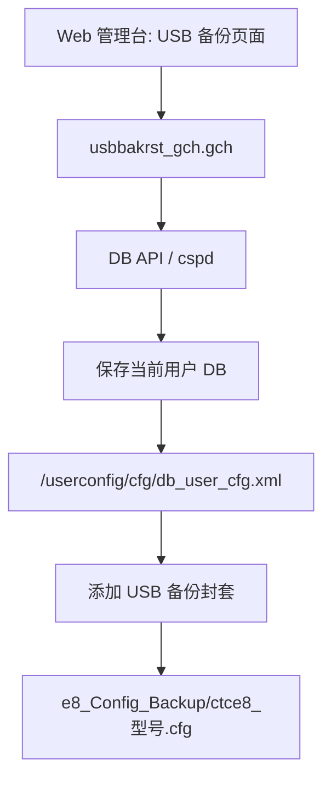
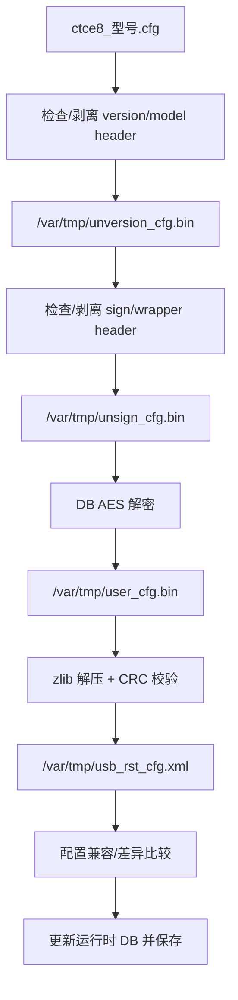
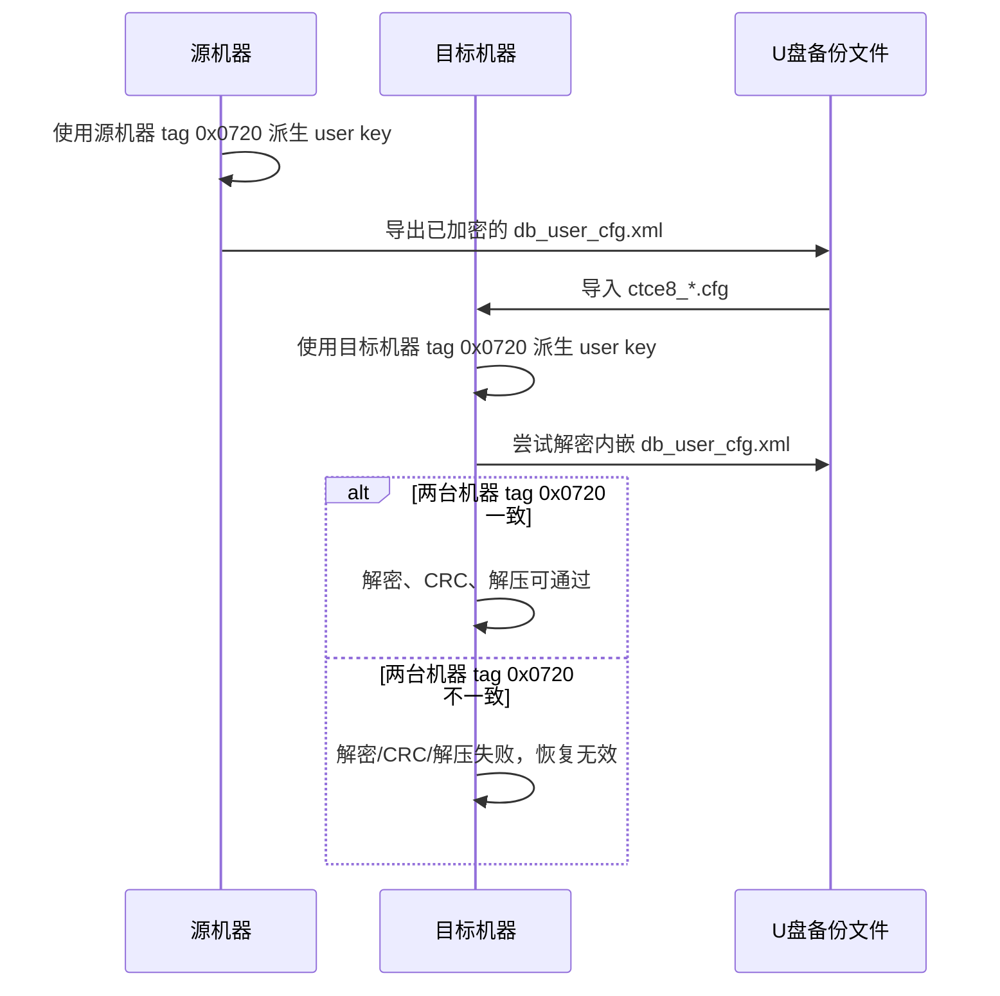

# 管理台 U 盘备份格式

本文说明 Web 管理台“备份到 U 盘”生成的
`e8_Config_Backup/ctce8_*.cfg` 文件。该文件不是新的数据库加密格式，而是
一个外层 USB 备份封套，内部嵌入完整的 `db_user_cfg.xml` 容器。

## 文件布局

当前样本：`e8_Config_Backup/ctce8_G7615-G-C.cfg`。

| 偏移 | 长度 | 含义 | 验证状态 |
|---:|---:|---|---|
| `0x00` | 16 | wrapper magic：`99 99 99 99 44 44 44 44 55 55 55 55 aa aa aa aa` | 已验证 |
| `0x18` | 4 | wrapper version/type：`4` | 已验证 |
| `0x3c` | 4 | descriptor offset：`0x40` | 已验证 |
| `0x40` | 4 | descriptor type：`2` | 已验证 |
| `0x44` | 4 | payload offset：`0x80` | 已验证 |
| `0x48` | 4 | payload length：`0xa14d` | 已验证 |
| `0x80` | 4 | version header magic：`04 03 02 01` | 已验证 |
| `0x88` | 4 | model string length，大端：`9` | 已验证 |
| `0x8c` | 9 | model string：`G7615-G-C` | 已验证 |
| `0x95` | 剩余 | 内嵌 `db_user_cfg.xml` 容器 | 已验证 |

```text
ctce8_G7615-G-C.cfg
├─ 0x0000..0x007f  USB 备份 wrapper header
├─ 0x0080..0x0094  version/model header
└─ 0x0095..EOF     db_user_cfg.xml 二进制容器
```

已验证：`0x95` 之后的 `41272` 字节与当前样本
`/userconfig/cfg/db_user_cfg.xml` 逐字节相同。

## 备份流程

Web 页面入口：

- `home/httpd/usbbackup_t.gch`
- `home/httpd/usbbackup_js.gch`
- `home/httpd/usbbakrst_gch.gch`

`StartBackup=1` 后触发 DB 保存/备份流程。`cspd` 中可见相关对象和字符串：

- `OBJ_USBBAKRST_ID`
- `OBJ_USBBACKUPSTORAGE_ID`
- `BakDir`
- `BakFileName`
- `cnc_Config_Backup`
- `usbbackup.cfg`



## 恢复流程

`cspd` 中恢复路径字符串包括：

- `USBRestore Starting!`
- `BakDir`
- `BakFileName`
- `/var/tmp/unversion_cfg.bin`
- `/var/tmp/unsign_cfg.bin`
- `/var/tmp/user_cfg.bin`
- `/var/tmp/usb_rst_cfg.xml`
- `LOGID_DB_CFG_VERTION_HEAD_FAIL`
- `LOGID_DB_CFG_SIGN_HEAD_FAIL`
- `LOGID_DB_UNCOMPRESS_FAIL`
- `LOGID_DB_COMPARE_FAIL`
- `LOGID_DB_CHECK_CONFIG_FILE fail`
- `LOGID_DB_UPDATE_CONFIG_FILE fail`



注意：恢复时真正解密的是内嵌的 `db_user_cfg.xml` 容器。USB 外层封套本身
没有替代 DB AES key/iv。

## 跨机器恢复

跨机器恢复通常会失败，原因是 user DB key 与设备个体数据有关。



已验证参与用户配置 DB key/iv 的输入：

- `/etc/hardcode`：用于派生 `/etc/hardcodefile/*` transport key/iv。
- `/etc/hardcodefile/dataprotocol`：
  - `CSP_USER_AESCBCENCRY_IV`
  - fallback `CSP_USER_AESCBCENCRY_KEY`，当前新设备 user DB 未直接使用它作为主 key。
- `/tagparam/paramtag`：
  - `INDIVKEY`，ID `1824`，即 tag `0x0720`，本样本实际用于 user key 派生。
  - `setmac show2` 中该项可能显示为星号，但真实 32 字节 seed 在该文件中。

未见参与本样本 user DB AES key/iv 的内容：

- LOID / 宽带注册号。
- Web 用户名/密码等普通配置项。
- U 盘备份文件名。
- U 盘备份封套中的型号字符串。

型号字符串可能参与恢复前的版本/型号匹配校验，但当前没有证据表明它参与
AES key/iv 派生。

公开工具方面，`yuleniwo/zxcfg` 覆盖当前这种 AES DB 容器和 `paramtag`
派生逻辑；`TommyLau/ztecfg` 更偏早期非 AES 的 `ctce8_*.cfg` zlib XML
格式。工具对照见 `外部工具对照.md`。

## 工具命令

查看封套：

```bash
python3 db-tools/e8_usb_cfg.py info e8_Config_Backup/ctce8_G7615-G-C.cfg
```

提取内嵌 DB：

```bash
python3 db-tools/e8_usb_cfg.py extract \
  e8_Config_Backup/ctce8_G7615-G-C.cfg \
  -o out-e8/db_user_cfg.embedded.xml
```

提取并解密：

```bash
python3 db-tools/e8_usb_cfg.py unpack \
  e8_Config_Backup/ctce8_G7615-G-C.cfg \
  -o out-e8 \
  --strict-crc
```

重建 U 盘备份：

```bash
python3 db-tools/e8_usb_cfg.py pack \
  e8_Config_Backup/ctce8_G7615-G-C.cfg \
  new_db_user_cfg.xml \
  -o ctce8_G7615-G-C.new.cfg
```
