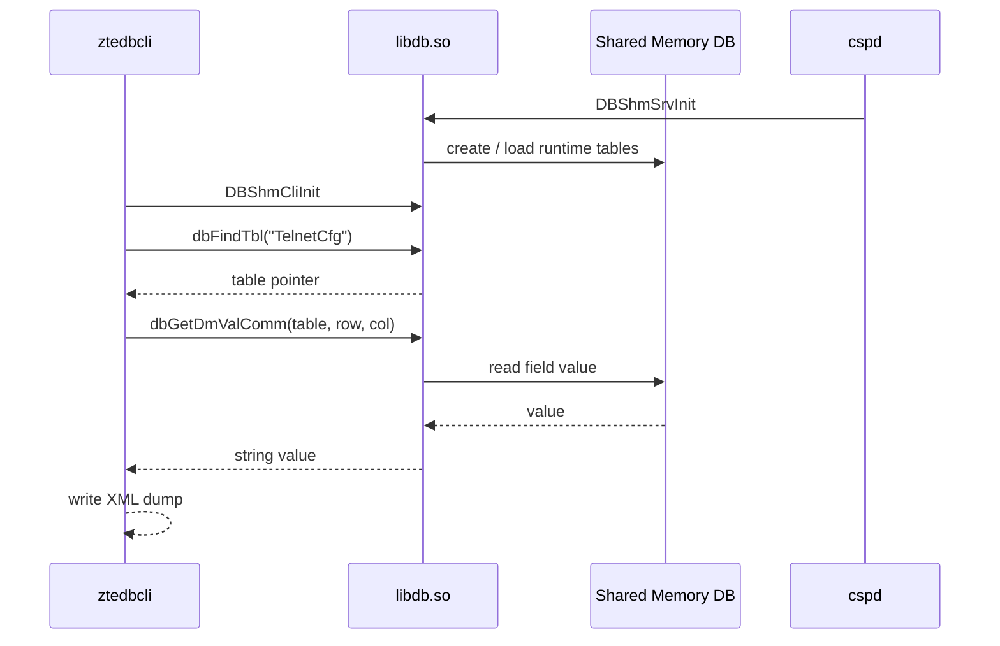
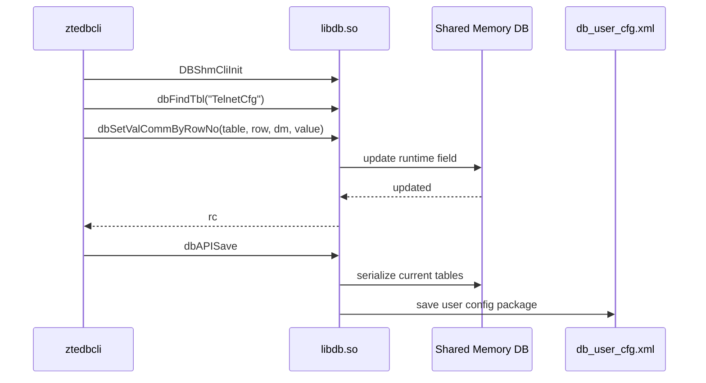
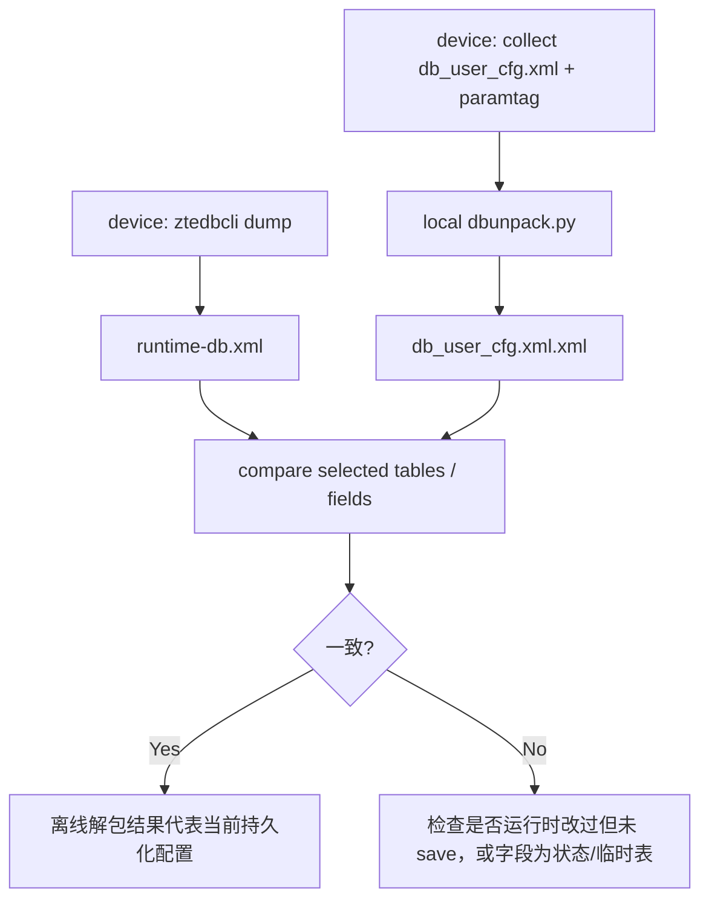

# 运行时 DB 客户端

## 定位

运行时 DB 客户端用于读取和修改设备当前共享内存数据库中的表和字段。它不是
离线解密工具，也不是 `sendcmd` 的完全等价实现，但可以覆盖常见的
`sendcmd 1 DB p/get/set/save/addr/delr` 类场景。

只读 dump 模式用来回答一个关键问题：

```text
离线解出的 db_user_cfg.xml XML
是否等于设备当前真正生效的运行时配置？
```

当前新增的工具：

```text
db-tools/ztedbcli.c
db-tools/build_ztedbcli.sh
db-tools/make_db_table_list.py
db-tools/db-table-list.txt
```

`ztedbcli.c` 内置了一份当前 G7615 样本的 194 个表名清单。外部
`db-table-list.txt` 仍然保留，用于其它机型或后续补充表名。

## 工作流程

`ztedbcli` 直接调用 `libdb.so` 的共享内存客户端 API。读取路径：



写入和保存路径：



和 `sendcmd` 的差别：

| 项目 | sendcmd | ztedbcli |
| --- | --- | --- |
| 入口 | APPID IPC 调试命令 | `libdb.so` shared memory client |
| 打印表 | `sendcmd 1 DB p TelnetCfg` | `ztedbcli p TelnetCfg` |
| 读取字段 | 机型命令不一定提供 | `ztedbcli get TelnetCfg 0 TS_Enable` |
| 修改字段 | `sendcmd 1 DB set ...` | `ztedbcli set ...` |
| 添加行 | `sendcmd 1 DB addr ...` | `ztedbcli addrow ...` |
| 删除行 | `sendcmd 1 DB delr ...` | `ztedbcli delrow ...` |
| 保存配置 | `sendcmd 1 DB save` | `ztedbcli save` |
| 依赖 APPID IPC | 是 | 否 |
| 主要用途 | 调试、修改、保存 | sendcmd 替代、运行时校验、批量表 dump |

## 编译

在本地 rootfs 目录下交叉编译：

```bash
cd /Users/builduser/tmp/g7615/all/db-tools
CC=arm-linux-gnueabi-gcc ./build_ztedbcli.sh
```

如果 rootfs 不在当前项目上一级目录：

```bash
ROOTFS=/path/to/rootfs \
CC=arm-linux-gnueabi-gcc \
./build_ztedbcli.sh
```

脚本默认链接：

```text
-ldb -ldl -loss -lcommfun
```

这是 `printbl.c` 给出的链接方式，也和当前 G7615 `libdb.so` 依赖相符。

## 表名清单

静态表名候选来自：

```text
docs/03-Vendors/ZTE/Architecture/artifacts/cspd_dbdef_tables.csv
```

生成清单：

```bash
python3 db-tools/make_db_table_list.py -o db-tools/db-table-list.txt
```

当前 G7615 样本生成 194 个表名候选。表名来自 `cspd` 导出的 `dbDef*`
符号，置信度高，但仍应以实机 `dbFindTbl` 结果为准。

使用规则：

- `ztedbcli dump`：使用程序内置表名清单。
- `ztedbcli dump -f table-list.txt`：使用外部表名清单。
- 其它机型建议先生成或手工整理自己的表名清单，再用 `-f` 覆盖。

## 设备端运行

单表：

```sh
LD_LIBRARY_PATH=/lib:/usr/lib /tmp/ztedbcli TelnetCfg
LD_LIBRARY_PATH=/lib:/usr/lib /tmp/ztedbcli p TelnetCfg
```

常用几张表：

```sh
LD_LIBRARY_PATH=/lib:/usr/lib /tmp/ztedbcli \
  TelnetCfg WLANBase WLANCfg WLANPSK GPONCFG
```

使用内置表名清单批量 dump：

```sh
LD_LIBRARY_PATH=/lib:/usr/lib /tmp/ztedbcli \
  dump \
  -o /tmp/runtime-db.xml
```

按外部表名文件批量 dump：

```sh
LD_LIBRARY_PATH=/lib:/usr/lib /tmp/ztedbcli \
  dump -f /tmp/db-table-list.txt \
  -o /tmp/runtime-db.xml
```

如果设备在容器或多 root 环境中运行，需要在能访问 `cspd` 同一 shared memory
命名空间的位置执行。否则 `DBShmCliInit` 可能失败，或读到空表。

## 读写命令

读取单个字段：

```sh
LD_LIBRARY_PATH=/lib:/usr/lib /tmp/ztedbcli get TelnetCfg 0 TS_Enable
```

修改单个字段：

```sh
LD_LIBRARY_PATH=/lib:/usr/lib /tmp/ztedbcli set TelnetCfg 0 TS_Enable 1
```

添加或删除行：

```sh
LD_LIBRARY_PATH=/lib:/usr/lib /tmp/ztedbcli addrow WLANCfg
LD_LIBRARY_PATH=/lib:/usr/lib /tmp/ztedbcli delrow WLANCfg 3
```

保存到用户配置包：

```sh
LD_LIBRARY_PATH=/lib:/usr/lib /tmp/ztedbcli save
```

语义和 `sendcmd DB set/save` 一样是两步：

- `set/addrow/delrow` 修改 shared memory 中的运行时 DB。
- `save` 才会触发持久化保存。
- 不执行 `save` 就重启，修改通常会丢失。

建议先在不关键的字段上验证：

```sh
/tmp/ztedbcli get TelnetCfg 0 TS_Enable
/tmp/ztedbcli set TelnetCfg 0 TS_Enable 1
/tmp/ztedbcli get TelnetCfg 0 TS_Enable
```

确认行为符合预期后，再决定是否执行：

```sh
/tmp/ztedbcli save
sync
```

## 和离线 XML 对照

推荐验证流程：



出现差异时优先考虑：

- 运行时配置已被 Web、TR-069、DBus 或 `sendcmd` 修改，但还没有 `DB save`。
- 某些表是状态表或运行时派生表，本来就不会完整保存进 `db_user_cfg.xml`。
- `sendcmd DB p` 可能脱敏，不能直接和 `ztedbcli` 或离线 XML 简单比较敏感字段。
- 设备加载的是 backup/default 回退路径，而不是当前看到的 user cfg。

## 已验证和待验证

已验证：

- `libdb.so` 导出 `DBShmCliInit`、`dbFindTbl`、`dbGetDmValComm`。
- 反汇编确认 `dbGetValComm(table, row, dm, buf, size)` 会按表名、行号、字段名读取。
- 反汇编确认 `dbSetValCommByRowNo(table, row, dm, value)` 会按行号定位，再由
  `dbSetValComm` 按字段类型转换字符串并写入。
- `dbAPISave()` 无参数导出，可作为保存入口。
- `printbl.c` 使用这些符号可以构造最小运行时表 dump 工具。
- 当前项目的 `ztedbcli.c` 主机侧语法编译通过。

待验证：

- 在实机 G7615 上 `dbGetDmValComm` 对敏感字段是否返回真实值。
- 在实机 G7615 上 `dbAPISave()` 的返回值、耗时和实际写盘时机。
- 不同固件中 `tbl_t`、`tbl_row_t`、`tbl_col_t` 布局是否保持一致。
- 是否可以安全恢复 `g_ptTblHead` 的全表枚举结构；当前工具采用表名文件，避免猜测。
