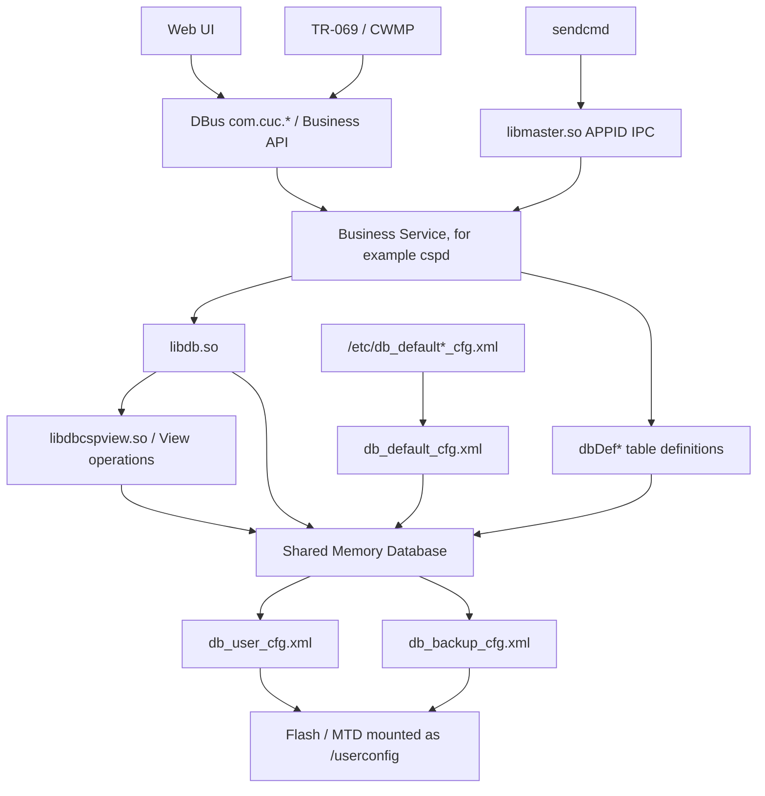
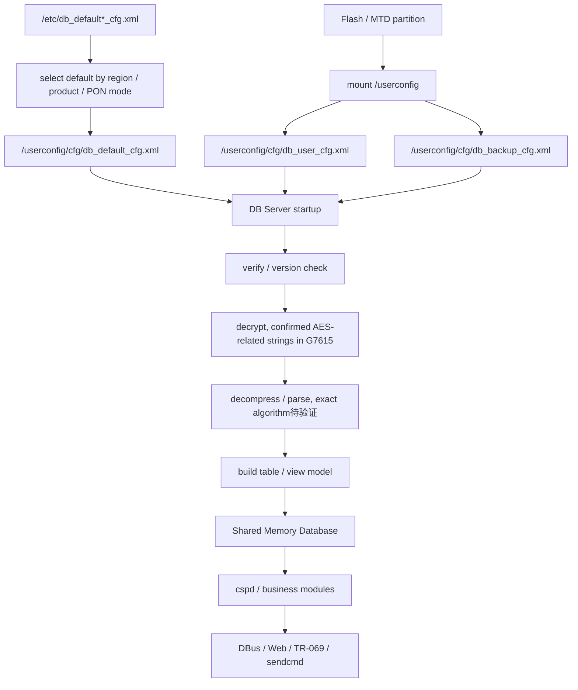
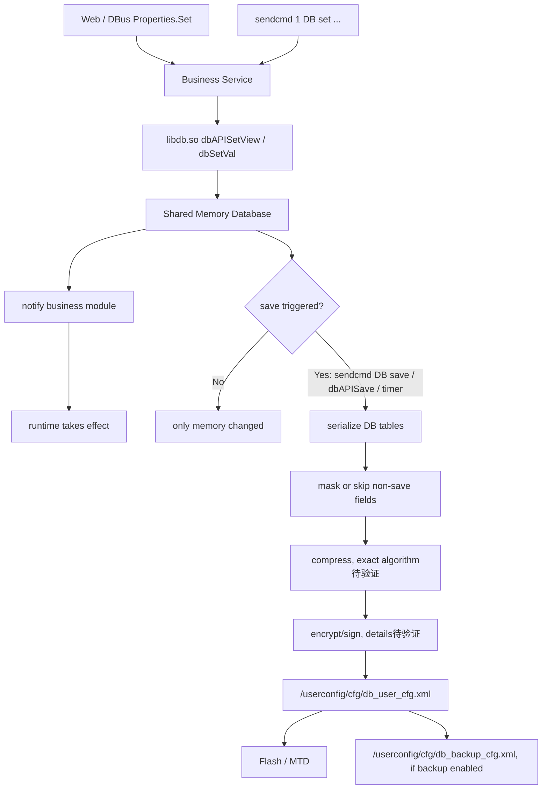
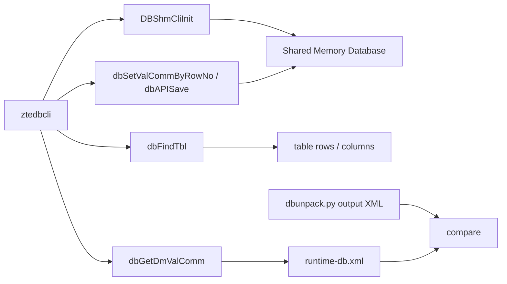
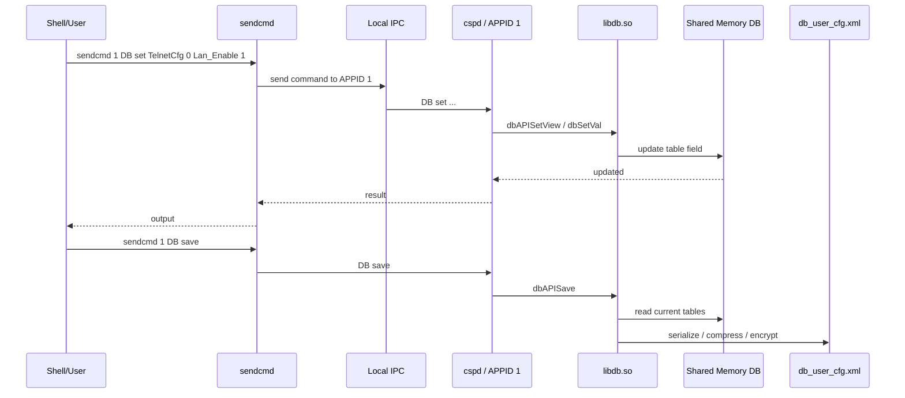
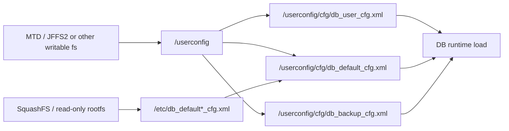

# 中兴配置数据库架构

## 简介

本文整理 ZTE Buildroot 光猫中常见的配置数据库架构，重点解释 Web、DBus、业务服务、`sendcmd`、`cspd`、`libdb.so`、共享内存数据库、配置文件和 Flash 持久化之间的关系。

本文定位是开发者文档和知识库文档，不是漏洞分析，也不是单一固件的 Reverse 报告。G7615 固件中的证据会作为已验证案例引用，但结论尽量抽象为以后分析 ZTE Buildroot 光猫时可复用的通用模型。

## 适用范围

适用对象：

- ZTE Buildroot 光猫固件
- 使用 `sendcmd` 作为本地调试命令入口的 ZTE 固件
- 存在 `cspd`、`libdb.so`、`db_user_cfg.xml`、`db_default_cfg.xml`、`db_backup_cfg.xml` 这类组件的固件
- 通过 Web / DBus / TR-069 / 本地业务进程共同读写配置的设备

不适用或需要重新验证的对象：

- 完全 OpenWrt 原生 `uci` 架构的设备
- 不含 `cspd` / `libdb.so` 的 ZTE 新架构设备
- 配置持久化已经迁移到 SQLite、ubus-only 或其他私有数据库的设备

## 术语

| 术语 | 含义 |
| --- | --- |
| 配置数据库 | ZTE 业务层维护的设备配置集合，不等同于 DBus，也不等同于某一个文件 |
| DB Server | 负责加载、维护、保存配置数据库的业务进程；在 G7615 中主要对应 `cspd` |
| DB Client | 调用数据库 API 或发送调试命令的客户端，例如 Web 后端、DBus 服务、`sendcmd` |
| Shared Memory Database | 运行时驻留在共享内存中的配置数据库 |
| User Config | 用户配置包，典型路径为 `/userconfig/cfg/db_user_cfg.xml` |
| Default Config | 默认配置包，典型路径为 `/userconfig/cfg/db_default_cfg.xml` 或 `/etc/db_default*_cfg.xml` |
| Backup Config | 备份配置包，典型路径为 `/userconfig/cfg/db_backup_cfg.xml` |

## 整体架构

ZTE 配置系统通常不是“Web 直接改文件”，而是多层业务架构：

```text
Web UI / TR-069 / App / CLI
        |
        v
DBus / Business API / sendcmd
        |
        v
Business Service, for example cspd
        |
        v
libdb.so
        |
        v
libdbcspview.so / dbDef* / dbView*
        |
        v
Shared Memory Database
        |
        v
db_user_cfg.xml / db_backup_cfg.xml
        |
        v
Flash partition mounted as /userconfig
```



在这个模型中：

- Web UI 不是数据库。
- DBus 不是数据库。
- `sendcmd` 不是数据库。
- `db_user_cfg.xml` 也不是运行时数据库本身。
- 真正运行时中心通常是业务服务维护的共享内存数据库。
- `libdbcspview.so` 是具体 View 的适配层，`cspd` 中的 `dbDef*` 函数提供大量表定义线索。

## 配置生命周期

### 启动加载流程

启动后，系统会先挂载持久化分区，再准备默认配置和用户配置，最后由 DB 服务加载成运行时共享内存数据库。



已确认事实：

- G7615 启动脚本会挂载 `/userconfig`。
- G7615 `etc/init.d/rcS` 导出 `OVSDB_PATH=/userconfig/cfg`。
- G7615 `cspd` 中可见 `/userconfig/cfg/db_user_cfg.xml`、`/userconfig/cfg/db_default_cfg.xml`、`/userconfig/cfg/db_backup_cfg.xml`。
- G7615 `cspd` 中可见 `DBDefAESCBCKey`、`DBDefAESCBCIV`。
- G7615 `libdb.so` 中可见 `DBShmSrvInit`、`DBShmCliInit`、`dbAPIGetView`、`dbAPISetView`、`dbAPISave`。

待验证部分：

- 不同机型的具体配置解密、验签、解压顺序可能不同。
- `db_user_cfg.xml` 的外层头格式、版本字段和压缩算法需要结合 GPL 源码或动态调试进一步确认。

### 修改保存流程

配置修改通常先进入共享内存数据库，立即影响运行时业务；只有执行保存或保存定时器触发后，才会写回持久化配置包。



因此可以解释两个常见现象：

- `sendcmd DB set` 后配置可能马上生效，因为它改的是共享内存中的运行时配置。
- 设备重启后配置是否保留，取决于是否成功执行保存并写回 `/userconfig/cfg/db_user_cfg.xml`。

## 各组件职责

### sendcmd

`sendcmd` 是本地命令客户端。它负责把命令发送给指定 APPID 对应的业务进程，并接收返回结果。

职责：

- 提供统一调试入口，例如 `sendcmd 1 DB p TelnetCfg`。
- 通过本地 IPC 与业务进程通信。
- 传递 `DB p`、`DB set`、`DB save`、`DB reject` 等命令。

不负责：

- 不直接解析 `db_user_cfg.xml`。
- 不直接维护共享内存数据库。
- 不直接决定字段是否脱敏。

G7615 已确认：

- `bin/sendcmd` 字符串中可见 `socket`、`connect`、`sendto`、`recvfrom`、`select`。
- `bin/sendcmd` 字符串中没有配置文件路径。
- `sendcmd` 帮助中包含 `[APPID] : show command list of APPID program`，说明它是按 APPID 转发命令的客户端。

### 运行时 DB 直读工具

除了 `sendcmd 1 DB p <table>`，还可以编写一个 DB Client，直接连接
`libdb.so` 的共享内存接口：

```text
DBShmCliInit()
  -> dbFindTbl(table)
  -> 遍历 row_hdr / col_hdr
  -> dbGetDmValComm(table, row, col)
  -> dbSetValCommByRowNo(table, rownum, dm, value)
  -> dbAPISave()
```

这个路线已经由外部 `printbl.c` 样例证明可行，本项目将其整理为
`db-tools/ztedbcli.c`。它的定位是运行时 DB 客户端：

- 不经过 `sendcmd` 的 APPID IPC。
- 不读取或解密 `db_user_cfg.xml`。
- 可以读取、打印、修改共享内存中的表。
- `set/addrow/delrow` 只改运行时 DB，`save` 才会触发持久化。
- 可用于把当前运行时表值与 `dbunpack.py` 解出的 XML 交叉对照。



和 `sendcmd` 的关系：

| 能力 | sendcmd | ztedbcli |
| --- | --- | --- |
| 读运行时表 | 是 | 是 |
| 改运行时表 | 是 | 是，`set/addrow/delrow` |
| 保存到配置包 | 是，`DB save` | 是，`save` |
| 依赖 APPID IPC | 是 | 否 |
| 依赖 shared memory | 间接依赖 | 直接依赖 |

详细使用见 `docs/03-Vendors/ZTE/Architecture/运行时DB转储.md`。

### cspd

`cspd` 是 ZTE 业务服务集合中的核心进程之一。在 G7615 中，DB 命令处理、配置表定义、配置加载保存逻辑与大量业务模块都能在 `cspd` 字符串中看到。

职责：

- 初始化 DB 服务端。
- 调用 `libdb.so` 创建和维护共享内存数据库。
- 处理 `sendcmd 1 DB ...` 这类命令。
- 为 Web / DBus / TR-069 / 其他业务模块提供配置读写能力。
- 执行配置保存、恢复、备份、部分恢复等动作。

G7615 已确认：

- `bin/cspd` 中可见 `DBShmSrvInit`。
- `bin/cspd` 中可见 `p [tablename]`、`set [tablename][rownum][dm][dmvalue]`、`fc [bin-file-name]`、`fuc [bin-file-name]`、`saveasy`、`reject`、`unreject` 等 DB 命令。
- `bin/cspd` 中硬编码了 `/userconfig/cfg/db_user_cfg.xml`、`/userconfig/cfg/db_default_cfg.xml`、`/userconfig/cfg/db_backup_cfg.xml`。

通用推测：

- 在其他 ZTE Buildroot 机型中，DB Server 不一定仍叫 `cspd`，但通常会存在一个或多个业务主进程负责同类职责。判断标准应以 `DBShmSrvInit`、配置文件路径、`dbAPI*` 调用和 `sendcmd` 命令表为准。

### libdb.so

`libdb.so` 是配置数据库核心库。它向业务进程暴露表、视图、行、字段、保存、恢复、共享内存初始化等 API。

职责：

- 提供 `dbAPIGetView`、`dbAPISetView`、`dbAPILstView`、`dbAPIQryView` 等访问接口。
- 提供 `dbAPISave`、`dbAPIRestore`、`dbAPICompress` 等持久化相关接口。
- 初始化服务端和客户端共享内存连接。
- 维护表、行、字段、视图、哈希索引等数据库内部结构。
- 对敏感字段进行打印脱敏。

G7615 已确认：

- `libdb.so` 中可见 `DBShmSrvInit`、`DBShmCliInit`。
- `libdb.so` 中可见 `dbAPIGetDefCfg`、`dbAPIGetUsrCfg`、`dbAPIGetDefPath`、`dbAPIGetUsrPath`、`dbAPIGetUsrBackPath`。
- `libdb.so` 中可见 `AES_encode`、`AES_decode`。
- `libdb.so` 中可见 `<DM name="%s" val="******"/>`，说明至少部分打印路径会脱敏。

### Shared Memory Database

共享内存数据库是运行时真实配置状态所在的位置。

职责：

- 保存已经加载、解密、解析后的配置表。
- 允许多个业务模块快速读取配置。
- 支持 `set` 后立即影响运行时。
- 为保存流程提供序列化来源。

生命周期：

- DB Server 启动时创建或初始化。
- 业务进程运行期间持续存在。
- `DB set`、DBus `Set`、TR-069 `SetParameterValues` 等操作会修改其中内容。
- 保存时从共享内存序列化到用户配置包。
- 重启后共享内存消失，需要重新从持久化配置包加载。

待验证部分：

- 共享内存 key、权限、大小和分段策略不同机型可能不同。
- 是否支持多 DB 实例或跨进程锁粒度，需要结合 GPL 源码或动态调试确认。

### db_user_cfg.xml

`db_user_cfg.xml` 是用户配置持久化文件，通常位于 `/userconfig/cfg/`。

职责：

- 保存用户修改后的配置。
- 设备重启后作为优先加载来源之一。
- 作为恢复、备份、升级迁移时的重要输入。

注意：

- 文件名含 `.xml`，但在 G7615 中不是明文 XML。
- 不能直接用文本编辑器修改。
- 直接替换或破坏该文件可能导致 DB 恢复默认或进入配置修复流程。

### db_default_cfg.xml

`db_default_cfg.xml` 是默认配置包。

来源：

- 固件只读区中的 `/etc/db_default_cfg.xml`。
- 区域定制版本，例如 `/etc/db_default_Beijing_cfg.xml`、`/etc/db_default_Guangdong_cfg.xml` 等。
- PON 模式定制版本，部分机型可能有 GPON / EPON 变体。

职责：

- 首次启动或用户配置缺失时提供基础配置。
- 恢复出厂时作为重建用户配置的来源。
- 区域版本切换时复制到 `/userconfig/cfg/db_default_cfg.xml`。

G7615 已确认：

- `etc/init.d/rcS` 中存在区域版本选择逻辑。
- `etc/init.d/rcS` 中会把 `/etc/db_default*_cfg.xml` 复制到 `/userconfig/cfg/db_default_cfg.xml`。

### db_backup_cfg.xml

`db_backup_cfg.xml` 是用户配置备份文件。

职责：

- 在用户配置损坏或保存失败时提供回退来源。
- 支持同步或定时备份，具体策略由 DB Server 控制。
- 可能用于升级前后配置迁移。

G7615 已确认：

- `cspd` 中包含 `/userconfig/cfg/db_backup_cfg.xml`。
- `cspd` 命令表中可见 `bckinterval`、`bcktype`、`backup`。

待验证部分：

- 备份触发条件、备份内容是全量还是增量，需要结合对应版本 GPL 源码或运行时日志确认。

### OVSDB_PATH

`OVSDB_PATH` 在 G7615 启动脚本中被设置为 `/userconfig/cfg`。

职责：

- 指示配置相关文件所在目录。
- 同时 `CFGDB="$OVSDB_PATH/conf.db"` 出现在启动脚本中，说明该路径也可能服务于 OVS 相关组件。

注意：

- 这里的 `OVSDB_PATH` 不应简单等同于 ZTE 配置数据库本身。
- 在 G7615 中，它至少说明 `/userconfig/cfg` 是系统级配置目录。
- `db_user_cfg.xml` 等 ZTE 配置包路径由 `cspd` 另行硬编码或通过 DB API 获取。

## sendcmd 工作机制

`sendcmd` 的基本模型是：

```text
sendcmd APPID module command args...
```

例如：

```bash
sendcmd 1 DB p TelnetCfg
sendcmd 1 DB set TelnetCfg 0 Lan_Enable 1
sendcmd 1 DB save
sendcmd 1 DB reject
```

工作流程：



常见命令语义：

| 命令 | 作用 | 是否持久化 |
| --- | --- | --- |
| `DB p <table>` | 打印表内容或表相关信息 | 否 |
| `DB set <table> <row> <dm> <value>` | 修改共享内存中的字段值 | 否，除非后续保存 |
| `DB save` | 把当前运行时配置保存到用户配置包 | 是 |
| `DB reject` | 拒绝 DB 保存，常用于调试或特殊流程 | 否，影响保存行为 |
| `DB unreject` | 取消拒绝保存状态 | 否，影响保存行为 |

为什么 `sendcmd` 输出可能脱敏：

- `libdb.so` 中存在 `<DM name="%s" val="******"/>`。
- DB 打印路径可能对密码、认证信息、密钥等字段统一脱敏。
- 因此 `sendcmd DB p` 适合看表结构、行数、开关状态，但不一定适合获取敏感字段真实值。

## Shared Memory 设计解释

ZTE 配置系统采用共享内存数据库，可以同时满足几个需求：

- 多业务模块高速读取配置。
- 修改后无需反复解析 Flash 上的配置包。
- Web、TR-069、DBus、本地 CLI 可以共享同一套运行时状态。
- 保存动作可以集中控制，避免每次字段变化都写 Flash。

为什么修改后立即生效：

- `DB set` 或 DBus `Set` 修改的是共享内存中的运行时配置。
- 业务模块通常监听配置变化，或在处理业务时重新读取共享内存。
- 因此无需等待配置文件落盘。

为什么 `save` 才持久化：

- Flash 写入成本高，且频繁写入会影响寿命。
- 运行时配置变化和持久化是两步。
- `save`、异步保存定时器或业务保存流程触发后，才序列化到 `/userconfig/cfg/db_user_cfg.xml`。

什么时候重新加载：

- 系统启动时。
- 恢复出厂或本地恢复配置时。
- 远程恢复配置时。
- 升级迁移配置时。
- 特定 DB reload 命令或内部状态机触发时。

什么时候覆盖：

- 用户配置缺失时由默认配置生成。
- 用户配置损坏时可能从备份或默认配置恢复。
- 区域版本切换时默认配置包可能被替换。
- 恢复出厂会重建用户配置。

## 配置持久化

### /userconfig

`/userconfig` 是用户配置持久化目录，通常挂载自 Flash MTD 分区。

G7615 已确认：

- `etc/default/S01userconfig` 会检查 `/dev/mtd5`。
- 成功时将 `/dev/mtdblock5` 以 `jffs2` 挂载到 `/userconfig`。
- 脚本会创建 `/userconfig/cfg`。

通用推测：

- 其他 ZTE Buildroot 光猫中，分区编号不一定是 `mtd5`。
- 文件系统也可能随平台变化，但 `/userconfig` 作为持久化挂载点是常见模式。

### /etc

`/etc` 中的 `db_default*_cfg.xml` 通常位于只读固件 rootfs。

职责：

- 提供出厂默认配置。
- 提供不同省份、运营商、PON 模式、硬件版本的默认配置。
- 在 `/userconfig/cfg/db_default_cfg.xml` 缺失或需要切换时作为复制来源。

### Flash / MTD

Flash 保存用户配置，启动脚本负责挂载。配置文件不是直接散落在普通 rootfs 中，而是在持久化分区中维护。

典型关系：



### 区域版本切换

G7615 启动脚本中存在 `regioncode` 映射和区域配置复制逻辑：

- 从 `/userconfig/flag_type` 读取当前区域编号。
- 通过 `/etc/init.d/regioncode` 找到区域名称。
- 生成 `/etc/db_default_${regionname}_cfg.xml`。
- 如果文件存在，则复制到 `/userconfig/cfg/db_default_cfg.xml`。
- 如果不存在，尝试根据 PON mode 选择 GPON / EPON 变体。

通用结论：

- ZTE 固件往往把默认配置做成区域、运营商或产品线变体。
- 分析配置问题时必须确认当前 `flag_type`、区域映射和默认配置来源。

## 配置文件格式

### 已确认事实

G7615 中的 `db_user_cfg.xml`、`db_default_cfg.xml`、`db_backup_cfg.xml` 文件名含 `.xml`，但本地检查显示它们不是明文 XML：

- `file` 识别为 `data`。
- `head` 输出为二进制内容。
- 文件头可见固定字节 `01 02 03 04`。
- `cspd` 中可见 `DBDefAESCBCKey`、`DBDefAESCBCIV`。
- `libdb.so` 中可见 `AES_encode`、`AES_decode`。
- `cspd` 中可见 `/var/tmp/db_user_cfg.xml`、`/var/tmp/db_reload_cfg.xml`、`/var/tmp/decry-cfg`、`/var/tmp/sign-cfg` 等中间路径。
- `cspd` 中存在 `<DB>`、`</DB>`、`<Tbl name="%s"...>`、`<DM name="%s"...>` 等明文 XML 片段，说明内部序列化阶段可能会生成 XML 形态。

### 合理解释

运行时可能存在这样的处理链：

```text
Shared Memory Tables
    -> XML-like serialization
    -> compress
    -> version/sign header
    -> AES encrypt
    -> db_user_cfg.xml binary package
```

### 待验证部分

以下内容不能写成确定事实：

- 压缩算法具体是 zlib、私有压缩还是其他算法。
- 签名和版本头的完整结构。
- AES key / IV 的来源优先级。
- `db_user_cfg.xml` 中每个头字段的语义。
- 默认配置包和用户配置包是否完全同格式。

### 实践建议

不要直接文本编辑 `db_user_cfg.xml`。

更安全的修改路径：

- 通过 Web / DBus 修改配置。
- 通过业务 API 修改配置。
- 通过 `sendcmd 1 DB set ...` 修改运行时字段，再执行 `sendcmd 1 DB save`。
- 如需离线修改，应先拿到对应版本 GPL 源码或确认完整解包、改包、校验、加密流程。

## DBus 在其中的位置

DBus 不是数据库。DBus 是业务 API 层。

在 ZTE 光猫中，DBus 常用于：

- Web 后端和业务服务之间通信。
- 插件、UFW 容器、厂商管理平台之间通信。
- 暴露对象、属性、方法和信号。
- 提供比 `sendcmd` 更接近业务对象的数据模型。

典型 DBus 接口形态：

- `org.freedesktop.DBus.Properties.Get`
- `org.freedesktop.DBus.Properties.GetAll`
- `org.freedesktop.DBus.Properties.Set`
- `org.freedesktop.DBus.ObjectManager.GetManagedObjects`
- 厂商接口，例如 `com.cuc.*`

为什么 DBus 可能比 `sendcmd` 返回更多真实数据：

- `sendcmd DB p` 走的是调试打印路径，打印层可能统一脱敏。
- DBus 走的是业务接口路径，返回值通常用于 Web UI、远程管理或 App，可能需要真实值才能显示或提交。
- 某些敏感字段在 `sendcmd` 打印时显示 `******`，但在具备权限的 DBus 方法或属性中可能返回真实值。

注意：

- DBus 是否返回真实敏感值取决于具体服务权限和接口设计。
- 不能假设所有 DBus 接口都会泄露真实值。
- 分析时应优先确认 DBus introspection、服务名、对象路径、接口权限和调用方身份。

## sendcmd 与 DBus 对比

| 项目 | sendcmd | DBus |
| --- | --- | --- |
| 定位 | 本地调试命令客户端 | 业务 API / IPC 总线 |
| 主要入口 | Shell 命令 | DBus service / object / interface |
| 典型用户 | 开发、产测、维护、调试 | Web、App、插件、业务服务 |
| 数据模型 | 命令行文本、表名、字段名 | 对象、属性、方法、信号 |
| 返回格式 | 文本输出 | typed value / variant / dict / array |
| 权限模型 | 依赖本地执行权限和 APPID 服务校验 | 依赖 DBus policy、服务内部鉴权、调用方身份 |
| 脱敏情况 | 常见，尤其 `DB p` 打印路径 | 不一定，取决于业务接口 |
| 是否直接改 DB | 通过业务进程间接修改 | 通过业务服务间接修改 |
| 是否持久化 | `DB set` 不持久化，`DB save` 才持久化 | 取决于业务接口是否自动保存或触发保存 |
| 适合场景 | 快速确认表、字段、运行时状态 | 还原 Web 真实业务流程、获取结构化数据 |
| Reverse 优先级 | 适合初步探索 | 适合深入业务建模 |
| 风险 | 命令误用可能改变运行时配置 | 方法调用可能触发真实业务动作 |

## 最佳实践

### 分析优先级

推荐顺序：

1. 启动脚本：先确认 `/userconfig` 如何挂载、默认配置如何复制、环境变量如何设置。
2. 进程和服务：确认 `cspd`、DBus daemon、Web 服务、TR-069、插件容器等如何启动。
3. DBus：优先还原 Web / App 的业务 API，因为它结构化、接近真实业务。
4. sendcmd：用于快速列出命令、打印 DB 表、验证运行时状态。
5. libdb.so / cspd：用于确认 DB API、共享内存、持久化、脱敏、表定义。
6. 配置文件：最后再做离线格式分析，避免一开始陷入加密包细节。

### 什么时候优先看 DBus

- 要还原 Web UI 数据来源。
- 要知道某个按钮最终调用哪个业务接口。
- 要获取结构化对象、属性列表和真实业务状态。
- `sendcmd` 输出被脱敏或过于粗糙。

### 什么时候优先看 sendcmd

- 需要快速确认某个表是否存在。
- 需要验证运行时 DB 字段是否变化。
- 需要触发保存、恢复、打印状态机等调试功能。
- 没有 Web 会话或 DBus 权限不足时。

### 什么时候分析 libdb.so / cspd

- 需要理解表、视图、字段和保存逻辑。
- 需要解释为什么某字段被脱敏。
- 需要确认配置文件路径。
- 需要找 `db_user_cfg.xml` 的加密、压缩、签名处理流程。

### 什么时候分析配置文件

- 要做离线迁移。
- 要比较不同区域默认配置差异。
- 要恢复损坏配置。
- 要做自动化配置备份或还原。

### 什么时候分析启动脚本

- 第一次接触某台 ZTE 固件时必须分析。
- 配置没有持久化时。
- 恢复出厂行为异常时。
- 区域、运营商、PON 模式、产品型号影响默认配置时。

## G7615 已验证证据索引

以下证据来自当前仓库提取出的 G7615 固件文件：

| 证据 | 路径 | 说明 |
| --- | --- | --- |
| `sendcmd` 是 ARM ELF 客户端 | `bin/sendcmd` | 字符串包含 socket/sendto/recvfrom/select，未发现 DB 配置路径 |
| APPID IPC 框架 | `lib/libmaster.so`、`bin/sendcmd` | `InitAppComm`、`ssend`、`/var/tmp/`、`APPID[...] EVENT[...]` 字符串说明 `sendcmd` 通过本地 socket 消息框架转发 |
| DB API 核心库 | `lib/libdb.so` | 包含 `dbAPIGetView`、`dbAPISetView`、`dbAPISave`、`DBShmSrvInit`、`DBShmCliInit` |
| DB 服务端证据 | `bin/cspd` | 包含 DB 命令表、配置路径、保存/恢复/备份相关字符串 |
| View 扩展库 | `lib/libdbcspview.so` | 包含 `dbViewWANCPPPFun`、`dbSetWANCPPPView`、`dbGetWLANCfgView` 等具体 View 操作 |
| 表定义函数 | `bin/cspd` | 动态符号中提取到 194 个 `dbDef*` 表候选 |
| View 操作函数 | `bin/cspd`、`lib/libdbcspview.so` | 动态符号中提取到 56 个 View 操作候选 |
| 用户配置路径 | `bin/cspd` | `/userconfig/cfg/db_user_cfg.xml` |
| 默认配置路径 | `bin/cspd`、`etc/init.d/rcS` | `/userconfig/cfg/db_default_cfg.xml`、`/etc/db_default*_cfg.xml` |
| 备份配置路径 | `bin/cspd` | `/userconfig/cfg/db_backup_cfg.xml` |
| AES 线索 | `bin/cspd`、`lib/libdb.so` | `DBDefAESCBCKey`、`DBDefAESCBCIV`、`AES_encode`、`AES_decode` |
| `/userconfig` 挂载 | `etc/default/S01userconfig` | `/dev/mtdblock5` 挂载到 `/userconfig` |
| 配置目录 | `etc/init.d/rcS` | `OVSDB_PATH=/userconfig/cfg` |
| 区域配置切换 | `etc/init.d/rcS`、`etc/init.d/regioncode` | 根据 `flag_type` 和 regioncode 选择默认配置 |
| 实际 `sendcmd DB set/save` 记录 | `userconfig/TdTraceLog.txt` | 可见 `sendcmd 1 DB set TelnetCfg ...` 和 `sendcmd 1 DB save` |

## 待验证清单

后续如果拿到 GPL 源码或实机动态环境，建议继续验证：

- `APPID=1` 到具体进程名的注册表和启动链路。
- `sendcmd` 使用的 IPC socket 路径、消息头结构和超时机制。
- 共享内存 key、大小、权限、锁机制。
- `db_user_cfg.xml` 文件头字段含义。
- 配置包的压缩算法、签名算法、AES mode 和 padding。
- `DB reject` 对定时保存、手动保存、恢复流程的具体影响。
- DBus service/object/interface 到 DB view/table 的映射关系。
- Web UI 哪些接口走 DBus，哪些直接走 CGI 或私有 IPC。

## 参考资料

本仓库资料：

- G7615 固件提取文件：`bin/sendcmd`、`bin/cspd`、`lib/libdb.so`、`lib/libcmapi.so`、`lib/libcfapi.so`
- 深入分析文档：`docs/03-Vendors/ZTE/Architecture/libdb分析.md`、`docs/03-Vendors/ZTE/Architecture/cspd分析.md`、`docs/03-Vendors/ZTE/Architecture/数据库生命周期.md`、`docs/03-Vendors/ZTE/Architecture/数据库Schema.md`、`docs/03-Vendors/ZTE/Architecture/DB与DBus映射.md`
- 自动生成索引：`docs/03-Vendors/ZTE/Architecture/artifacts/db_dynamic_symbols.csv`、`cspd_dbdef_tables.csv`、`db_view_operations.csv`、`db_string_inventory.csv`、`db_schema_candidates.json`
- 启动脚本：`etc/init.d/rcS`、`etc/default/S01userconfig`、`etc/init.d/regioncode`
- 配置文件样本：`etc/db_default*_cfg.xml`、`userconfig/cfg/db_user_cfg.xml`、`userconfig/cfg/db_default_cfg.xml`、`userconfig/cfg/db_backup_cfg.xml`
- 运行记录：`userconfig/TdTraceLog.txt`

通用背景资料：

- Buildroot Manual: `https://buildroot.org/manual.html`
- OpenWrt Documentation: `https://openwrt.org/docs/start`
- Linux Kernel Documentation: `https://docs.kernel.org/`
- D-Bus Specification: `https://dbus.freedesktop.org/doc/dbus-specification.html`
- Linux man-pages: `https://man7.org/linux/man-pages/`

源码类资料：

- GPL 源码：用于验证 `cspd`、`libdb.so`、配置文件格式、共享内存结构和保存流程；本文未引用未经验证的论坛猜测。
- Buildroot 源码：用于理解启动、rootfs、工具链和 BusyBox/glibc 组合。
- OpenWrt 源码：用于理解 UFW / OpenWrt 容器、opkg、procd、ubus 等背景，但不能把 ZTE 私有 DB 等同于 OpenWrt UCI。

## 最后验证时间

更新时间：2026-07-13

验证环境：当前仓库提取出的 ZTE G7615 Buildroot 固件文件、启动脚本、二进制字符串、运行日志。

适用版本：ZTE Buildroot 光猫配置数据库通用架构，G7615 为已验证案例。

作者：Codex
