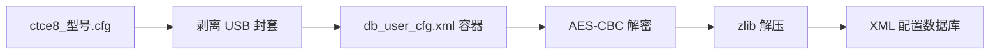

# 配置文件重打包

工具目录：`db-tools/`。

## 设备端采集

每台设备的 `tagparam/paramtag` 可能不同，因此 user DB 的 key/iv 不能跨设备硬套。
新设备上 user DB 的 seed key 不是直接使用
`/etc/hardcodefile/dataprotocol` 里的 `CSP_USER_AESCBCENCRY_KEY`，而是优先
使用 `setmac show2` 中的 `INDIVKEY`。该项 ID 为 `1824`，即 paramtag
tag `0x0720`；命令显示可能是星号，真实值在 `/tagparam/paramtag` 中。
先把 `db-tools/device_collect.sh` 放到设备上执行：

```sh
sh device_collect.sh
```

输出示例：

```text
/tmp/zte-db-live-dump-20260714-000000.tgz
```

采集包包含：

- `/userconfig/cfg/db_user_cfg.xml`
- `/userconfig/cfg/db_backup_cfg.xml`
- `/userconfig/cfg/db_default_cfg.xml`
- `/tagparam/paramtag`
- `/wlan/paramtag`
- `/etc/hardcode`
- `/etc/hardcodefile/*`
- `/proc/csp/boardtype`
- 可选的 `cspd` key slot 内存片段

把压缩包放到本地 `db-tools/` 目录后运行：

```bash
python3 db-tools/prepare_from_dump.py
```

该脚本会生成：

- `db-tools/db_keys.json`：`dbunpack.py` / `dbpack.py` 默认读取的 key 文件。
- `db-tools/db_keys.env`：便于 shell `source` 的 key/iv 环境变量。
- `live-root/`：规整后的设备 root 视图。
- `out-live/`：自动解包后的 XML。

## 解包

无 key 时只解析外层容器：

```bash
python3 db-tools/dbunpack.py --info userconfig/cfg/db_user_cfg.xml
```

导出 hardcode 参数：

```bash
python3 db-tools/hardcode_dump.py
```

设备端快速打印 user DB key/iv：

```sh
sh device_print_user_db_key.sh
```

脚本会自动扫描 `/tagparam/paramtag` 的 tag `0x0720`，不依赖固定偏移。

本样本默认配置可直接解包：

```bash
python3 db-tools/dbunpack.py userconfig/cfg/db_default_cfg.xml \
  -o out-default
```

本样本用户配置可直接解包：

```bash
python3 db-tools/dbunpack.py userconfig/cfg/db_user_cfg.xml \
  -o out-user

python3 db-tools/dbunpack.py userconfig/cfg/db_backup_cfg.xml \
  -o out-backup
```

## 打包

```bash
python3 db-tools/dbpack.py out/db_user_cfg.xml.xml new_db_user_cfg.xml \
  --key-profile user
```

`dbpack.py` 当前是实验性工具。外层 AES 容器行为已经按代码实现；内层头部
若要达到固件完全接受，仍需要在设备上做写回前后的往返验证。

已验证的用户配置 key 来自 `INDIVKEY` / tag `0x0720` / ID `1824`：

- seed：`cKZF6ufRy2ecKZHfYPh7FfP9cUDPzbuE`
- 完整 MD5：`e64c0347a55b5f2423fa487c3e646ac9`
- cspd key slot 有效字符串：`e64c0347a55b5f2423fa487c3e646ac`
- cspd IV slot 有效字符串：`667b02a85c61c786def4521b060265e`

重打包 `db_user_cfg.xml` 或 `db_backup_cfg.xml` 时使用 cspd slot 有效字符串，
不要使用完整 32 字符 MD5 或完整 32 字符 hardcode IV。

## 管理台 U 盘备份

管理台导出的 `e8_Config_Backup/ctce8_*.cfg` 是 USB 备份封套，内部嵌入
完整 `db_user_cfg.xml` 容器。当前样本的内嵌 DB 起始偏移为 `0x95`。



解包：

```bash
python3 db-tools/e8_usb_cfg.py unpack \
  e8_Config_Backup/ctce8_G7615-G-C.cfg \
  -o out-e8 \
  --strict-crc
```

重建：

```bash
python3 db-tools/e8_usb_cfg.py pack \
  e8_Config_Backup/ctce8_G7615-G-C.cfg \
  new_db_user_cfg.xml \
  -o ctce8_G7615-G-C.new.cfg
```

跨机器恢复通常无效，因为内嵌 DB 仍使用源机器的 user key 加密；目标机器
恢复时会用目标机器自己的 `tag 0x0720` 派生 key 来解密。

## 自动生成替换包

本地生成并验证新 DB 后：

```bash
python3 db-tools/make_replace_package.py new_db_user_cfg.xml \
  -o db-tools/db-replace-package.tgz
```

上传到设备 `/tmp` 后执行：

```sh
cd /tmp
tar -xzf db-replace-package.tgz
cd zte-db-replace
sh install_db_cfg.sh --yes-reboot
```

`install_db_cfg.sh` 会：

1. 备份当前 `/userconfig/cfg/db_user_cfg.xml` 和 `db_backup_cfg.xml`。
2. 替换两份配置文件。
3. 执行 `sync` 两次。
4. 使用 `--yes-reboot` 时执行 `reboot -f`。

如果想先替换但不重启：

```sh
sh install_db_cfg.sh
```

如果想一条命令替换并强制重启：

```sh
sh install_and_reboot.sh
```

## 手动替换步骤

手动操作时推荐同时替换 user 和 backup：

```sh
cd /userconfig/cfg

TS=$(date +%Y%m%d-%H%M%S 2>/dev/null || echo now)
mkdir -p offline-backup-$TS
cp -a db_user_cfg.xml offline-backup-$TS/db_user_cfg.xml.bak
cp -a db_backup_cfg.xml offline-backup-$TS/db_backup_cfg.xml.bak

cp /tmp/new_db_user_cfg.xml db_user_cfg.xml
cp /tmp/new_db_user_cfg.xml db_backup_cfg.xml
chmod 666 db_user_cfg.xml db_backup_cfg.xml

sync
sync
reboot -f
```
