# 功能域映射

本页按后台功能理解 DBus 对象。标注“推测”的内容来自对象名和字段名，尚未通过 Web 后台抓包确认。

## 总览

| 功能 | 对象 | 证据 | 说明 |
| --- | --- | --- | --- |
| WiFi 设置 | `Config/WLAN/Devices/{1..8}` | 采集确认 | `SSID/PWD/Channel/TransmitPower/Enable` 等字段 |
| WPS | `Config/WLAN/Devices/{n}/WPS` | 采集确认 | `Enable/WPSStatus` |
| WiFi 定时 | `Config/WLAN/Timer` | 采集确认 | `StartTime/EndTime/ControlCycle` |
| DHCP | `Config/DHCPServer` | 采集确认 | 地址池、租期、LAN IP |
| LAN 口 | `Config/EthernetConfig/{1..4}` | 采集确认 | 端口开关、速率、双工、流量 |
| 客户端列表 | `Config/LANHosts/{1..19}` | 采集确认 | MAC/IP/名称/速率/信号 |
| 终端限速 | `Config/LANHosts/{n}` | 采集确认 | `UsBandwidth/DsBandwidth` |
| WAN 状态 | `Info/Network/WANConnectionDb/{1,2}` | 采集确认 | IPv4/IPv6/DNS/VLAN/连接状态 |
| 端口映射 | `Info/Network/WANConnectionDb/{n}/PortMapping` | 采集确认 | 对象名确认，字段需进一步展开 |
| PON 信息 | `Info/PON` | 采集确认 | 光功率、电压、电流、温度 |
| VoIP | `Info/VoIP/1` | 采集确认 | 电话状态、号码等 |
| 防火墙 IPSet | `Firewall/IPSet` | 采集确认 | Add/Delete/Get IPSet |
| L2TP VPN | `Firewall/L2TPVPN` | 采集确认 | Profile 状态与对象管理 |
| 网络加速 | `Firewall/NetworkAcceleration` | 采集确认 | Profile 状态与对象管理 |
| 流量控制 | `Firewall/TrafficControl` | 采集确认 | Profile 状态与对象管理 |
| QoS | `Transfer/TrafficQoSFlow/{1..8}` | 采集确认 | 上下行速率、DSCP |
| WMM | `Transfer/WMMConfiguration` | 采集确认 | WMMProfile |
| USB/NAS | `Storage/NAS`, `Storage/USB/Devices` | 采集确认 | 文件与 USB 设备 |
| Samba | `Storage/SambaServer` | 采集确认 | Samba 开关、匿名、账号 |
| FTP | `Storage/FTPServers/1` | 采集确认 | FTP 开关、路径、端口、账号 |
| Ping/TraceRoute | `Diagnostics/IPPing`, `Diagnostics/TraceRoute` | 采集确认 | 诊断方法 |
| FTTR | `FTTR/LanOptic`, `FTTR/Slave` | 采集确认 | 光口、从设备 |
| 系统维护 | `Unicom/System` | 采集确认 | 重启、恢复、升级通知、日志 |

## Web 后台映射

```mermaid
flowchart TD
    Web["Web 后台"]
    WiFi["无线设置"]
    LAN["局域网/DHCP"]
    Clients["终端管理"]
    WAN["网络状态/WAN"]
    Storage["USB/存储"]
    Firewall["安全/防火墙"]
    QoS["QoS/加速"]
    System["系统维护"]

    Web --> WiFi --> WLAN["Config/WLAN/Devices"]
    WiFi --> WPS["Config/WLAN/Devices/*/WPS"]
    WiFi --> Timer["Config/WLAN/Timer"]
    Web --> LAN --> DHCP["Config/DHCPServer"]
    LAN --> Eth["Config/EthernetConfig"]
    Web --> Clients --> Hosts["Config/LANHosts"]
    Web --> WAN --> WANDB["Info/Network/WANConnectionDb"]
    Web --> Storage --> NAS["Storage/NAS"]
    Storage --> Samba["Storage/SambaServer"]
    Storage --> FTP["Storage/FTPServers"]
    Web --> Firewall --> IPSet["Firewall/IPSet"]
    Firewall --> ACL["Network/AccessControlBlackList"]
    Web --> QoS --> Flow["Transfer/TrafficQoSFlow"]
    QoS --> WMM["Transfer/WMMConfiguration"]
    Web --> System --> Sys["Unicom/System"]
```

## 推测待验证项

| 页面/功能 | 推测对象 | 需要验证 |
| --- | --- | --- |
| WiFi 基本设置 | `Config/WLAN/Devices/{n}` | 页面保存时是否调用 `SetValues` |
| 客户端重命名 | `Config/LANHosts/{n}.DevName` | 前端是否按 MAC 查 path |
| 一键测速 | `Network/SpeedTestTry` | 状态机字段和结果字段含义 |
| 端口映射 | `Info/Network/WANConnectionDb/{n}/PortMapping` | 新增/删除参数签名 |
| USB 文件管理 | `Storage/NAS` | Web 文件管理器是否直接调用 DBus |
| 固件升级 | `Unicom/System` 或 `ufw/appframework` | 升级链路到底由哪个 Service 执行 |
