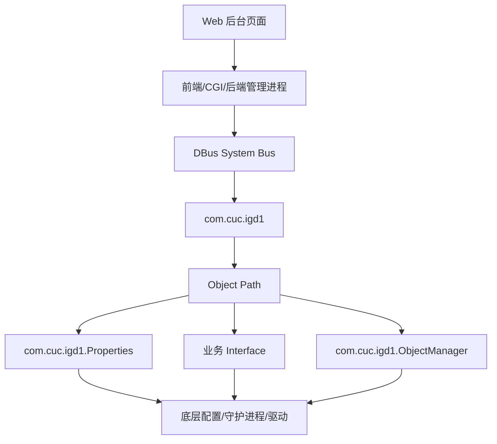
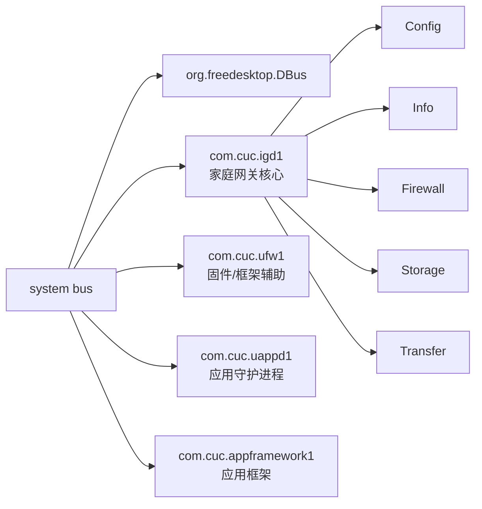
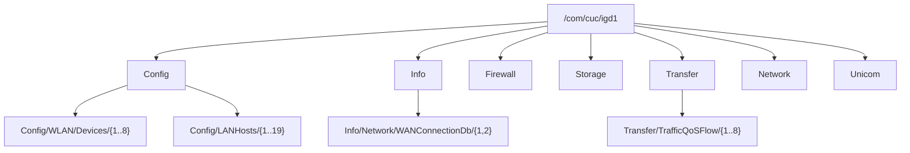

# DBus 架构

## 整体设计

采集结果显示，该设备把家庭网关管理能力抽象为 DBus object tree。核心 Service 是 `com.cuc.igd1`，其下按功能拆分为 `Config`、`Info`、`Network`、`Firewall`、`Storage`、`Transfer`、`Diagnostics`、`FTTR`、`Unicom` 等一级域。

这说明管理后台并不是只读某几个配置文件，而是通过一套运行时对象模型访问设备能力：

- `Config` 偏配置，可修改项集中在 WiFi、DHCP、LAN Host 命名/限速、LED、定时器。
- `Info` 偏状态，包含设备、PON、WAN、VoIP、WiFi 等运行信息。
- `Network` 偏网络服务与测试，包含 HTTPServer、SpeedTestTry、黑名单。
- `Firewall` 偏防火墙、VPN、加速、限速。
- `Storage` 偏 USB/NAS/Samba/FTP。
- `Transfer` 偏转发、流量、QoS、WMM、镜像、监控。
- `Unicom` 偏运营商定制系统能力，例如 PPPoE 与系统命令。

## 管理后台调用链



## Service 关系



## Object Tree 设计

对象路径采用“域/子域/实例”的层次模型：



## Interface 分类

| 类型 | 代表接口 | 作用 |
| --- | --- | --- |
| DBus 标准接口 | `org.freedesktop.DBus.Introspectable`, `Peer` | introspect、ping、machine id |
| 厂商属性接口 | `com.cuc.igd1.Properties` | 读取/修改属性，提供 `Get/GetAll/Set/SetValues` |
| 厂商对象管理接口 | `com.cuc.igd1.ObjectManager` | 管理动态子对象，提供 `AddObject/DeleteObject/GetManagedObjects/RemoveAllObjects` |
| 配置业务接口 | `WLANConfiguration`, `DHCPServer`, `EthernetConfig` | WiFi、DHCP、LAN 口配置 |
| 状态业务接口 | `DeviceInfo`, `PONInfo`, `WANConnectionInfo`, `LANHost` | 设备与网络运行状态 |
| 操作业务接口 | `NASAccess`, `IPSet`, `SysCmd`, `IPPingDiagnostics` | 文件、防火墙、系统、诊断操作 |

## Property 分类

| 分类 | 字段特征 | 示例 |
| --- | --- | --- |
| 配置型 RW | `readwrite` | `SSID`, `PWD`, `Channel`, `DHCPStartIP`, `Enable` |
| 状态型 RO | `readonly` | `RSSI`, `RxBytes`, `ConnectionStatus`, `PONStatus` |
| 统计型 RO | 字节、包、速率 | `TotalBytesSent`, `TxPkts`, `UpSpeed` |
| 拓扑型 RO | 连接关系 | `ConnectDeviceMAC`, `ConnectInterface`, `WANName` |
| 凭据型 RW/RO | 用户名、密码 | `PWD`, `Password`, `UserName`, `PPPoEPassword` |

## Method 分类

| 分类 | 方法 | 风险 |
| --- | --- | --- |
| 通用读取 | `Get`, `GetAll`, `GetManagedObjects` | 低 |
| 通用修改 | `Set`, `SetValues` | 中到高 |
| 对象增删 | `AddObject`, `DeleteObject`, `RemoveAllObjects` | 高 |
| 诊断 | `StartIPPingDiagnostics`, `StartTraceRouteDiagnostics` | 中 |
| 文件操作 | `Copy`, `Move`, `Rename`, `Remove`, `CreateFolder` | 高 |
| 系统操作 | `Reboot`, `Restore`, `LocalRecovery`, `Upgrade` | 极高 |

## `ObjectManager` 的作用

设备使用 `com.cuc.igd1.ObjectManager` 表示“对象集合”。例如：

- `/Config/LANHosts` 管理 `/Config/LANHosts/1..19`
- `/Config/WLAN/Devices` 管理 `/Config/WLAN/Devices/1..8`
- `/Transfer/TrafficQoSFlow` 管理 QoS flow 实例
- `/Info/Network/WANConnectionDb` 管理 WAN 连接实例

这类对象通常不是最终配置对象，而是集合入口。

## `Properties.GetAll` 的作用

`com.cuc.igd1.Properties.GetAll` 是读取某个业务接口全部属性的通用入口。它适合 Web 后台打开页面时一次性读取页面所需字段。

示例：

```sh
gdbus call --system \
  --dest com.cuc.igd1 \
  --object-path /com/cuc/igd1/Config/WLAN/Devices/1 \
  --method com.cuc.igd1.Properties.GetAll \
  com.cuc.igd1.WLANConfiguration
```

## `Properties.Set` 与 `SetValues` 的作用

采集确认每个配置对象几乎都暴露 `Set` 和 `SetValues`：

- `Set`：修改单个属性。
- `SetValues`：批量修改多个属性。

推测 Web 后台保存页面时更可能使用 `SetValues`，因为页面通常一次提交多个字段，例如 WiFi 页面同时提交 `SSID/PWD/Channel/Enable`。

实际调用前必须先读取当前值并确认参数签名，避免修改失败或触发服务重启。
