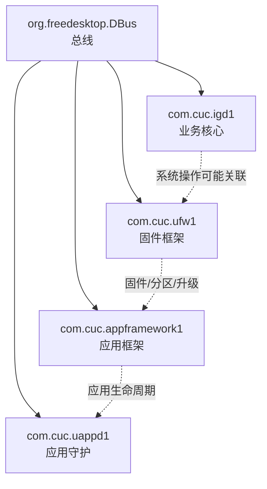

# Service 总览

## 服务列表

| Service | Object 数 | 功能 | 说明 |
| --- | ---: | --- | --- |
| `com.cuc.igd1` | 127 | 家庭网关核心服务 | 采集到几乎所有业务对象，覆盖 WiFi、LAN、WAN、PON、Storage、Firewall、QoS、诊断、FTTR、联通定制 |
| `com.cuc.appframework1` | 4 | 应用框架服务 | 暴露 `AppAgent`，包含安装、卸载、升级、恢复、运行、停止、日志级别等能力 |
| `com.cuc.ufw1` | 4 | 固件/框架辅助服务 | 暴露 `framework`，包含固件版本、MTD、升级、恢复、切换、暂停等能力 |
| `com.cuc.uappd1` | 4 | 应用守护进程 | 暴露应用守护状态与升级上报相关方法 |
| `org.freedesktop.DBus` | 2 | 标准 DBus 服务 | 提供 `ListNames`、连接信息、监控、统计等标准能力 |

## 服务职责关系

## `com.cuc.igd1`

这是最重要的 Service。它不仅包含配置，也包含运行状态和可执行操作。

确认覆盖：

- `Config`：WiFi、DHCP、LAN Host、以太网口、家长控制、LED、电源定时。
- `Info`：设备、管理平台、网络、WAN、PON、VoIP、WiFi。
- `Network`：HTTP 服务、测速、访问控制黑名单、存储黑名单。
- `Firewall`：IPSet、L2TP VPN、网络加速、流量控制。
- `Storage`：FTP、Samba、NAS、USB 设备。
- `Transfer`：自动诊断、转发、流量镜像、监控、QoS、WMM。
- `Diagnostics`：Ping、TraceRoute。
- `FTTR`：光口、从设备。
- `Unicom`：PPPoE 与系统命令。

## `com.cuc.appframework1`

该服务只有一个核心业务接口 `com.cuc.appframework1.AppAgent`，但方法风险很高：

- `Install`
- `Uninstall`
- `Upgrade`
- `Restore`
- `Run`
- `Stop`
- `Reload`
- `HandleKernelMod`

它更像应用框架或插件框架，不应在不了解参数时直接调用。

## `com.cuc.ufw1`

该服务暴露 `com.cuc.ufw1.framework`，采集到属性包括：

- `UfwVersion`
- `UfwBVersion`
- `UfwmgVersion`
- `ActiveMTD`
- `BackupMTD`
- `UfwLogLevel`

方法包括：

- `Upgrade`
- `Restore`
- `Switch`
- `UpdateMTDInfo`
- `Pause`

它与固件分区、升级、框架状态有关。

## `com.cuc.uappd1`

该服务接口名就是 `com.cuc.uappd1`，采集到 `GetStatus` 与 `UpgRep`。从命名看，它是应用守护进程或升级结果上报组件。

## `org.freedesktop.DBus`

标准总线服务。用于发现 Service、查看连接信息和监控总线，不是设备业务配置入口。
