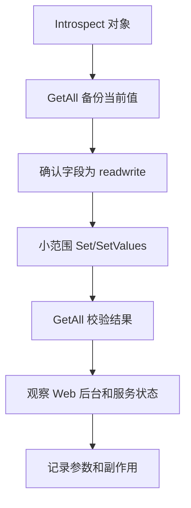

# 开发指南

## 基本原则

所有示例使用 `gdbus`，目标 bus 为 system bus。

开发前先确认：

```sh
gdbus call --system \
  --dest org.freedesktop.DBus \
  --object-path /org/freedesktop/DBus \
  --method org.freedesktop.DBus.ListNames
```

## Introspect

```sh
gdbus introspect --system \
  --dest com.cuc.igd1 \
  --object-path /com/cuc/igd1/Config/WLAN/Devices/1
```

用途：

- 确认业务接口名。
- 确认 property 类型与权限。
- 确认 method 参数签名。
- 确认是否有子对象。

## 读取 WiFi 配置

```sh
gdbus call --system \
  --dest com.cuc.igd1 \
  --object-path /com/cuc/igd1/Config/WLAN/Devices/1 \
  --method com.cuc.igd1.Properties.GetAll \
  com.cuc.igd1.WLANConfiguration
```

关注字段：

- `SSID`
- `PWD`
- `Enable`
- `EncryptionMode`
- `Channel`
- `AutoChannelEnable`
- `TransmitPower`
- `SSIDAdvertisementEnabled`
- `OnlineSta`
- `TotalBytesSent`
- `TotalBytesReceived`

## 读取 DHCP 配置

```sh
gdbus call --system \
  --dest com.cuc.igd1 \
  --object-path /com/cuc/igd1/Config/DHCPServer \
  --method com.cuc.igd1.Properties.GetAll \
  com.cuc.igd1.DHCPServer
```

关注字段：

- `DHCPServerEnable`
- `LocalIP`
- `Submask`
- `DHCPStartIP`
- `DHCPEndIP`
- `DHCPDuration`

## 读取客户端列表

先读取集合：

```sh
gdbus call --system \
  --dest com.cuc.igd1 \
  --object-path /com/cuc/igd1/Config/LANHosts \
  --method com.cuc.igd1.ObjectManager.GetManagedObjects
```

再读取单个客户端：

```sh
gdbus call --system \
  --dest com.cuc.igd1 \
  --object-path /com/cuc/igd1/Config/LANHosts/1 \
  --method com.cuc.igd1.Properties.GetAll \
  com.cuc.igd1.LANHost
```

## 读取 WAN 状态

```sh
gdbus call --system \
  --dest com.cuc.igd1 \
  --object-path /com/cuc/igd1/Info/Network/WANConnectionDb/1 \
  --method com.cuc.igd1.Properties.GetAll \
  com.cuc.igd1.WANConnectionInfo
```

关注字段：

- `ConnectionStatus`
- `IPAddress`
- `Gateway`
- `DNSServers`
- `IPv6IPAddress`
- `IPv6Gateway`
- `RxBytes`
- `TxBytes`

## 修改工作流



## 推荐先验证的低风险项

- `Config/LANHosts/{n}.DevName`
- `Config/LANHosts/{n}.DevType`
- `Config/LANHosts.EnableStats`
- `Config/Peripheral/LED.LEDStatus`，仍需谨慎

## 不建议直接测试的项

- `Unicom/System.Reboot`
- `Unicom/System.Restore`
- `Unicom/System.LocalRecovery`
- `appframework.AppAgent.Upgrade`
- `ufw.framework.Upgrade`
- `ObjectManager.RemoveAllObjects`
- WAN、DHCP 地址池、WiFi 密码、HTTP 管理密码
