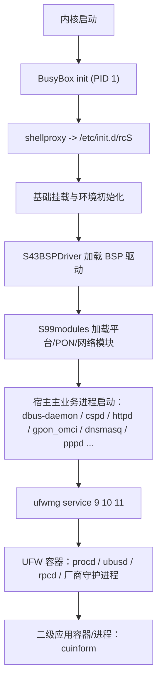
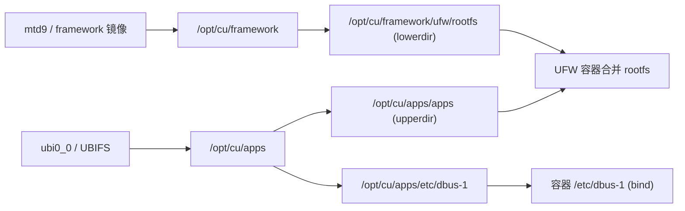

# 中兴 G7615 宿主 Buildroot / UFW(OpenWrt) LXC / OPKG 分析报告

## 说明

- 本报告仅依据当前工作区内提取出的文件与运行时快照进行分析。
- 未执行任何目标架构二进制。
- 未对原始提取内容做破坏性修改。
- 凡是仓库中证据不足之处，均明确标注为“证据不足”。

## 一、结论摘要

- 宿主系统是厂商定制的 Buildroot/Linux 环境，CPU 具备 ARMv8 64 位能力，但当前提取出的宿主用户态并不是 AArch64，而是 **32 位 ARM EABI5 + glibc 2.26**。
- 宿主运行了厂商 LXC 管理程序 `ufwmg`，并且 UFW 容器的 rootfs 在配置中被明确写成 `overlayfs:/opt/cu/framework/ufw/rootfs:/opt/cu/apps/apps`。
- 二次上机采集已经证明：宿主实际内核命令行使用 `root=/dev/mtdblock13 rootfstype=jffs2`，设备树 `compatible/model` 为 `zte,132s / ZTE 132S`。
- 二次上机采集已经证明：UFW 主容器中的 `procd` 处在 `cgroup /lxc.payload.ufw` 下，并且拥有独立的 `mnt/ipc/pid/uts/cgroup` namespace；但其 `net` namespace 与宿主相同。
- UFW 子系统虽然自报为 `OpenWrt 19.07.7`，但同时带有明显厂商定制标识，例如 `UFW`、`V02.01.0230_arm_zte_ZX279132K419_F`、`OPENWRT_ARCH=arm_zte_ZX279132K419_F`、`OPENWRT_TAINTS="no-all glibc mklibs busybox"`，因此不能视为“通用官方 OpenWrt”。
- OPKG 虽然存在并启用了签名检查，但其包架构名是私有值 `arm_zte_ZX279132K419_F`，并不是常见官方架构名；再加上容器使用 glibc，因此 **不能直接认定官方 OpenWrt 通用 feed 与其兼容**。
- `opkg print-architecture` 已由容器实机输出确认：`all`、`noarch`、`arm_zte_ZX279132K419_F`，其中设备私有架构优先级为 `10`。
- 若后续需要扩展软件，优先级更高的路线应该是：恢复原厂匹配 feed，或离线为当前 ABI 单独构建 IPK / 静态二进制，而不是直接接入通用官方源。

## 二、仓库盘点

### 2.1 统计信息

基于当前工作区本地扫描，排除 `.git`、`.codex`、`.agents` 后得到：

| 项目 | 数量 |
| --- | ---: |
| 目录数 | 300 |
| 文件系统条目总数 | 2700 |
| 普通文件数 | 2318 |
| 软链接数 | 382 |
| ELF 文件数 | 430 |
| 脚本文件数（以 `#!` 判断） | 124 |
| 配置类文件数 | 534 |
| 压缩/归档类文件数 | 3 |
| 提取中保留的设备节点 | 0 |

### 2.2 关键文件存在性

| 路径 | 是否存在 | 说明 |
| --- | --- | --- |
| `mount` | 是 | 宿主运行时挂载快照 |
| `ps` | 是 | 宿主运行时进程快照 |
| `proc/cpuinfo` | 是 | CPU 证据 |
| `proc/mtd` | 是 | MTD 分区证据 |
| `proc/cmdline` | 否 | 未提取 |
| `proc/version` | 否 | 未提取 |
| `etc/inittab` | 是 | 宿主 init 入口 |
| `etc/init.d/rcS` | 是 | 宿主启动脚本 |
| `opt/cu/framework/ufw/config` | 是 | UFW 容器 LXC 配置 |
| `opt/cu/framework/ufw/rootfs/etc/os-release` | 是 | 容器版本信息 |
| `opt/cu/framework/ufw/rootfs/etc/openwrt_release` | 是 | 厂商 UFW 发行标识 |
| `opt/cu/framework/ufw/rootfs/etc/openwrt_version` | 是 | 容器版本号 |
| `opt/cu/framework/ufw/rootfs/etc/opkg.conf` | 是 | OPKG 主配置 |
| `opt/cu/framework/ufw/rootfs/etc/opkg/distfeeds.conf` | 是 | feed 配置 |
| `opt/cu/framework/ufw/rootfs/usr/lib/opkg/status` | 是 | 容器已安装包数据库 |

补充：

- 后续二次上机采集已经补回 `proc/cmdline`、`proc/version`、`/proc/device-tree/compatible`、`/proc/device-tree/model`、容器 `opkg print-architecture`、容器与宿主关键 PID 的 `cmdline/cgroup/mountinfo/ns`。

### 2.3 目录结构摘要

- 宿主初始化与配置：`etc/`、`etc/init.d/`、`etc/rcS.d/`
- 宿主厂商框架：`opt/cu/framework/`
- UFW 容器基础 rootfs：`opt/cu/framework/ufw/rootfs/`
- UFW 容器持久化 upperdir：`opt/cu/apps/apps/`
- 容器插件/应用数据：`opt/cu/apps/apps/opt/`
- 运行时日志与状态：`var/`、`tmp/`、`opt/cu/apps/apps/var/`

## 三、宿主 Buildroot 系统分析

### 3.1 CPU、架构与位数

`proc/cpuinfo` 中可见：

- `CPU implementer : 0x41`
- `CPU architecture: 8`
- `CPU part        : 0xd03`
- 共 4 个 `processor`

据此可得：

| 字段 | 结论 | 依据 |
| --- | --- | --- |
| CPU ISA | ARMv8 家族 | `CPU architecture: 8` |
| 核心数 | 4 核 | `processor 0..3` |
| implementer | Arm (`0x41`) | `proc/cpuinfo` |
| part | `0xd03` | `proc/cpuinfo` |
| 核心类型 | 大概率 Cortex-A53 类 | 依据 ARM part 映射，属推断 |
| CPU 是否具备 64 位能力 | 是 | ARMv8 |
| 当前提取用户态位数 | 32 位 | 宿主与容器 ELF 头一致表明为 32 位 |
| 字节序 | 小端 | `file` / ELF 头显示 `LSB` |

关键区分：

- CPU 本身具备 64 位能力。
- 但当前提取出的宿主与容器用户态都表现为 **32 位 ARM EABI5**。
- 因此不能把这台机器直接当作 “AArch64 用户态系统”。

### 3.2 SoC / 板级证据

仓库中可见的直接线索：

- 设备型号线索：`etc/versioncode_G7615`
- 板级/构建标识：
  - `OPENWRT_BOARD="zte/zte_132_K419_hgu_fttr"`
  - `OPENWRT_ARCH="arm_zte_ZX279132K419_F"`
  - `V02.01.0230_arm_zte_ZX279132K419_F`
- 内核模块/平台命名：
  - `UX3326.ko`
  - `GN28L95.ko`
  - `plat_132.ko`
  - `zte_xeaspon.ko`
  - `zte_xespon.ko`
  - `zte_xgpon.ko`
  - `epondrv.ko`
  - `gpondrv.ko`
- Wi-Fi 相关痕迹：
  - `etc/wireless/mt7916/*`
  - `var/tmp/MT7916_EEPROM.bin`

二次实机采集补充：

- `/proc/device-tree/compatible`：`zte,132s`
- `/proc/device-tree/model`：`ZTE 132S`

判断：

- 这些证据足以把固件与 G7615、`ZX279132K419_F`、`UX3326`、`GN28L95`、`plat_132` 强关联起来。
- 现在已经能把板级设备树型号补充为 `ZTE 132S`。
- 但这仍然 **不足以仅凭当前证据断言精确 SoC 商业型号**，所以 SoC 芯片型号结论仍保持“证据不足”。

### 3.3 宿主 ELF / ABI / libc / 工具链

已确认的宿主证据：

- `bin/ufwmg`：`ELF 32-bit LSB executable, ARM, EABI5`
- `bin/busybox`：`ELF 32-bit LSB executable, ARM, EABI5`
- `usr/bin/lxc-attach`：`ELF 32-bit LSB executable, ARM, EABI5`
- 动态加载器：`/lib/ld-linux.so.3`
- glibc 实体：`lib/libc-2.26.so`
- loader 实体：`lib/ld-2.26.so`
- `objdump -p` 中可见 `libc.so.6`、`libpthread.so.0`、`libm.so.6`
- 字符串中可见：
  - `GNU C Library (Buildroot) stable release version 2.26`
  - `glibc 2.26`
  - `GCC: (Buildroot 2017.05) 5.3.1 20160412`
- 二次实机采集 `/proc/version`：
  - `Linux version 4.19.136`
  - `gcc version 5.3.1 20160412 (Buildroot 2017.05)`
  - 编译时间 `Fri Nov 3 19:14:13 CST 2023`

结论：

| 字段 | 结论 |
| --- | --- |
| ELF class | 32 位 |
| 架构 | ARM |
| 字节序 | 小端 |
| ABI | EABI5 |
| 动态加载器 | `/lib/ld-linux.so.3` |
| libc 类型 | glibc |
| libc 版本 | 2.26 |
| 工具链线索 | Buildroot 2017.05 / GCC 5.3.1 |
| 宿主内核版本 | 4.19.136 |

因此，宿主更像是 **Buildroot + glibc 的厂商定制固件**，不是 musl 系宿主。

### 3.4 宿主内核命令行与启动根分区

二次实机采集得到 `/proc/cmdline`：

```text
console=ttyAMA0,115200n8 swiotlb=128 root=/dev/mtdblock13 ro rootfstype=jffs2 pcie_pme=nomsi vid=141 mem=512M patch=9ef80000
```

可直接确认：

| 字段 | 结论 |
| --- | --- |
| 控制台 | `ttyAMA0,115200n8` |
| root 设备 | `/dev/mtdblock13` |
| rootfs 类型 | `jffs2` |
| 内存参数 | `mem=512M` |

这与运行时 `mount` 中 `/dev/root on / type jffs2 (ro,...)` 相互吻合。

### 3.5 宿主启动链

证据链：

- `etc/inittab`：通过 `/bin/shellproxy ttyAMA0 115200 /etc/init.d/rcS /dev/ttyp0` 拉起 `rcS`
- `etc/init.d/rcS`：先 `mount -a`，设置环境，然后执行 `/etc/rcS.d/S??*`
- `etc/rcS.d/S43BSPDriver`：加载 BSP 驱动
- `etc/rcS.d/S99modules`：加载平台/PON/网络相关驱动
- `ps` 中能看到宿主业务进程，再看到 `ufwmg`，之后能看到 UFW 容器进程

可还原的启动顺序如下：



### 3.6 MTD 分区分析

依据 `proc/mtd`：

| MTD | 十六进制大小 | 十进制大小 | 擦除块 | 名称 | 推测用途 | 风险 | 是否建议单独备份 |
| --- | --- | ---: | --- | --- | --- | --- | --- |
| mtd0 | `0x10000000` | 268435456 | `0x20000` | `whole flash` | 全 Flash 聚合视图 | 高 | 是 |
| mtd1 | `0x00300000` | 3145728 | `0x20000` | `u-boot` | Bootloader | 高 | 是 |
| mtd2 | `0x00200000` | 2097152 | `0x20000` | `others` | 厂商保留区，推测 | 高 | 是 |
| mtd3 | `0x00200000` | 2097152 | `0x20000` | `parameter tags` | 板级参数/生产参数，推测 | 高 | 是 |
| mtd4 | `0x00200000` | 2097152 | `0x20000` | `wlan` | Wi-Fi 校准/配置区，推测 | 高 | 是 |
| mtd5 | `0x00800000` | 8388608 | `0x20000` | `usercfg` | 用户配置/运行配置区，推测 | 高 | 是 |
| mtd6 | `0x00600000` | 6291456 | `0x20000` | `preplugin` | 预置插件镜像区，推测 | 中 | 是 |
| mtd7 | `0x03000000` | 50331648 | `0x20000` | `kernel1` | 系统槽位 1 内核，推测 | 高 | 是 |
| mtd8 | `0x03000000` | 50331648 | `0x20000` | `kernel2` | 系统槽位 2 内核，推测 | 高 | 是 |
| mtd9 | `0x01000000` | 16777216 | `0x20000` | `framework` | UFW 框架镜像，推测 | 高 | 是 |
| mtd10 | `0x01000000` | 16777216 | `0x20000` | `framework1` | 备用/第二框架槽位，推测 | 高 | 是 |
| mtd11 | `0x06800000` | 109051904 | `0x20000` | `plugin_data` | 插件/应用可写区，推测 | 高 | 是 |
| mtd12 | `0x03000000` | 50331648 | `0x20000` | `rootfs1` | 系统槽位 1 rootfs，推测 | 高 | 是 |
| mtd13 | `0x02ae0000` | 44957696 | `0x20000` | `rootfs2` | 系统槽位 2 rootfs，推测 | 高 | 是 |

## 四、LXC 与 `ufwmg` 分析

### 4.1 运行时进程证据

`ps` 中关键条目：

- `ufwmg service 9 10 11`
- `/sbin/procd -S -d 4`
- `/sbin/ubusd`
- `/sbin/rpcd`
- `/usr/sbin/telnetd -p 223 -l /bin/ash`
- `//sbin/init.lxc -n cuinform --quiet -- /files/cuinform`
- `/files/cuinform`

说明：

- `ufwmg` 确实在宿主运行。
- UFW 容器已经启动，且运行了 `procd`、`ubusd`、`rpcd`、厂商服务进程。
- 容器内曾通过修改启动脚本启用了 `telnetd`，并监听 `223` 端口。
- 还存在一个 `cuinform` 二级 LXC 应用环境。

二次实机采集补充：

- `ufwmg` 宿主命令行：`ufwmg service 9 10 11`
- UFW 容器 `procd` 命令行：`/sbin/procd -S -d 4`
- `cuinform` 二级容器 init：`//sbin/init.lxc -n cuinform --quiet -- /files/cuinform`

### 4.2 `ufwmg` 静态分析

`bin/ufwmg` 的性质：

- 32 位 ARM EABI5 动态 ELF
- 动态加载器：`/lib/ld-linux.so.3`
- 依赖：
  - `liblxc.so.1`
  - `libglib-2.0.so.0`
  - `libgio-2.0.so.0`
  - `libc.so.6`

字符串中可见：

- `lxc_container_new`
- `lxc_conf_init`
- `lxc_config_define_load`
- `/opt/cu/framework/ufw/config`
- `/var/run/ufwmg.pid`
- `/var/log/ufw_lxc.log`
- `start fw lxc ...`
- `stop fw lxc ...`
- D-Bus 方法：
  - `Upgrade`
  - `Switch`
  - `Restore`
  - `Pause`
  - `UpdateMTDInfo`

据此判断：

- `ufwmg` 不是简单 shell 包装器。
- 它是一个 **直接链接 `liblxc` 的厂商管理 ELF**，并且同时承担固件框架槽位管理、LXC 启停、升级/切换等逻辑。
- 已能确认其存在 `start/stop/restart/upgrade/switch/restore/pause` 一类功能线索。
- 当前提取中 **没有直接证据** 证明其 `console/attach` 子命令仍可用。
- 但也 **不能仅因帮助信息缺失就断言二进制内部完全没有相关代码**。

### 4.3 UFW 主容器配置

`opt/cu/framework/ufw/config` 里直接写着：

- `lxc.rootfs.path = overlayfs:/opt/cu/framework/ufw/rootfs:/opt/cu/apps/apps`
- `lxc.uts.name = ufw`
- `lxc.net.0.type = none`
- 以及若干 bind mount：
  - `/tmp -> hgutmp`
  - `/mnt -> mnt`
  - `/var/run/dbus -> var/run/dbus`
  - `/opt/cu/apps/etc/dbus-1 -> etc/dbus-1`
  - `/opt/cu/framework/ufw/rootfs -> opt/rootfs`
  - `/opt/cu/apps/info -> opt/info`
  - 宿主 `/lib`、`/usr/lib`、`/proc`、`/sys`、`/var` 暴露到容器 `/map/*`

结论：

- UFW 容器具有独立文件系统视图。
- 它 **没有** 使用标准 veth + bridge 这种常见 LXC 网络配置，至少当前提取到的配置里是 `lxc.net.0.type = none`。
- 因此其网络更可能由厂商自定义方式提供，或依赖宿主共享/桥接的其他机制。

二次实机采集把这件事进一步坐实：

- 宿主 `ufwmg` 的 namespace：
  - `mnt:[4026531840]`
  - `ipc:[4026531839]`
  - `pid:[4026531836]`
  - `uts:[4026531838]`
  - `cgroup:[4026531835]`
  - `net:[4026531906]`
- UFW 容器 `procd` 的 namespace：
  - `mnt:[4026532565]`
  - `ipc:[4026532567]`
  - `pid:[4026532568]`
  - `uts:[4026532566]`
  - `cgroup:[4026532569]`
  - `net:[4026531906]`

这说明：

- UFW 容器 **确实拥有独立的 mount / ipc / pid / uts / cgroup namespace**
- 但其 `net` namespace **与宿主完全相同**

因此现在可以把原先的判断收紧为：

- UFW 是一个真实的 LXC payload 容器
- 但它 **不是独立网络 namespace 容器**
- 它采用的是 **共享宿主 network namespace** 的方案

### 4.4 `cuinform` 二级容器

`opt/cu/apps/apps/opt/preinstall/cuinform/cuinform/config` 显示：

- `lxc.rootfs.path = dir:/opt/preinstall/cuinform/cuinform/rootfs`
- `lxc.net.0.type = none`
- 宿主 `/bin`、`/sbin`、`/usr`、`/lib`、`/etc/config`、`/var/run/dbus` 都会 bind 进去

这说明除了主 UFW 容器外，还存在一个面向应用插件的二级 LXC 环境。

## 五、容器文件系统与 OverlayFS 关系

### 5.1 直接证据

两条证据可以互相印证：

- `mount` 显示：`ubi0_0 on /opt/cu/apps type ubifs`
- UFW LXC 配置中明确写明：`overlayfs:/opt/cu/framework/ufw/rootfs:/opt/cu/apps/apps`

因此当前最稳妥的模型是：

| 宿主路径 | 容器内角色 | 类型 | 只读/可写 | 是否持久化 | 证据 |
| --- | --- | --- | --- | --- | --- |
| `/opt/cu/framework/ufw/rootfs` | lowerdir / 基础 rootfs | overlay lowerdir | 只读 | 基础镜像 | `opt/cu/framework/ufw/config` |
| `/opt/cu/apps/apps` | upperdir / 持久化改动层 | overlay upperdir | 可写 | 是 | `opt/cu/framework/ufw/config` |
| `/opt/cu/apps` | upperdir 所在持久化卷 | UBIFS | 可写 | 是 | `mount` |
| `/opt/cu/apps/etc/dbus-1` | 容器 `/etc/dbus-1` | bind | 可写 | 是 | `opt/cu/framework/ufw/config` |
| `/opt/cu/apps/info` | 容器 `/opt/info` | bind | 可写 | 是 | `opt/cu/framework/ufw/config` |

二次实机采集还补到了 UFW 容器内 `procd_mountinfo` 的第一行：

```text
overlay /opt/cu/framework/ufw/rootfs rw,lowerdir=/opt/cu/framework/ufw/rootfs,upperdir=/opt/cu/apps/apps,workdir=/opt/cu/apps/work
```

这意味着：

- 之前从配置文件中得到的 `lowerdir=/opt/cu/framework/ufw/rootfs`、`upperdir=/opt/cu/apps/apps`
- 现在已经被 **运行时 mountinfo 直接验证**
- 同时还能补出实际 `workdir=/opt/cu/apps/work`

### 5.2 关键问题回答

1. 修改 `/opt/cu/apps/apps/etc/...` 是否会覆盖容器 `/etc/...`

- 高概率会。
- 这不是猜测，而是来自 `lxc.rootfs.path = overlayfs:lower:upper` 的直接配置证据。

2. 新增文件如何生效

- 只要新增到 upperdir 的对应路径，合并视图里就会出现。

3. 删除 lowerdir 文件如何表达

- 标准 overlayfs 会使用 whiteout 或 opaque 标记。
- 当前提取中没有发现 `.wh.*`，所以 **没有仓库内直接示例**。

4. 权限、属主、软链接修改是否可持久化

- 按标准 overlayfs 语义，一般可以。
- 当前仓库结构与这种模型一致，但没有抽到一个现成的对照样本来逐项证明。

5. 恢复出厂或升级时哪些路径可能被清空

- `/opt/cu/apps` 与 `/userconfig` 都是高风险候选，因为它们承担了运行时可写数据与配置角色。
- 但当前仓库里没有完整恢复出厂逻辑，故这里只能谨慎推断。

6. 如何备份 overlay

- 首选备份 `/opt/cu/apps/apps`
- 如条件允许，再连同 `/opt/cu/apps` 下相关元数据一起备份

7. 如何安全回滚

- 更建议对 `/opt/cu/apps/apps` 做目录级备份/恢复
- 不建议直接改 lowerdir 内容

### 5.3 挂载关系图



## 六、UFW / OpenWrt 容器分析

### 6.1 版本识别

`opt/cu/framework/ufw/rootfs/etc/os-release`：

- `NAME="OpenWrt"`
- `VERSION="19.07.7"`
- `BUILD_ID="V02.01.0230_arm_zte_ZX279132K419_F"`
- `OPENWRT_BOARD="zte/zte_132_K419_hgu_fttr"`
- `OPENWRT_ARCH="arm_zte_ZX279132K419_F"`
- `OPENWRT_TAINTS="no-all glibc mklibs busybox"`

`opt/cu/framework/ufw/rootfs/etc/openwrt_release`：

- `DISTRIB_ID='UFW'`
- `DISTRIB_RELEASE='UFW'`
- `DISTRIB_REVISION='V02.01.0230_arm_zte_ZX279132K419_F'`
- `DISTRIB_ARCH='arm_zte_ZX279132K419_F'`
- `DISTRIB_DESCRIPTION='china unicom C system framework V02.01.0230_arm_zte_ZX279132K419_F'`

结论：

- 基础谱系：OpenWrt 19.07.7 用户态
- 发行标识：厂商私有 `UFW`
- 架构标识：厂商私有 `arm_zte_ZX279132K419_F`
- 更准确的表述应是：**中兴/联通定制的 OpenWrt 派生框架系统**
- 不能直接称其为“标准官方 OpenWrt”

### 6.2 容器 ABI

容器侧已确认：

- `bin/opkg`：32 位 ARM EABI5 PIE
- `bin/busybox`：32 位 ARM EABI5 PIE
- `sbin/procd`：32 位 ARM EABI5 PIE
- 动态加载器：`/lib/ld-linux.so.3 -> ld-2.26.so`
- libc：`/lib/libc-2.26.so`
- `OPENWRT_TAINTS` 中明确包含 `glibc`

结论：

| 字段 | 结论 |
| --- | --- |
| 容器 ELF class | 32 位 |
| 架构 | ARM |
| 字节序 | 小端 |
| ABI | EABI5 |
| 动态加载器 | `/lib/ld-linux.so.3` |
| libc | glibc 2.26 |
| OPKG 架构名 | `arm_zte_ZX279132K419_F` |

因此，UFW 容器 **不是 musl OpenWrt**，而是 **glibc 型定制分支**。

### 6.3 OpenWrt 组件清单

从 `usr/lib/opkg/info/*.control`、`status` 与运行时快照综合可见：

| 组件 | 是否存在 | 版本/说明 | 证据 |
| --- | --- | --- | --- |
| `opkg` | 是 | `2021-01-31-c5dccea9-1` | `opkg.control` |
| `uci` | 是 | 已装包 | `uci.control` |
| `ubus` | 是 | `1` | `ubus.control` |
| `ubusd` | 是 | `1` | `ubusd.control`，且 `ps` 可见 |
| `procd` | 是 | `1` | `procd.control`，且 `ps` 可见 |
| `netifd` | 是 | `2021-01-09-753c351b-1` | `netifd.control` |
| `rpcd` | 是 | `2020-05-26-67c8a3fd-1` | `rpcd.control`，且 `ps` 可见 |
| `uhttpd` | 有脚本 | 存在 init 脚本，但未直接确认对应 control 包 | `etc/init.d/uhttpd` |
| LuCI | 未见直接证据 | 未扫到 `luci` 包 | 包数据库扫描 |
| `dnsmasq` | 容器内未见直接证据 | 宿主里有 `dnsmasq`，容器包库里没直接看到 | 扫描结果 |
| `odhcpd` | 未见 | - | 扫描结果 |
| `firewall3` | 未见 | - | 扫描结果 |
| `firewall4` | 未见 | - | 扫描结果 |
| `iptables` | 容器内未见直接证据 | 宿主有 `/bin/iptables` | 扫描结果 |
| `nftables` | 未见 | - | 扫描结果 |
| `dropbear` | 未见直接证据 | - | 扫描结果 |
| `telnetd` | 运行时存在 | 通过启动脚本注入后运行 | `ps` |
| `tcpdump` | 是 | `4.9.3-2` | `tcpdump.control` |
| `lxc-*` | 是 | `4.0.3-3` 系列 | 多个 `lxc-*.control` |

二次容器采集还补充确认：

- `opkg list-installed` 中可见：
  - `cuinform - V02.01.0003`
  - `hpsrv - V02.01.0230`
  - `local - V02.01.0230`
  - `log - V02.01.0230`
  - `proxy - V02.01.0230`
  - `pushd - V02.01.0230`
  - `taskd - V02.01.0230`
  - `uappd - V02.01.0230`
- 这进一步说明 UFW 容器承担的是 **厂商业务守护进程平台**，不是干净的通用 OpenWrt 根文件系统

### 6.4 容器角色判断

容器中已知服务包括：

- `procd`、`ubusd`、`rpcd`
- 厂商守护进程：`hpsrv`、`proxy`、`pushd`、`taskd`、`uappd`、`log`
- 二级应用环境：`cuinform`

综合判断：

- 高可信：**家庭/业务应用框架容器**
- 中可信：**管理/插件平台容器**
- 低可信：**完整数据平面路由/防火墙容器**

理由：

- 宿主明显保留了内核、PON、WAN/PPP、Wi-Fi 驱动与主要网络控制权。
- 容器更像承载 OpenWrt 风格服务框架与厂商业务守护进程。
- `lxc.net.0.type = none` 也不符合一个典型“独立路由容器”的标准网络配置。

## 七、OPKG 现状分析

### 7.1 核心配置

`etc/opkg.conf` 中可见：

- `dest root /`
- `dest ram /tmp`
- `lists_dir ext /var/opkg-lists`
- `option overlay_root /overlay`
- `option check_signature`

这说明：

- 默认安装目标是容器 rootfs 合并视图
- 包列表缓存目录在 `/var/opkg-lists`
- 启用了签名校验

二次实机采集 `opkg print-architecture`：

```text
arch all 1
arch noarch 1
arch arm_zte_ZX279132K419_F 10
```

这提供了两条直接证据：

- 设备私有架构名确实就是 `arm_zte_ZX279132K419_F`
- 其优先级高于 `all` / `noarch`

### 7.2 feed 配置

`etc/opkg/distfeeds.conf` 中可见：

- `openwrt_core http://downloads.openwrt.org/releases/19.07.7/targets/zte/zte_132_K419_hgu_fttr/packages`
- `openwrt_base http://downloads.openwrt.org/releases/19.07.7/packages/arm_zte_ZX279132K419_F/base`
- `openwrt_luci http://downloads.openwrt.org/releases/19.07.7/packages/arm_zte_ZX279132K419_F/luci`
- `openwrt_packages http://downloads.openwrt.org/releases/19.07.7/packages/arm_zte_ZX279132K419_F/packages`
- `openwrt_routing http://downloads.openwrt.org/releases/19.07.7/packages/arm_zte_ZX279132K419_F/routing`

`customfeeds.conf` 目前为空模板，没有额外自定义源。

### 7.3 已安装包情况

可以确认：

- OPKG 数据库是完整存在的
- `usr/lib/opkg/info` 下大约有 99 个 `.control` 文件
- 基础 OpenWrt 组件与厂商私有包同时存在

代表性已装包包括：

- 通用基础包：
  - `base-files`
  - `busybox`
  - `opkg`
  - `procd`
  - `ubus`
  - `ubusd`
  - `rpcd`
  - `netifd`
  - `lxc`
  - `lxc-start`
  - `lxc-attach`
  - `lxc-console`
  - `lxc-info`
- 厂商私有包：
  - `uappd`
  - `log`
  - `proxy`
  - `pushd`
  - `taskd`

### 7.4 与官方通用 feed 不兼容的强信号

以下几点都在当前仓库中有直接证据：

- 包架构名是私有值：`arm_zte_ZX279132K419_F`
- 容器 libc 是 `glibc 2.26`，而不是 OpenWrt 19.07 常见的 musl
- `OPENWRT_TAINTS` 里直接写了 `glibc`
- `base-files` 版本号是厂商私有形式：`204.2-V02.01.0230_arm_zte_ZX279132K419_F`
- 厂商业务包依赖了私有库 `libhguapi`

## 八、官方 OpenWrt 软件源兼容性评估

### 8.1 候选源分类

| 候选类型 | 结论 | 说明 |
| --- | --- | --- |
| 原厂完全匹配 feed（同 `arm_zte_ZX279132K419_F`、同 `zte/zte_132_K419_hgu_fttr`） | E 证据不足 | 配置里指向了类似路径，但当前仓库无法证明线上源仍存在且内容匹配 |
| 通用官方 OpenWrt 19.07.7 core/target feed | D 不兼容 | 私有架构名 + glibc 分支 + 厂商定制基础包 |
| 其他 ARM 官方 feed | D 不兼容 | 架构名和 ABI 直接不匹配 |
| 为当前 ABI 离线定制重编译的包 | C 需离线验证 | 可以做，但要匹配 ABI、依赖、签名与安装策略 |
| 纯脚本 / 无架构强依赖的小工具 | B 可能部分可行 | 仍需检查声明架构、依赖与签名校验行为 |

### 8.2 为什么不能直接接通用官方源

不能直接 `opkg update && opkg install` 通用官方包，原因包括：

- 架构名不是通用值
- libc 家族与版本必须匹配
- `libubox`、`ubus`、`uci`、`openssl/mbedtls`、`libgcc`、`libstdc++` 这些基础依赖很可能存在差异
- 厂商业务守护进程与私有库耦合明显
- 当前容器角色更像业务框架，而不是完全隔离、可随意替换底层组件的标准 OpenWrt 路由系统

现在还能再补一条更硬的理由：

- `opkg print-architecture` 已经证明该系统接受的首选架构不是官方通用 `arm_*`，而是设备私有 `arm_zte_ZX279132K419_F`

### 8.3 明确不建议替换的核心包

在未证明与厂商构建完全一致前，不应建议替换：

- `kmod-*`
- `kernel`
- `base-files`
- `libc`
- `libgcc`
- `busybox`
- `procd`
- `ubus`
- `libubox`
- `uci`
- `netifd`
- `firewall3`
- `firewall4`
- `fstools`
- `block-mount`
- 无线驱动
- PON 驱动

## 九、用户态工具风险分级

这个分级的前提是：后续若真的要装包，必须先完成 ABI 匹配验证。

| 软件 | 风险 | 说明 |
| --- | --- | --- |
| `jq`、小型 shell/Lua 工具 | 低 | 大多偏纯用户态，但仍需匹配 libc/依赖 |
| `nano`、`vim`、`tmux`、`htop` | 低到中 | 基本纯用户态，风险主要来自 ABI 和空间 |
| `socat`、`tcpdump`、`iperf3` | 中 | 纯用户态为主，但可能涉及抓包能力/附加库 |
| `curl`、`wget`、`rsync` | 中 | 对 TLS、libcurl、OpenSSL 版本敏感 |
| `bash` | 中到高 | 容易影响脚本兼容性与系统习惯 |
| `dropbear`、`openssh-server` | 高 | 会引入新网络暴露面和认证风险 |
| `wireguard-tools` | 单独工具中，涉及内核高 | 工具和内核模块风险完全不同 |

现实上，更稳妥的办法通常是：

- 针对当前 ABI 单独编译静态或近静态工具
- 尽量避免替换 OpenWrt/厂商核心包

## 十、进入容器方式评估

按实用性与风险大致排序：

1. 通过启动脚本拉起 `telnetd`，仅限 LAN：中风险
2. 通过启动脚本拉起 `dropbear`，严格限 LAN：中高风险
3. `lxc-attach`：理论较优，但设备上是否被裁剪尚待验证
4. `nsenter`：中风险，可直接进 namespace，但绕过厂商流程
5. `chroot /proc/<PID>/root`：中高风险，只是文件系统层进入，不等同完整 namespace
6. `lxc-console`：当前未证实能正常使用

关键区别：

- `chroot` 只切根，不自动进入 PID / NET / MNT namespace
- `nsenter` 可以定向进入 namespace
- `lxc-attach` 若可用，通常更贴近 LXC 官方方式

## 十一、后续推荐路线

### 11.1 建议优先级

| 方案 | 评价 |
| --- | --- |
| A. 恢复原厂 feed | 最优先尝试 |
| B. 直接使用通用官方 OpenWrt feed | 不建议 |
| C. 基于匹配 SDK / toolchain 自建 IPK | 可控性最好 |
| D. 基于匹配交叉工具链构建独立二进制 | 对诊断类工具通常更安全 |

### 11.2 可能的离线工具链方向

这里只能给“待验证候选”，不能当作最终结论：

- `arm-linux-gnueabi`
- `arm-linux-gnueabihf`
- 与 `arm_zte_ZX279132K419_F` 匹配的厂商 OpenWrt SDK

当前仓库还不足以反推出唯一、确定的 canonical triplet。

## 十二、还缺什么证据

当前最缺的关键补充项有：

- 宿主 `proc/cmdline`
- 宿主 `proc/version`
- `/proc/device-tree/compatible`
- `/proc/device-tree/model`
- `ps w` 的更完整命令行
- 目标 PID 的 `/proc/<PID>/cmdline`
- 目标 PID 的 `/proc/<PID>/cgroup`
- 目标 PID 的 `/proc/<PID>/mountinfo`
- 容器内 `opkg print-architecture`
- 容器内更完整的 `opkg status` / `opkg list-installed`

这些信息正好可以通过下一步的“上机只读采集脚本”来补齐。

## 十三、二次采集后的收紧结论

基于你补回的宿主与容器实机采集，现阶段可以把若干原先的“推测”升级为“直接证据”：

1. 宿主系统

- 宿主内核版本可直接写为 `Linux 4.19.136`
- 宿主工具链线索可直接写为 `Buildroot 2017.05 / GCC 5.3.1`
- 宿主实际启动根分区是 `/dev/mtdblock13`
- 宿主根文件系统类型是 `jffs2`
- 设备树板级标识可写为 `zte,132s / ZTE 132S`

2. UFW 主容器

- `procd` 位于 `cgroup /lxc.payload.ufw`
- UFW 是真正的 LXC payload
- 它有独立的 `mnt/ipc/pid/uts/cgroup` namespace
- 但它与宿主共享同一个 `net namespace`

3. OverlayFS

- 运行时 `mountinfo` 已直接确认：
  - `lowerdir=/opt/cu/framework/ufw/rootfs`
  - `upperdir=/opt/cu/apps/apps`
  - `workdir=/opt/cu/apps/work`

4. OPKG

- `opkg print-architecture` 已直接确认：
  - `all`
  - `noarch`
  - `arm_zte_ZX279132K419_F`
- 因而“该系统可直接吃通用官方 OpenWrt 架构包”的假设，现在可以明确判定为 **不成立**

5. 最重要的实务结论

- UFW 不是独立网络 namespace 的“完整 OpenWrt 路由容器”
- 更像是 **共享宿主网络栈的厂商业务框架容器**
- 所以后续所有软件改动，尤其是网络服务、系统库、基础包替换，都必须按“影响宿主现网业务”的高敏感度来处理
