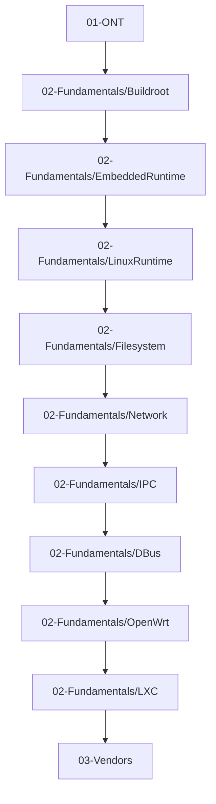

# ChapterDependencies

## 说明

本文用于定义章节依赖关系，以及后续章节禁止重复介绍的知识边界。

## 依赖主链

## 章节依赖表

| 章节 | 直接依赖 | 后续章节可复用内容 |
| --- | --- | --- |
| `01-ONT` | 无 | ONT、ONU、OLT、GPON、FTTH、术语 |
| `02-Fundamentals/Buildroot` | `01-ONT` | 构建系统、Rootfs 生成、Overlay、Init 选型、Buildroot/OpenWrt 对比 |
| `02-Fundamentals/EmbeddedRuntime` | `Buildroot` | CPU、ABI、ELF、libc、Toolchain、Sysroot、SDK、交叉编译 |
| `02-Fundamentals/LinuxRuntime` | `EmbeddedRuntime` | 进程、系统调用、`/proc`、`/sys`、mount、VFS、socket、namespace、cgroup |
| `02-Fundamentals/Filesystem` | `LinuxRuntime` | 根文件系统、伪文件系统、挂载、块设备、overlay 运行时语义 |
| `02-Fundamentals/Network` | `LinuxRuntime` | socket、进程、sysfs、procfs、权限模型 |
| `02-Fundamentals/IPC` | `LinuxRuntime` | process、signal、socket、Unix socket、namespace |
| `02-Fundamentals/DBus` | `IPC`、`LinuxRuntime` | Unix socket、daemon、权限模型、运行时服务组织 |
| `02-Fundamentals/OpenWrt` | `Buildroot`、`EmbeddedRuntime`、`LinuxRuntime` | Toolchain、Rootfs、procd、mount、ubus 的运行前提 |
| `02-Fundamentals/LXC` | `LinuxRuntime` | namespace、cgroup、mount、`/proc`、`/sys`、`/dev` |
| `03-Vendors` | 前述全部基础层 | 不再重复解释 ABI、ELF、Toolchain、procfs、namespace 等基础机制 |

## 禁止重复介绍的知识

后续章节默认禁止重新展开以下内容，只允许一句话说明并给出引用：

- CPU、ISA、位宽、大小端
- ABI、EABI、Hard Float / Soft Float
- ELF、动态链接、动态链接器、共享库
- glibc / musl / uClibc 的定位差异
- Sysroot、Toolchain、SDK、交叉编译
- 进程、线程、PID 1、daemon、TTY、shell
- system call、signal、environment
- procfs、sysfs、devtmpfs、tmpfs、mount、VFS
- socket、Unix Domain Socket
- namespace、cgroup、capability、经典权限模型

## 引用规则

- 遇到构建相关底层概念：优先引用 `Buildroot` 或 `EmbeddedRuntime`
- 遇到运行时底层概念：优先引用 `LinuxRuntime`
- 厂商章节默认不重新解释基础原理，只写“该厂商如何体现这一原理”
