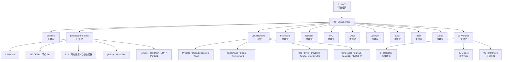

# KnowledgeMap

## 说明

本文用于描述当前知识库的整体知识地图，只梳理现有结构和已规划结构，不新增知识正文。

## 知识地图

## 阅读顺序

1. `01-ONT`
2. `02-Fundamentals/Buildroot`
3. `02-Fundamentals/EmbeddedRuntime`
4. `02-Fundamentals/LinuxRuntime`
5. 后续待建设的 `Filesystem`、`Network`、`IPC`、`DBus`、`OpenWrt`、`LXC`
6. `03-Vendors`
7. `04-Database`、`05-Guides`、`06-References`

## 当前结论

- `Buildroot` 已经完成“系统构建层”的基础铺垫。
- `EmbeddedRuntime` 已经完成“二进制运行环境层”的基础铺垫。
- `LinuxRuntime` 已经完成“系统启动后运行机制层”的基础铺垫。
- 后续章节应尽量复用这三层，不重复解释底层概念。
