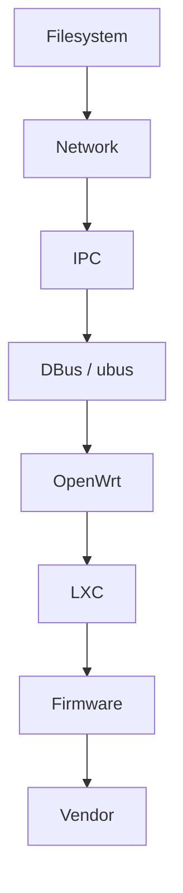

# Roadmap

## 说明

本文用于定义未来章节建设顺序，只基于当前已完成内容和已规划内容做整理，不新增知识正文。

## 推荐路线

## 排序理由

### 1. Filesystem

原因：

- 现在已经有 `Buildroot` 的 Rootfs 生成视角
- 已有 `LinuxRuntime` 的 mount / VFS / tmpfs / devtmpfs 运行时视角
- 下一步最自然的是把“生成出来的文件系统”和“运行时看到的文件系统”统一起来

### 2. Network

原因：

- 网络章节天然依赖 LinuxRuntime 中的 process、socket、mount、sysfs、权限模型
- 光猫、路由器的核心功能本来就以网络为中心

### 3. IPC

原因：

- IPC 依赖 process、signal、socket、Unix Domain Socket、权限模型
- 当前 LinuxRuntime 已经把这些运行机制铺平

### 4. DBus / ubus

原因：

- DBus / ubus 本质属于 IPC 的上层协议与服务组织
- 在 IPC 之前写 DBus，容易重复解释 socket、daemon、权限模型

### 5. OpenWrt

原因：

- OpenWrt 同时依赖 Buildroot 对比、EmbeddedRuntime、LinuxRuntime、Network、IPC、ubus
- 基础层没铺完前写 OpenWrt，会不断回头解释底层

### 6. LXC

原因：

- LXC 明确依赖 LinuxRuntime 中的 namespace、cgroup、mount、`/proc`、`/sys`、`/dev`
- 若再加上 Filesystem、Network、IPC 背景，LXC 章节会更完整

### 7. Firmware

原因：

- 固件分析需要同时理解 Rootfs、Toolchain、ELF、LinuxRuntime、Filesystem、OpenWrt/Buildroot 差异

### 8. Vendor

原因：

- 厂商章节最适合放在最后
- 届时基础概念已经全部铺平，厂商章节可以专注“体现差异”，而不是重复写基础课

## 当前建设原则

- 后续章节先复用，不重复解释
- 先基础层，后系统层，再厂商层
- 先抽象机制，后具体实现

## 当前建议

下一章节优先进入：

1. `docs/02-Fundamentals/Filesystem/`
2. 然后是 `docs/02-Fundamentals/Network/`
3. 再进入 `docs/02-Fundamentals/IPC/`
